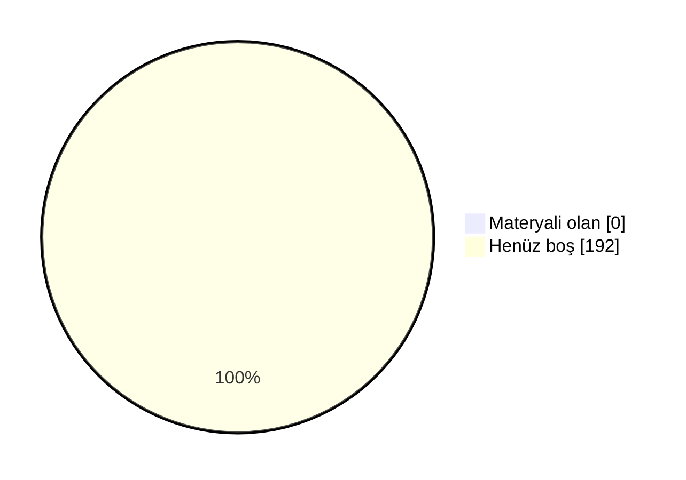

# 📖 Marmara Makine Mühendisliği Arşiv

Marmara Üniversitesi Mühendislik Fakültesi Makine Mühendisliği öğrencileri için düzenli, sürdürülebilir ve değer üreten bir akademik arşiv. Ders notları, ödev çözümleri, slaytlar, çıkmış sorular ve çalışma rehberleri tek bir yerde toplandı.

 ## 🗣️ Geri Bildirimde Bulunun

📬 Öğrenciler ve hocalar, derslerle ilgili hakaret içermeyen geri bildirimlerinizi aşağıdaki linkler aracılığıyla anonim olarak paylaşabilirsiniz.

- [✍️ **Hocalar için yorum linki**](https://docs.google.com/forms/d/e/1FAIpQLSc176jMotSqaPIlgQ9K22Cwb89bamxmshoPOndm4ZCUPTEQ9w/viewform)
- [✍️ **Dersler için yorum linki**](https://docs.google.com/forms/d/e/1FAIpQLSfR_tBZzHDNEntdy4EsPvOetmFfSS-TyuCyUz8SK1Lrojxhvg/viewform)
- [⭐ **Dersler için oylama linki**](https://docs.google.com/forms/d/e/1FAIpQLSfRjwGKQkYf_TGow0_K-7bAGHKBcTRKa6O4v1THyXg-PmtlQA/viewform)

## 🤝 Katkıda Bulunun

Elinde ders notu, slayt, çıkmış soru ya da ödev çözümü varsa arşive eklemek çok kolay:

- 📁 **GitHub kullanmıyorsan:** [Google Drive klasörümüze](https://drive.google.com/drive/folders/1KRobMRVHpJxUKcCZdCEippSZ5SmgpkZq?usp=sharing) yükle. Önce BENİOKU dosyasını oku, sonra **Makine-Mühendislik** klasöründe kendi adınla bir klasör aç.
- 🌐 **GitHub hesabın varsa:** Repoyu fork'la, dosyayı ilgili ders klasörüne yükle ve pull request gönder. Kurulum gerekmez, her şey tarayıcıdan yapılır.
- 📖 **Adım adım rehber:** [CONTRIBUTING.md](CONTRIBUTING.md)

Pull request ile katkıda bulunanların adı sayfanın en altındaki **Katkıda Bulunanlar** listesine otomatik eklenir.

### 📺 Video Rehberler
- 🎬 **Repoya nasıl katkı yapılır?** (~10 dk): *yakında*
- 🎬 **Repo nasıl kullanılır?** Klasör yapısı, ders README'leri ve aradığını bulma: *yakında*

<b>🛠 Repo Kullanımı</b>

## 🛠 Repo Kullanımı

### ⚙️ Açıklamalar:
- 📋 Bölümde bilinen ve güvenilir bir kaynak olmak.
- 📋 Akademik network oluşturmak ve iş birliklerini kolaylaştırmak.
- 📋 Dışarıdan bakan biri için temiz, düzenli ve profesyonel bir imaj sunmak.
- 📋 İçerikler: ders slaytları, kişisel ders notları ve özetler, ödev çözümleri, atölye çalışmaları, çıkmış sorular ve analizleri, proje dosyaları ve örnekleri.

### 📝 Talimatlar:
- 👉 Repo içindeki README.md'leri ders bazlı takip edin.
- 👉 Ödevleri çalıştırmak için ilgili klasörlerdeki .py veya .cpp dosyalarını kullanabilirsiniz.
- 👉 Ders özetleri, kısa ve okunabilir şekilde markdown olarak hazırlanmıştır.
- 👉 Özet ve ödevleri birleştirip kendi öğrenme sürecinize uyarlayabilirsiniz.

<b>🔍 Kavramlar</b>

## 🔍 Kavramlar

📌 Bölümle ilgili sık karşılaşılan terimlerin kısa açıklamaları. Not: tarih/şart gibi somut rakamlar dönemden
döneme değişebilir, kesin ve güncel bilgi için bölüm/fakülte öğrenci işlerine danışın.

- 💡 **Bütünleme Sınavı**
  - 📘 **S: Bütünleme sınavı nedir?** **C:** Final sınavının ardından yapılan, dersten başarısız olanların
    (ve şartlı geçenlerin isterlerse) girebildiği ek bir sınavdır. Bütünlemeye giren bir öğrencinin notu,
    final notunun yerini alır — geri dönüş yoktur.
- 💡 **Çan Eğrisi**
  - 📘 **S: Çan eğrisi nedir?** **C:** Bir sınıfın sınav sonuçlarının ortalama ve standart sapmasına göre
    harf notlarının belirlendiği bağıl bir değerlendirme yöntemidir. Her hoca kullanmak zorunda değildir;
    bazı dersler mutlak (bareme dayalı) notlandırılır.
- 💡 **DC Notu / Şartlı Geçme**
  - 📘 **S: DC nedir?** **C:** Şartlı geçme notudur — dersi geçmiş sayılırsınız ama not ortalamanız
    (GANO) yeterince yüksek değilse dersi tekrar almanız istenebilir. Bütünlemeye isteğe bağlı girilebilir.
- 💡 **GANO / AGNO**
  - 📘 **S: GANO nedir?** **C:** Genel Ağırlıklı Not Ortalaması — o ana kadar alınan tüm derslerin kredi
    ağırlıklı not ortalamasıdır. Mezuniyet, ÇAP/yandal başvurusu gibi şartlarda kullanılır.
- 💡 **YANO**
  - 📘 **S: YANO nedir?** **C:** Yarıyıl Ağırlıklı Not Ortalaması — yalnızca ilgili dönemde alınan derslerin
    kredi ağırlıklı not ortalamasıdır. Her dönem sıfırdan hesaplanır; GANO ise tüm dönemleri kapsar.
- 💡 **Mazeret Sınavı**
  - 📘 **S: Mazeret sınavı nedir?** **C:** Sağlık raporu, resmi belgeli bir mazeret vb. nedenle vize/finale
    giremeyen öğrenciler için düzenlenen, geçerli belgeyle başvurulan ek sınavdır.
- 💡 **ÇAP / Yandal**
  - 📘 **S: ÇAP nedir?** **C:** Çift Anadal Programı — uygun GANO'ya sahip öğrencilerin, okurken ikinci bir
    bölümden de lisans diploması almasını sağlayan program.
  - 📘 **S: Yandal nedir?** **C:** Diploma vermeyen, ikinci bir alanda sertifika niteliğinde daha hafif bir
    program.
- 💡 **Staj 1 / Staj 2**
  - 📘 **S: Staj 1/2 nedir?** **C:** Müfredatta 3. ve 4. yıllarda yer alan, işletmede kısa süreli uygulamalı
    çalışmayı zorunlu kılan derslerdir. Hangi dönemde olduklarını dönem sayfalarında görebilirsin.
- 💡 **Bitirme Projesi**
  - 📘 **S: Bitirme Projesi nedir?** **C:** Son dönemde bir danışman hoca eşliğinde yürütülen, mezuniyet
    şartı olan bitirme çalışmasıdır.
- 💡 **Mesleki Seçmeli / Üniversite Seçmeli**
  - 📘 **S: Aralarındaki fark ne?** **C:** Mesleki Seçmeli dersler bölüm içi teknik derslerdir. Üniversite Seçmeli dersler ise bölüm dışı, daha genel/sosyal
    içeriklidir (örn. Girişimcilik, Osmanlı Tarihi). Bkz. [Seçmeli Dersler](#-seçmeli-dersler).

<!-- DOLULUK_BASLANGIC -->

<b>📊 Arşiv Doluluk Durumu</b>

## 📊 Arşiv Doluluk Durumu

Arşivdeki **192** dersin **0** tanesinde en az bir materyal var (genel doluluk **%0**).

| Dönem | Doluluk | Materyali olan ders |
|---|---|---|
| [1. Yıl Güz](./1-1/) | ⬜⬜⬜⬜⬜⬜⬜⬜⬜⬜ %0 | 0 / 8 |
| [1. Yıl Bahar](./1-2/) | ⬜⬜⬜⬜⬜⬜⬜⬜⬜⬜ %0 | 0 / 7 |
| [2. Yıl Güz](./2-1/) | ⬜⬜⬜⬜⬜⬜⬜⬜⬜⬜ %0 | 0 / 7 |
| [2. Yıl Bahar](./2-2/) | ⬜⬜⬜⬜⬜⬜⬜⬜⬜⬜ %0 | 0 / 7 |
| [3. Yıl Güz](./3-1/) | ⬜⬜⬜⬜⬜⬜⬜⬜⬜⬜ %0 | 0 / 7 |
| [3. Yıl Bahar](./3-2/) | ⬜⬜⬜⬜⬜⬜⬜⬜⬜⬜ %0 | 0 / 4 |
| [4. Yıl Güz](./4-1/) | ⬜⬜⬜⬜⬜⬜⬜⬜⬜⬜ %0 | 0 / 6 |
| [4. Yıl Bahar](./4-2/) | ⬜⬜⬜⬜⬜⬜⬜⬜⬜⬜ %0 | 0 / 4 |
| [Mesleki Seçmeli](./Mesleki%20Seçmeli/) | ⬜⬜⬜⬜⬜⬜⬜⬜⬜⬜ %0 | 0 / 47 |
| [Fakülte Teknik Seçmeli](./Fakülte%20Teknik%20Seçmeli/) | ⬜⬜⬜⬜⬜⬜⬜⬜⬜⬜ %0 | 0 / 30 |
| [Teknik Olmayan Seçmeli](./Teknik%20Olmayan%20Seçmeli/) | ⬜⬜⬜⬜⬜⬜⬜⬜⬜⬜ %0 | 0 / 65 |

### 🙋 Bu dersler katkını bekliyor
Elinde bu derslerden materyal varsa yukarıdaki **🤝 Katkıda Bulunun** bölümüne göz at.

- **1. Yıl Güz:** Atatürk İlkeleri ve İnkılap Tarihi 1, Basic Chemistry, Calculus 1, Introduction to Mechanical Engineering, Physics Lab. 1, Physics 1, Scientific Programming, Türk Dili 1
- **1. Yıl Bahar:** Atatürk İlkeleri ve İnkılap Tarihi 2, Calculus 2, Engineering Drawing, Physics Lab. 2, Physics 2, Statics, Türk Dili 2
- **2. Yıl Güz:** Differential Equations, Dynamics, Introduction to Materials Science, Mechanical Engineering Drawing, Mechanical Engineering Fundamentals, Thermodynamics 1, Vector Analysis
- **2. Yıl Bahar:** Fundamentals of Electrical & Electronics Engineering, Fundamentals of Electrical & Electronics Engineering Lab, Linear Algebra, Mechanics of Materials, Numerical Methods, Statistics for Engineers, Thermodynamics 2
- **3. Yıl Güz:** Fluid Mechanics, Introduction to Economics, Machine Design 1, Manufacturing Processes 1, Mechanisms, Summer Practice 1, System Dynamics and Control
- **3. Yıl Bahar:** Engineering Economy, Heat Transfer, Machine Design Project, Machine Design 2
- **4. Yıl Güz:** Computer-Aided Design Techniques, Engineering Project 1, Experimental Methods in Mechanical Engineering, İş Sağlığı ve Güvenliği 1, Mechanical System Design, Thermal System Design
- **4. Yıl Bahar:** Engineering Project 2, İş Sağlığı ve Güvenliği 2, Mechanical Engineering Laboratory, Summer Practice 2
- **Mesleki Seçmeli:** Advanced Strength of Materials, Automotive Engineering, Automotive Suspension Systems, Compressible Fluid Flow, Computational Fluid Dynamics and Heat Transfer, Computational Methods in Mechanical Engineering, Computer-Aided Manufacturing, Control Systems, Design and Rating of Heat Exchangers, Dynamics of Mechanisms and Machines, Energy Conversion Systems 1, Energy Conversion Systems 2, Exchange Program Technical Elective 1, Exchange Program Technical Elective 2, Exchange Program Technical Elective 3, Exchange Program Technical Elective 4, Exchange Program Technical Elective 5, Exchange Program Technical Elective 6, Exchange Program Technical Elective 7, Fluid Power System, HVAC System Design, Hydraulic Machinery, Internal Combustion Engines 1, Internal Combustion Engines 2, Introduction to Artificial Intelligence for Mechanical Engineering, Introduction to Finite Element Analysis, Introduction to Robotics, Manufacturing Processes 2, Mathematical Modeling in Mechanical Engineering, Mechanical Vibrations, Mechanics of Composite Materials, Mechatronics, Micro Electro Mechanical Systems, Natural Gas Applications, Optimization of Mechanical Systems, Production Engineering 1, Production Engineering 2, Production Planning & Control, Refrigeration, Reliability for Mechanical Engineers, Renewable Energy Utilization, Solar Energy Technology, Special Topics in Mechanical Engineering 1, Special Topics in Mechanical Engineering 2, Steam Boilers, Thermal Environmental Engineering, Thermic Turbomachineries
- **Fakülte Teknik Seçmeli:** Advanced Innovative Design Management for Entrepreneurship, Business Management for Engineers, Chemical Engineering for Sustainable Biosphere, Construction Materials for Environmental Engineering, Cost Management in Chemical Industries, Design of Experiments, Designing Quality Products, Energy and the Environment, Entrepreneurship with Open-Source ERP Systems, Financial Engineering, From Waste to Value - Circular Economy Applications, Innovation and New Product Development Management, Instrumental Analysis for Engineers, Interdisciplinary Engineering Practices in Modern Systems, Introduction to Data Science and Analytics, Introduction to Image Processing, Introduction to Information Systems Management, Introduction to Systems Security, Introduction to Total Quality Management, Management of Information Systems, Managing Engineering and Technology, Materials Engineering Economics and Plant Design, Planning and Management of Research, Project Management for Engineers, Simulation for Engineering Systems, Software Project Management, Survey Design and Measure Development, Sustainable Innovation and Circular Economy, Total Quality Management in Materials Engineering, Quality Management System in Automotive Industry
- **Teknik Olmayan Seçmeli:** Arabic for Beginners, Basic Principles of Accessibility in Informatics and Technology, Behavioral Sciences for Engineers, Brand Creation-Branding, Business Communication, Business Intelligence for Managers, Cardiopulmonary Resuscitation and First Aid Basics, Career Development, Career Orientation, Chinese 1, Chinese 2, Chinese 3, Cinema, Communication Models and Techniques, Creativity and lnnovation Management, Design, Innovation and Entrepreneurship, Earthquake and Rescue Principles, Effects of Human Behaviour on Environment, Energy for Physical Activity, Entrepreneurship and Innovation, Environmental Sociology, Ethics in Engineering and Science, French, French for Beginners, Fundamentals of Management, Geometric Origami, German, German Communication, German for Beginners, Health and Body Sociology, Human Performance and Nutrition, Industrial and Economic Sociology, Industrial Psychology, Information Literacy in Engineering, Integrated Marketing Communication, International Business, Interpersonal Relations and Communication, Introduction to Angel Financing for Engineers, Introduction to Business World for Engineers, Introduction to Corporate Governance for Engineers, Introduction to Finance for Engineers, Introduction to Leadership & Management for Engineers, Introduction to Programming with Python, Introduction to Strategic Human Resources Management, Introduction to Strategy for Engineers, Investment Planning, Japanese 1, Japanese 2, Labor Law, Marketing in a Technology Driven world for Engineers, Organizational Behaviour, Our Biosphere, Positive Thinking, Principles of Managerial Economics & Financial Management, Report Writing in English, Self Management, Seminars in German, Sociology of Urban Life, Spanish, Spanish for Beginners, Strategic Entrepreneurship, Sustainability Management, The Culture of Radiation Safety, Trekking and Orienteering, World Cultures

<!-- DOLULUK_BITIS -->

<b>📖 Dersler</b>

## 📖 Dersler
📄 Bu bölümde, tüm dersler hakkında detaylı bilgiler ve kaynaklar bulunmaktadır. Öğrenciler bu bölümü kullanarak ders materyallerine ve içeriklerine ulaşabilirler.

### 🗓 1. Yıl - Güz

#### 📘 Atatürk İlkeleri ve İnkılap Tarihi 1 
  - 🏷️ **Ders Tipi:** Zorunlu
  - 🏷️ **Müfredat:** Güncel Müfredat
  - ⭐ **Yıldız Sayıları:**
      - ℹ️ Henüz yıldız veren yok. Siz de [linkten](https://docs.google.com/forms/d/e/1FAIpQLSfRjwGKQkYf_TGow0_K-7bAGHKBcTRKa6O4v1THyXg-PmtlQA/viewform?usp=pp_url&entry.952939837=Atat%C3%BCrk%20%C4%B0lkeleri%20ve%20%C4%B0nk%C4%B1lap%20Tarihi%201) anonim şekilde oylamaya katılabilirsiniz.
  - 💬 **Öğrenci Görüşleri:**
      - ℹ️ Henüz yorum yok. Siz de [linkten](https://docs.google.com/forms/d/e/1FAIpQLSfR_tBZzHDNEntdy4EsPvOetmFfSS-TyuCyUz8SK1Lrojxhvg/viewform?usp=pp_url&entry.574703185=Atat%C3%BCrk%20%C4%B0lkeleri%20ve%20%C4%B0nk%C4%B1lap%20Tarihi%201) anonim şekilde görüşlerinizi belirtebilirsiniz.
  - 👨‍🏫 👩‍🏫 **Dersi Yürüten Akademisyenler:**
    - **2026-2027**: [HÖ](#‍-öğr-gör-hülya-özler)
  - 📂 [Ders Klasörü](./1-1/Atat%C3%BCrk%20%C4%B0lkeleri%20ve%20%C4%B0nk%C4%B1lap%20Tarihi%201)

#### 📘 Basic Chemistry 
  - 🏷️ **Ders Tipi:** Zorunlu
  - 🏷️ **Müfredat:** Güncel Müfredat
  - ⭐ **Yıldız Sayıları:**
      - ℹ️ Henüz yıldız veren yok. Siz de [linkten](https://docs.google.com/forms/d/e/1FAIpQLSfRjwGKQkYf_TGow0_K-7bAGHKBcTRKa6O4v1THyXg-PmtlQA/viewform?usp=pp_url&entry.952939837=Basic%20Chemistry) anonim şekilde oylamaya katılabilirsiniz.
  - 💬 **Öğrenci Görüşleri:**
      - ℹ️ Henüz yorum yok. Siz de [linkten](https://docs.google.com/forms/d/e/1FAIpQLSfR_tBZzHDNEntdy4EsPvOetmFfSS-TyuCyUz8SK1Lrojxhvg/viewform?usp=pp_url&entry.574703185=Basic%20Chemistry) anonim şekilde görüşlerinizi belirtebilirsiniz.
  - 👨‍🏫 👩‍🏫 **Dersi Yürüten Akademisyenler:**
    - **2026-2027**: [SP](#‍-doç-dr-sevgi-polat), [BNÇ](#‍-dr-öğretim-üyesi-burcu-nilgün-çetiner)
  - 📂 [Ders Klasörü](./1-1/Basic%20Chemistry)

#### 📘 Scientific Programming 
  - 🏷️ **Ders Tipi:** Zorunlu
  - 🏷️ **Müfredat:** Güncel Müfredat
  - ⭐ **Yıldız Sayıları:**
      - ℹ️ Henüz yıldız veren yok. Siz de [linkten](https://docs.google.com/forms/d/e/1FAIpQLSfRjwGKQkYf_TGow0_K-7bAGHKBcTRKa6O4v1THyXg-PmtlQA/viewform?usp=pp_url&entry.952939837=Scientific%20Programming) anonim şekilde oylamaya katılabilirsiniz.
  - 💬 **Öğrenci Görüşleri:**
      - ℹ️ Henüz yorum yok. Siz de [linkten](https://docs.google.com/forms/d/e/1FAIpQLSfR_tBZzHDNEntdy4EsPvOetmFfSS-TyuCyUz8SK1Lrojxhvg/viewform?usp=pp_url&entry.574703185=Scientific%20Programming) anonim şekilde görüşlerinizi belirtebilirsiniz.
  - 👨‍🏫 👩‍🏫 **Dersi Yürüten Akademisyenler:**
    - **2026-2027**: [MUY](#‍-dr-murat-umut-yangaz), [SÖ](#‍-dr-öğretim-üyesi-serkan-öğüt)
  - 📂 [Ders Klasörü](./1-1/Scientific%20Programming)

#### 📘 Calculus 1 
  - 🏷️ **Ders Tipi:** Zorunlu
  - 🏷️ **Müfredat:** Güncel Müfredat
  - ⭐ **Yıldız Sayıları:**
      - ℹ️ Henüz yıldız veren yok. Siz de [linkten](https://docs.google.com/forms/d/e/1FAIpQLSfRjwGKQkYf_TGow0_K-7bAGHKBcTRKa6O4v1THyXg-PmtlQA/viewform?usp=pp_url&entry.952939837=Calculus%201) anonim şekilde oylamaya katılabilirsiniz.
  - 💬 **Öğrenci Görüşleri:**
      - ℹ️ Henüz yorum yok. Siz de [linkten](https://docs.google.com/forms/d/e/1FAIpQLSfR_tBZzHDNEntdy4EsPvOetmFfSS-TyuCyUz8SK1Lrojxhvg/viewform?usp=pp_url&entry.574703185=Calculus%201) anonim şekilde görüşlerinizi belirtebilirsiniz.
  - 👨‍🏫 👩‍🏫 **Dersi Yürüten Akademisyenler:**
    - **2026-2027**: [MBG](#‍-doç-dr-mehmet-berke-gür)
  - 📂 [Ders Klasörü](./1-1/Calculus%201)

#### 📘 Introduction to Mechanical Engineering 
  - 🏷️ **Ders Tipi:** Zorunlu
  - 🏷️ **Müfredat:** Güncel Müfredat
  - ⭐ **Yıldız Sayıları:**
      - ℹ️ Henüz yıldız veren yok. Siz de [linkten](https://docs.google.com/forms/d/e/1FAIpQLSfRjwGKQkYf_TGow0_K-7bAGHKBcTRKa6O4v1THyXg-PmtlQA/viewform?usp=pp_url&entry.952939837=Introduction%20to%20Mechanical%20Engineering) anonim şekilde oylamaya katılabilirsiniz.
  - 💬 **Öğrenci Görüşleri:**
      - ℹ️ Henüz yorum yok. Siz de [linkten](https://docs.google.com/forms/d/e/1FAIpQLSfR_tBZzHDNEntdy4EsPvOetmFfSS-TyuCyUz8SK1Lrojxhvg/viewform?usp=pp_url&entry.574703185=Introduction%20to%20Mechanical%20Engineering) anonim şekilde görüşlerinizi belirtebilirsiniz.
  - 👨‍🏫 👩‍🏫 **Dersi Yürüten Akademisyenler:**
    - **2026-2027**: [MBG](#‍-doç-dr-mehmet-berke-gür)
  - 📂 [Ders Klasörü](./1-1/Introduction%20to%20Mechanical%20Engineering)

#### 📘 Physics 1 
  - 🏷️ **Ders Tipi:** Zorunlu
  - 🏷️ **Müfredat:** Güncel Müfredat
  - ⭐ **Yıldız Sayıları:**
      - ℹ️ Henüz yıldız veren yok. Siz de [linkten](https://docs.google.com/forms/d/e/1FAIpQLSfRjwGKQkYf_TGow0_K-7bAGHKBcTRKa6O4v1THyXg-PmtlQA/viewform?usp=pp_url&entry.952939837=Physics%201) anonim şekilde oylamaya katılabilirsiniz.
  - 💬 **Öğrenci Görüşleri:**
      - ℹ️ Henüz yorum yok. Siz de [linkten](https://docs.google.com/forms/d/e/1FAIpQLSfR_tBZzHDNEntdy4EsPvOetmFfSS-TyuCyUz8SK1Lrojxhvg/viewform?usp=pp_url&entry.574703185=Physics%201) anonim şekilde görüşlerinizi belirtebilirsiniz.
  - 👨‍🏫 👩‍🏫 **Dersi Yürüten Akademisyenler:**
    - **2026-2027**: [FD](#‍-prof-dr-fatih-dumludağ)
  - 📂 [Ders Klasörü](./1-1/Physics%201)

#### 📘 Physics Lab. 1 
  - 🏷️ **Ders Tipi:** Zorunlu
  - 🏷️ **Müfredat:** Güncel Müfredat
  - ⭐ **Yıldız Sayıları:**
      - ℹ️ Henüz yıldız veren yok. Siz de [linkten](https://docs.google.com/forms/d/e/1FAIpQLSfRjwGKQkYf_TGow0_K-7bAGHKBcTRKa6O4v1THyXg-PmtlQA/viewform?usp=pp_url&entry.952939837=Physics%20Lab.%201) anonim şekilde oylamaya katılabilirsiniz.
  - 💬 **Öğrenci Görüşleri:**
      - ℹ️ Henüz yorum yok. Siz de [linkten](https://docs.google.com/forms/d/e/1FAIpQLSfR_tBZzHDNEntdy4EsPvOetmFfSS-TyuCyUz8SK1Lrojxhvg/viewform?usp=pp_url&entry.574703185=Physics%20Lab.%201) anonim şekilde görüşlerinizi belirtebilirsiniz.
  - 👨‍🏫 👩‍🏫 **Dersi Yürüten Akademisyenler:**
    - **2026-2027**: [HY](#‍-arş-gör-hüseyin-yaltırık)
  - 📂 [Ders Klasörü](./1-1/Physics%20Lab.%201)

#### 📘 Türk Dili 1 
  - 🏷️ **Ders Tipi:** Zorunlu
  - 🏷️ **Müfredat:** Güncel Müfredat
  - ⭐ **Yıldız Sayıları:**
      - ℹ️ Henüz yıldız veren yok. Siz de [linkten](https://docs.google.com/forms/d/e/1FAIpQLSfRjwGKQkYf_TGow0_K-7bAGHKBcTRKa6O4v1THyXg-PmtlQA/viewform?usp=pp_url&entry.952939837=T%C3%BCrk%20Dili%201) anonim şekilde oylamaya katılabilirsiniz.
  - 💬 **Öğrenci Görüşleri:**
      - ℹ️ Henüz yorum yok. Siz de [linkten](https://docs.google.com/forms/d/e/1FAIpQLSfR_tBZzHDNEntdy4EsPvOetmFfSS-TyuCyUz8SK1Lrojxhvg/viewform?usp=pp_url&entry.574703185=T%C3%BCrk%20Dili%201) anonim şekilde görüşlerinizi belirtebilirsiniz.
  - 👨‍🏫 👩‍🏫 **Dersi Yürüten Akademisyenler:**
    - **2026-2027**: [NYIL](#‍-öğr-gör-dr-nurgül-yıldız)
  - 📂 [Ders Klasörü](./1-1/T%C3%BCrk%20Dili%201)

### 🗓 1. Yıl - Bahar

#### 📘 Atatürk İlkeleri ve İnkılap Tarihi 2 
  - 🏷️ **Ders Tipi:** Zorunlu
  - 🏷️ **Müfredat:** Güncel Müfredat
  - ⭐ **Yıldız Sayıları:**
      - ℹ️ Henüz yıldız veren yok. Siz de [linkten](https://docs.google.com/forms/d/e/1FAIpQLSfRjwGKQkYf_TGow0_K-7bAGHKBcTRKa6O4v1THyXg-PmtlQA/viewform?usp=pp_url&entry.952939837=Atat%C3%BCrk%20%C4%B0lkeleri%20ve%20%C4%B0nk%C4%B1lap%20Tarihi%202) anonim şekilde oylamaya katılabilirsiniz.
  - 💬 **Öğrenci Görüşleri:**
      - ℹ️ Henüz yorum yok. Siz de [linkten](https://docs.google.com/forms/d/e/1FAIpQLSfR_tBZzHDNEntdy4EsPvOetmFfSS-TyuCyUz8SK1Lrojxhvg/viewform?usp=pp_url&entry.574703185=Atat%C3%BCrk%20%C4%B0lkeleri%20ve%20%C4%B0nk%C4%B1lap%20Tarihi%202) anonim şekilde görüşlerinizi belirtebilirsiniz.
  - 👨‍🏫 👩‍🏫 **Dersi Yürüten Akademisyenler:**
    - **2025-2026**: [HÖ](#‍-öğr-gör-hülya-özler)
  - 📂 [Ders Klasörü](./1-2/Atat%C3%BCrk%20%C4%B0lkeleri%20ve%20%C4%B0nk%C4%B1lap%20Tarihi%202)

#### 📘 Calculus 2 
  - 🏷️ **Ders Tipi:** Zorunlu
  - 🏷️ **Müfredat:** Güncel Müfredat
  - ⭐ **Yıldız Sayıları:**
      - ℹ️ Henüz yıldız veren yok. Siz de [linkten](https://docs.google.com/forms/d/e/1FAIpQLSfRjwGKQkYf_TGow0_K-7bAGHKBcTRKa6O4v1THyXg-PmtlQA/viewform?usp=pp_url&entry.952939837=Calculus%202) anonim şekilde oylamaya katılabilirsiniz.
  - 💬 **Öğrenci Görüşleri:**
      - ℹ️ Henüz yorum yok. Siz de [linkten](https://docs.google.com/forms/d/e/1FAIpQLSfR_tBZzHDNEntdy4EsPvOetmFfSS-TyuCyUz8SK1Lrojxhvg/viewform?usp=pp_url&entry.574703185=Calculus%202) anonim şekilde görüşlerinizi belirtebilirsiniz.
  - 👨‍🏫 👩‍🏫 **Dersi Yürüten Akademisyenler:**
    - **2025-2026**: [SÖ](#‍-dr-öğretim-üyesi-serkan-öğüt)
  - 📂 [Ders Klasörü](./1-2/Calculus%202)

#### 📘 Statics 
  - 🏷️ **Ders Tipi:** Zorunlu
  - 🏷️ **Müfredat:** Güncel Müfredat
  - ⭐ **Yıldız Sayıları:**
      - ℹ️ Henüz yıldız veren yok. Siz de [linkten](https://docs.google.com/forms/d/e/1FAIpQLSfRjwGKQkYf_TGow0_K-7bAGHKBcTRKa6O4v1THyXg-PmtlQA/viewform?usp=pp_url&entry.952939837=Statics) anonim şekilde oylamaya katılabilirsiniz.
  - 💬 **Öğrenci Görüşleri:**
      - ℹ️ Henüz yorum yok. Siz de [linkten](https://docs.google.com/forms/d/e/1FAIpQLSfR_tBZzHDNEntdy4EsPvOetmFfSS-TyuCyUz8SK1Lrojxhvg/viewform?usp=pp_url&entry.574703185=Statics) anonim şekilde görüşlerinizi belirtebilirsiniz.
  - 👨‍🏫 👩‍🏫 **Dersi Yürüten Akademisyenler:**
    - **2025-2026**: [ÖHB](#‍-arş-gör-dr-ömer-haluk-bayraktar)
  - 📂 [Ders Klasörü](./1-2/Statics)

#### 📘 Engineering Drawing 
  - 🏷️ **Ders Tipi:** Zorunlu
  - 🏷️ **Müfredat:** Güncel Müfredat
  - ⭐ **Yıldız Sayıları:**
      - ℹ️ Henüz yıldız veren yok. Siz de [linkten](https://docs.google.com/forms/d/e/1FAIpQLSfRjwGKQkYf_TGow0_K-7bAGHKBcTRKa6O4v1THyXg-PmtlQA/viewform?usp=pp_url&entry.952939837=Engineering%20Drawing) anonim şekilde oylamaya katılabilirsiniz.
  - 💬 **Öğrenci Görüşleri:**
      - ℹ️ Henüz yorum yok. Siz de [linkten](https://docs.google.com/forms/d/e/1FAIpQLSfR_tBZzHDNEntdy4EsPvOetmFfSS-TyuCyUz8SK1Lrojxhvg/viewform?usp=pp_url&entry.574703185=Engineering%20Drawing) anonim şekilde görüşlerinizi belirtebilirsiniz.
  - 👨‍🏫 👩‍🏫 **Dersi Yürüten Akademisyenler:**
    - **2025-2026**: [ÖHB](#‍-arş-gör-dr-ömer-haluk-bayraktar)
  - 📂 [Ders Klasörü](./1-2/Engineering%20Drawing)

#### 📘 Physics 2 
  - 🏷️ **Ders Tipi:** Zorunlu
  - 🏷️ **Müfredat:** Güncel Müfredat
  - ⭐ **Yıldız Sayıları:**
      - ℹ️ Henüz yıldız veren yok. Siz de [linkten](https://docs.google.com/forms/d/e/1FAIpQLSfRjwGKQkYf_TGow0_K-7bAGHKBcTRKa6O4v1THyXg-PmtlQA/viewform?usp=pp_url&entry.952939837=Physics%202) anonim şekilde oylamaya katılabilirsiniz.
  - 💬 **Öğrenci Görüşleri:**
      - ℹ️ Henüz yorum yok. Siz de [linkten](https://docs.google.com/forms/d/e/1FAIpQLSfR_tBZzHDNEntdy4EsPvOetmFfSS-TyuCyUz8SK1Lrojxhvg/viewform?usp=pp_url&entry.574703185=Physics%202) anonim şekilde görüşlerinizi belirtebilirsiniz.
  - 👨‍🏫 👩‍🏫 **Dersi Yürüten Akademisyenler:**
    - **2026-2027**: [MT](#‍-dr-öğretim-üyesi-makbule-tamkaş), [FD](#‍-prof-dr-fatih-dumludağ)
  - 📂 [Ders Klasörü](./1-2/Physics%202)

#### 📘 Physics Lab. 2 
  - 🏷️ **Ders Tipi:** Zorunlu
  - 🏷️ **Müfredat:** Güncel Müfredat
  - ⭐ **Yıldız Sayıları:**
      - ℹ️ Henüz yıldız veren yok. Siz de [linkten](https://docs.google.com/forms/d/e/1FAIpQLSfRjwGKQkYf_TGow0_K-7bAGHKBcTRKa6O4v1THyXg-PmtlQA/viewform?usp=pp_url&entry.952939837=Physics%20Lab.%202) anonim şekilde oylamaya katılabilirsiniz.
  - 💬 **Öğrenci Görüşleri:**
      - ℹ️ Henüz yorum yok. Siz de [linkten](https://docs.google.com/forms/d/e/1FAIpQLSfR_tBZzHDNEntdy4EsPvOetmFfSS-TyuCyUz8SK1Lrojxhvg/viewform?usp=pp_url&entry.574703185=Physics%20Lab.%202) anonim şekilde görüşlerinizi belirtebilirsiniz.
  - 👨‍🏫 👩‍🏫 **Dersi Yürüten Akademisyenler:**
    - **2025-2026**: [HY](#‍-arş-gör-hüseyin-yaltırık)
  - 📂 [Ders Klasörü](./1-2/Physics%20Lab.%202)

#### 📘 Türk Dili 2 
  - 🏷️ **Ders Tipi:** Zorunlu
  - 🏷️ **Müfredat:** Güncel Müfredat
  - ⭐ **Yıldız Sayıları:**
      - ℹ️ Henüz yıldız veren yok. Siz de [linkten](https://docs.google.com/forms/d/e/1FAIpQLSfRjwGKQkYf_TGow0_K-7bAGHKBcTRKa6O4v1THyXg-PmtlQA/viewform?usp=pp_url&entry.952939837=T%C3%BCrk%20Dili%202) anonim şekilde oylamaya katılabilirsiniz.
  - 💬 **Öğrenci Görüşleri:**
      - ℹ️ Henüz yorum yok. Siz de [linkten](https://docs.google.com/forms/d/e/1FAIpQLSfR_tBZzHDNEntdy4EsPvOetmFfSS-TyuCyUz8SK1Lrojxhvg/viewform?usp=pp_url&entry.574703185=T%C3%BCrk%20Dili%202) anonim şekilde görüşlerinizi belirtebilirsiniz.
  - 👨‍🏫 👩‍🏫 **Dersi Yürüten Akademisyenler:**
    - **2025-2026**: [NYIL](#‍-öğr-gör-dr-nurgül-yıldız)
  - 📂 [Ders Klasörü](./1-2/T%C3%BCrk%20Dili%202)

### 🗓 2. Yıl - Güz

#### 📘 Vector Analysis 
  - 🏷️ **Ders Tipi:** Zorunlu
  - 🏷️ **Müfredat:** Güncel Müfredat
  - ⭐ **Yıldız Sayıları:**
      - ℹ️ Henüz yıldız veren yok. Siz de [linkten](https://docs.google.com/forms/d/e/1FAIpQLSfRjwGKQkYf_TGow0_K-7bAGHKBcTRKa6O4v1THyXg-PmtlQA/viewform?usp=pp_url&entry.952939837=Vector%20Analysis) anonim şekilde oylamaya katılabilirsiniz.
  - 💬 **Öğrenci Görüşleri:**
      - ℹ️ Henüz yorum yok. Siz de [linkten](https://docs.google.com/forms/d/e/1FAIpQLSfR_tBZzHDNEntdy4EsPvOetmFfSS-TyuCyUz8SK1Lrojxhvg/viewform?usp=pp_url&entry.574703185=Vector%20Analysis) anonim şekilde görüşlerinizi belirtebilirsiniz.
  - 👨‍🏫 👩‍🏫 **Dersi Yürüten Akademisyenler:**
    - **2026-2027**: [MRÖ](#‍-doç-dr-mehmed-rafet-özdemir)
  - 📂 [Ders Klasörü](./2-1/Vector%20Analysis)

#### 📘 Differential Equations 
  - 🏷️ **Ders Tipi:** Zorunlu
  - 🏷️ **Müfredat:** Güncel Müfredat
  - ⭐ **Yıldız Sayıları:**
      - ℹ️ Henüz yıldız veren yok. Siz de [linkten](https://docs.google.com/forms/d/e/1FAIpQLSfRjwGKQkYf_TGow0_K-7bAGHKBcTRKa6O4v1THyXg-PmtlQA/viewform?usp=pp_url&entry.952939837=Differential%20Equations) anonim şekilde oylamaya katılabilirsiniz.
  - 💬 **Öğrenci Görüşleri:**
      - ℹ️ Henüz yorum yok. Siz de [linkten](https://docs.google.com/forms/d/e/1FAIpQLSfR_tBZzHDNEntdy4EsPvOetmFfSS-TyuCyUz8SK1Lrojxhvg/viewform?usp=pp_url&entry.574703185=Differential%20Equations) anonim şekilde görüşlerinizi belirtebilirsiniz.
  - 👨‍🏫 👩‍🏫 **Dersi Yürüten Akademisyenler:**
    - **2026-2027**: [MY](#‍-prof-dr-mustafa-yılmaz)
  - 📂 [Ders Klasörü](./2-1/Differential%20Equations)

#### 📘 Mechanical Engineering Fundamentals 
  - 🏷️ **Ders Tipi:** Zorunlu
  - 🏷️ **Müfredat:** Güncel Müfredat
  - ⭐ **Yıldız Sayıları:**
      - ℹ️ Henüz yıldız veren yok. Siz de [linkten](https://docs.google.com/forms/d/e/1FAIpQLSfRjwGKQkYf_TGow0_K-7bAGHKBcTRKa6O4v1THyXg-PmtlQA/viewform?usp=pp_url&entry.952939837=Mechanical%20Engineering%20Fundamentals) anonim şekilde oylamaya katılabilirsiniz.
  - 💬 **Öğrenci Görüşleri:**
      - ℹ️ Henüz yorum yok. Siz de [linkten](https://docs.google.com/forms/d/e/1FAIpQLSfR_tBZzHDNEntdy4EsPvOetmFfSS-TyuCyUz8SK1Lrojxhvg/viewform?usp=pp_url&entry.574703185=Mechanical%20Engineering%20Fundamentals) anonim şekilde görüşlerinizi belirtebilirsiniz.
  - 👨‍🏫 👩‍🏫 **Dersi Yürüten Akademisyenler:**
    - **2026-2027**: [BE](#‍-prof-dr-bülent-ekici)
  - 📂 [Ders Klasörü](./2-1/Mechanical%20Engineering%20Fundamentals)

#### 📘 Dynamics 
  - 🏷️ **Ders Tipi:** Zorunlu
  - 🏷️ **Müfredat:** Güncel Müfredat
  - ⭐ **Yıldız Sayıları:**
      - ℹ️ Henüz yıldız veren yok. Siz de [linkten](https://docs.google.com/forms/d/e/1FAIpQLSfRjwGKQkYf_TGow0_K-7bAGHKBcTRKa6O4v1THyXg-PmtlQA/viewform?usp=pp_url&entry.952939837=Dynamics) anonim şekilde oylamaya katılabilirsiniz.
  - 💬 **Öğrenci Görüşleri:**
      - ℹ️ Henüz yorum yok. Siz de [linkten](https://docs.google.com/forms/d/e/1FAIpQLSfR_tBZzHDNEntdy4EsPvOetmFfSS-TyuCyUz8SK1Lrojxhvg/viewform?usp=pp_url&entry.574703185=Dynamics) anonim şekilde görüşlerinizi belirtebilirsiniz.
  - 👨‍🏫 👩‍🏫 **Dersi Yürüten Akademisyenler:**
    - **2026-2027**: [İSK](#‍-doç-dr-i̇brahim-sina-kuseyri), [UT](#‍-doç-dr-uğur-tümerdem)
  - 📂 [Ders Klasörü](./2-1/Dynamics)

#### 📘 Mechanical Engineering Drawing 
  - 🏷️ **Ders Tipi:** Zorunlu
  - 🏷️ **Müfredat:** Güncel Müfredat
  - ⭐ **Yıldız Sayıları:**
      - ℹ️ Henüz yıldız veren yok. Siz de [linkten](https://docs.google.com/forms/d/e/1FAIpQLSfRjwGKQkYf_TGow0_K-7bAGHKBcTRKa6O4v1THyXg-PmtlQA/viewform?usp=pp_url&entry.952939837=Mechanical%20Engineering%20Drawing) anonim şekilde oylamaya katılabilirsiniz.
  - 💬 **Öğrenci Görüşleri:**
      - ℹ️ Henüz yorum yok. Siz de [linkten](https://docs.google.com/forms/d/e/1FAIpQLSfR_tBZzHDNEntdy4EsPvOetmFfSS-TyuCyUz8SK1Lrojxhvg/viewform?usp=pp_url&entry.574703185=Mechanical%20Engineering%20Drawing) anonim şekilde görüşlerinizi belirtebilirsiniz.
  - 👨‍🏫 👩‍🏫 **Dersi Yürüten Akademisyenler:**
    - **2026-2027**: [ÖHB](#‍-arş-gör-dr-ömer-haluk-bayraktar)
  - 📂 [Ders Klasörü](./2-1/Mechanical%20Engineering%20Drawing)

#### 📘 Thermodynamics 1 
  - 🏷️ **Ders Tipi:** Zorunlu
  - 🏷️ **Müfredat:** Güncel Müfredat
  - ⭐ **Yıldız Sayıları:**
      - ℹ️ Henüz yıldız veren yok. Siz de [linkten](https://docs.google.com/forms/d/e/1FAIpQLSfRjwGKQkYf_TGow0_K-7bAGHKBcTRKa6O4v1THyXg-PmtlQA/viewform?usp=pp_url&entry.952939837=Thermodynamics%201) anonim şekilde oylamaya katılabilirsiniz.
  - 💬 **Öğrenci Görüşleri:**
      - ℹ️ Henüz yorum yok. Siz de [linkten](https://docs.google.com/forms/d/e/1FAIpQLSfR_tBZzHDNEntdy4EsPvOetmFfSS-TyuCyUz8SK1Lrojxhvg/viewform?usp=pp_url&entry.574703185=Thermodynamics%201) anonim şekilde görüşlerinizi belirtebilirsiniz.
  - 👨‍🏫 👩‍🏫 **Dersi Yürüten Akademisyenler:**
    - **2026-2027**: [CS](#‍-doç-dr-candeniz-seçkin)
  - 📂 [Ders Klasörü](./2-1/Thermodynamics%201)

#### 📘 Introduction to Materials Science 
  - 🏷️ **Ders Tipi:** Zorunlu
  - 🏷️ **Müfredat:** Güncel Müfredat
  - ⭐ **Yıldız Sayıları:**
      - ℹ️ Henüz yıldız veren yok. Siz de [linkten](https://docs.google.com/forms/d/e/1FAIpQLSfRjwGKQkYf_TGow0_K-7bAGHKBcTRKa6O4v1THyXg-PmtlQA/viewform?usp=pp_url&entry.952939837=Introduction%20to%20Materials%20Science) anonim şekilde oylamaya katılabilirsiniz.
  - 💬 **Öğrenci Görüşleri:**
      - ℹ️ Henüz yorum yok. Siz de [linkten](https://docs.google.com/forms/d/e/1FAIpQLSfR_tBZzHDNEntdy4EsPvOetmFfSS-TyuCyUz8SK1Lrojxhvg/viewform?usp=pp_url&entry.574703185=Introduction%20to%20Materials%20Science) anonim şekilde görüşlerinizi belirtebilirsiniz.
  - 👨‍🏫 👩‍🏫 **Dersi Yürüten Akademisyenler:**
    - **2026-2027**: [BNÇ](#‍-dr-öğretim-üyesi-burcu-nilgün-çetiner)
  - 📂 [Ders Klasörü](./2-1/Introduction%20to%20Materials%20Science)

### 🗓 2. Yıl - Bahar

#### 📘 Fundamentals of Electrical & Electronics Engineering 
  - 🏷️ **Ders Tipi:** Zorunlu
  - 🏷️ **Müfredat:** Güncel Müfredat
  - ⭐ **Yıldız Sayıları:**
      - ℹ️ Henüz yıldız veren yok. Siz de [linkten](https://docs.google.com/forms/d/e/1FAIpQLSfRjwGKQkYf_TGow0_K-7bAGHKBcTRKa6O4v1THyXg-PmtlQA/viewform?usp=pp_url&entry.952939837=Fundamentals%20of%20Electrical%20%26%20Electronics%20Engineering) anonim şekilde oylamaya katılabilirsiniz.
  - 💬 **Öğrenci Görüşleri:**
      - ℹ️ Henüz yorum yok. Siz de [linkten](https://docs.google.com/forms/d/e/1FAIpQLSfR_tBZzHDNEntdy4EsPvOetmFfSS-TyuCyUz8SK1Lrojxhvg/viewform?usp=pp_url&entry.574703185=Fundamentals%20of%20Electrical%20%26%20Electronics%20Engineering) anonim şekilde görüşlerinizi belirtebilirsiniz.
  - 👨‍🏫 👩‍🏫 **Dersi Yürüten Akademisyenler:**
    - **2025-2026**: [UT](#‍-doç-dr-uğur-tümerdem)
  - 📂 [Ders Klasörü](./2-2/Fundamentals%20of%20Electrical%20%26%20Electronics%20Engineering)

#### 📘 Fundamentals of Electrical & Electronics Engineering Lab 
  - 🏷️ **Ders Tipi:** Zorunlu
  - 🏷️ **Müfredat:** Güncel Müfredat
  - ⭐ **Yıldız Sayıları:**
      - ℹ️ Henüz yıldız veren yok. Siz de [linkten](https://docs.google.com/forms/d/e/1FAIpQLSfRjwGKQkYf_TGow0_K-7bAGHKBcTRKa6O4v1THyXg-PmtlQA/viewform?usp=pp_url&entry.952939837=Fundamentals%20of%20Electrical%20%26%20Electronics%20Engineering%20Lab) anonim şekilde oylamaya katılabilirsiniz.
  - 💬 **Öğrenci Görüşleri:**
      - ℹ️ Henüz yorum yok. Siz de [linkten](https://docs.google.com/forms/d/e/1FAIpQLSfR_tBZzHDNEntdy4EsPvOetmFfSS-TyuCyUz8SK1Lrojxhvg/viewform?usp=pp_url&entry.574703185=Fundamentals%20of%20Electrical%20%26%20Electronics%20Engineering%20Lab) anonim şekilde görüşlerinizi belirtebilirsiniz.
  - 👨‍🏫 👩‍🏫 **Dersi Yürüten Akademisyenler:**
    - **2025-2026**: [HY](#‍-arş-gör-hüseyin-yaltırık)
  - 📂 [Ders Klasörü](./2-2/Fundamentals%20of%20Electrical%20%26%20Electronics%20Engineering%20Lab)

#### 📘 Linear Algebra 
  - 🏷️ **Ders Tipi:** Zorunlu
  - 🏷️ **Müfredat:** Güncel Müfredat
  - ⭐ **Yıldız Sayıları:**
      - ℹ️ Henüz yıldız veren yok. Siz de [linkten](https://docs.google.com/forms/d/e/1FAIpQLSfRjwGKQkYf_TGow0_K-7bAGHKBcTRKa6O4v1THyXg-PmtlQA/viewform?usp=pp_url&entry.952939837=Linear%20Algebra) anonim şekilde oylamaya katılabilirsiniz.
  - 💬 **Öğrenci Görüşleri:**
      - ℹ️ Henüz yorum yok. Siz de [linkten](https://docs.google.com/forms/d/e/1FAIpQLSfR_tBZzHDNEntdy4EsPvOetmFfSS-TyuCyUz8SK1Lrojxhvg/viewform?usp=pp_url&entry.574703185=Linear%20Algebra) anonim şekilde görüşlerinizi belirtebilirsiniz.
  - 👨‍🏫 👩‍🏫 **Dersi Yürüten Akademisyenler:**
    - **2025-2026**: [İSK](#‍-doç-dr-i̇brahim-sina-kuseyri)
  - 📂 [Ders Klasörü](./2-2/Linear%20Algebra)

#### 📘 Numerical Methods 
  - 🏷️ **Ders Tipi:** Zorunlu
  - 🏷️ **Müfredat:** Güncel Müfredat
  - ⭐ **Yıldız Sayıları:**
      - ℹ️ Henüz yıldız veren yok. Siz de [linkten](https://docs.google.com/forms/d/e/1FAIpQLSfRjwGKQkYf_TGow0_K-7bAGHKBcTRKa6O4v1THyXg-PmtlQA/viewform?usp=pp_url&entry.952939837=Numerical%20Methods) anonim şekilde oylamaya katılabilirsiniz.
  - 💬 **Öğrenci Görüşleri:**
      - ℹ️ Henüz yorum yok. Siz de [linkten](https://docs.google.com/forms/d/e/1FAIpQLSfR_tBZzHDNEntdy4EsPvOetmFfSS-TyuCyUz8SK1Lrojxhvg/viewform?usp=pp_url&entry.574703185=Numerical%20Methods) anonim şekilde görüşlerinizi belirtebilirsiniz.
  - 👨‍🏫 👩‍🏫 **Dersi Yürüten Akademisyenler:**
    - **2025-2026**: [MBG](#‍-doç-dr-mehmet-berke-gür)
  - 📂 [Ders Klasörü](./2-2/Numerical%20Methods)

#### 📘 Thermodynamics 2 
  - 🏷️ **Ders Tipi:** Zorunlu
  - 🏷️ **Müfredat:** Güncel Müfredat
  - ⭐ **Yıldız Sayıları:**
      - ℹ️ Henüz yıldız veren yok. Siz de [linkten](https://docs.google.com/forms/d/e/1FAIpQLSfRjwGKQkYf_TGow0_K-7bAGHKBcTRKa6O4v1THyXg-PmtlQA/viewform?usp=pp_url&entry.952939837=Thermodynamics%202) anonim şekilde oylamaya katılabilirsiniz.
  - 💬 **Öğrenci Görüşleri:**
      - ℹ️ Henüz yorum yok. Siz de [linkten](https://docs.google.com/forms/d/e/1FAIpQLSfR_tBZzHDNEntdy4EsPvOetmFfSS-TyuCyUz8SK1Lrojxhvg/viewform?usp=pp_url&entry.574703185=Thermodynamics%202) anonim şekilde görüşlerinizi belirtebilirsiniz.
  - 👨‍🏫 👩‍🏫 **Dersi Yürüten Akademisyenler:**
    - **2025-2026**: [CS](#‍-doç-dr-candeniz-seçkin)
  - 📂 [Ders Klasörü](./2-2/Thermodynamics%202)

#### 📘 Mechanics of Materials 
  - 🏷️ **Ders Tipi:** Zorunlu
  - 🏷️ **Müfredat:** Güncel Müfredat
  - ⭐ **Yıldız Sayıları:**
      - ℹ️ Henüz yıldız veren yok. Siz de [linkten](https://docs.google.com/forms/d/e/1FAIpQLSfRjwGKQkYf_TGow0_K-7bAGHKBcTRKa6O4v1THyXg-PmtlQA/viewform?usp=pp_url&entry.952939837=Mechanics%20of%20Materials) anonim şekilde oylamaya katılabilirsiniz.
  - 💬 **Öğrenci Görüşleri:**
      - ℹ️ Henüz yorum yok. Siz de [linkten](https://docs.google.com/forms/d/e/1FAIpQLSfR_tBZzHDNEntdy4EsPvOetmFfSS-TyuCyUz8SK1Lrojxhvg/viewform?usp=pp_url&entry.574703185=Mechanics%20of%20Materials) anonim şekilde görüşlerinizi belirtebilirsiniz.
  - 👨‍🏫 👩‍🏫 **Dersi Yürüten Akademisyenler:**
    - **2025-2026**: [PY](#‍-prof-dr-paşa-yayla)
  - 📂 [Ders Klasörü](./2-2/Mechanics%20of%20Materials)

#### 📘 Statistics for Engineers 
  - 🏷️ **Ders Tipi:** Zorunlu
  - 🏷️ **Müfredat:** Güncel Müfredat
  - ⭐ **Yıldız Sayıları:**
      - ℹ️ Henüz yıldız veren yok. Siz de [linkten](https://docs.google.com/forms/d/e/1FAIpQLSfRjwGKQkYf_TGow0_K-7bAGHKBcTRKa6O4v1THyXg-PmtlQA/viewform?usp=pp_url&entry.952939837=Statistics%20for%20Engineers) anonim şekilde oylamaya katılabilirsiniz.
  - 💬 **Öğrenci Görüşleri:**
      - ℹ️ Henüz yorum yok. Siz de [linkten](https://docs.google.com/forms/d/e/1FAIpQLSfR_tBZzHDNEntdy4EsPvOetmFfSS-TyuCyUz8SK1Lrojxhvg/viewform?usp=pp_url&entry.574703185=Statistics%20for%20Engineers) anonim şekilde görüşlerinizi belirtebilirsiniz.
  - 👨‍🏫 👩‍🏫 **Dersi Yürüten Akademisyenler:**
    - **2025-2026**: [CAG](#‍-dr-öğretim-üyesi-canan-ağlan-gökler)
  - 📂 [Ders Klasörü](./2-2/Statistics%20for%20Engineers)

### 🗓 3. Yıl - Güz

#### 📘 Introduction to Economics 
  - 🏷️ **Ders Tipi:** Zorunlu
  - 🏷️ **Müfredat:** Güncel Müfredat
  - ⭐ **Yıldız Sayıları:**
      - ℹ️ Henüz yıldız veren yok. Siz de [linkten](https://docs.google.com/forms/d/e/1FAIpQLSfRjwGKQkYf_TGow0_K-7bAGHKBcTRKa6O4v1THyXg-PmtlQA/viewform?usp=pp_url&entry.952939837=Introduction%20to%20Economics) anonim şekilde oylamaya katılabilirsiniz.
  - 💬 **Öğrenci Görüşleri:**
      - ℹ️ Henüz yorum yok. Siz de [linkten](https://docs.google.com/forms/d/e/1FAIpQLSfR_tBZzHDNEntdy4EsPvOetmFfSS-TyuCyUz8SK1Lrojxhvg/viewform?usp=pp_url&entry.574703185=Introduction%20to%20Economics) anonim şekilde görüşlerinizi belirtebilirsiniz.
  - 👨‍🏫 👩‍🏫 **Dersi Yürüten Akademisyenler:**
    - **2026-2027**: [MB](#‍-dr-öğretim-üyesi-murat-bilsel)
  - 📂 [Ders Klasörü](./3-1/Introduction%20to%20Economics)

#### 📘 Summer Practice 1 
  - 🏷️ **Ders Tipi:** Zorunlu
  - 🏷️ **Müfredat:** Güncel Müfredat
  - ⭐ **Yıldız Sayıları:**
      - ℹ️ Henüz yıldız veren yok. Siz de [linkten](https://docs.google.com/forms/d/e/1FAIpQLSfRjwGKQkYf_TGow0_K-7bAGHKBcTRKa6O4v1THyXg-PmtlQA/viewform?usp=pp_url&entry.952939837=Summer%20Practice%201) anonim şekilde oylamaya katılabilirsiniz.
  - 💬 **Öğrenci Görüşleri:**
      - ℹ️ Henüz yorum yok. Siz de [linkten](https://docs.google.com/forms/d/e/1FAIpQLSfR_tBZzHDNEntdy4EsPvOetmFfSS-TyuCyUz8SK1Lrojxhvg/viewform?usp=pp_url&entry.574703185=Summer%20Practice%201) anonim şekilde görüşlerinizi belirtebilirsiniz.
  - 📂 [Ders Klasörü](./3-1/Summer%20Practice%201)

#### 📘 Manufacturing Processes 1 
  - 🏷️ **Ders Tipi:** Zorunlu
  - 🏷️ **Müfredat:** Güncel Müfredat
  - ⭐ **Yıldız Sayıları:**
      - ℹ️ Henüz yıldız veren yok. Siz de [linkten](https://docs.google.com/forms/d/e/1FAIpQLSfRjwGKQkYf_TGow0_K-7bAGHKBcTRKa6O4v1THyXg-PmtlQA/viewform?usp=pp_url&entry.952939837=Manufacturing%20Processes%201) anonim şekilde oylamaya katılabilirsiniz.
  - 💬 **Öğrenci Görüşleri:**
      - ℹ️ Henüz yorum yok. Siz de [linkten](https://docs.google.com/forms/d/e/1FAIpQLSfR_tBZzHDNEntdy4EsPvOetmFfSS-TyuCyUz8SK1Lrojxhvg/viewform?usp=pp_url&entry.574703185=Manufacturing%20Processes%201) anonim şekilde görüşlerinizi belirtebilirsiniz.
  - 👨‍🏫 👩‍🏫 **Dersi Yürüten Akademisyenler:**
    - **2026-2027**: [PA](#‍-dr-öğretim-üyesi-parviz-asadı)
  - 📂 [Ders Klasörü](./3-1/Manufacturing%20Processes%201)

#### 📘 Mechanisms 
  - 🏷️ **Ders Tipi:** Zorunlu
  - 🏷️ **Müfredat:** Güncel Müfredat
  - ⭐ **Yıldız Sayıları:**
      - ℹ️ Henüz yıldız veren yok. Siz de [linkten](https://docs.google.com/forms/d/e/1FAIpQLSfRjwGKQkYf_TGow0_K-7bAGHKBcTRKa6O4v1THyXg-PmtlQA/viewform?usp=pp_url&entry.952939837=Mechanisms) anonim şekilde oylamaya katılabilirsiniz.
  - 💬 **Öğrenci Görüşleri:**
      - ℹ️ Henüz yorum yok. Siz de [linkten](https://docs.google.com/forms/d/e/1FAIpQLSfR_tBZzHDNEntdy4EsPvOetmFfSS-TyuCyUz8SK1Lrojxhvg/viewform?usp=pp_url&entry.574703185=Mechanisms) anonim şekilde görüşlerinizi belirtebilirsiniz.
  - 👨‍🏫 👩‍🏫 **Dersi Yürüten Akademisyenler:**
    - **2026-2027**: [ÖHB](#‍-arş-gör-dr-ömer-haluk-bayraktar)
  - 📂 [Ders Klasörü](./3-1/Mechanisms)

#### 📘 System Dynamics and Control 
  - 🏷️ **Ders Tipi:** Zorunlu
  - 🏷️ **Müfredat:** Güncel Müfredat
  - ⭐ **Yıldız Sayıları:**
      - ℹ️ Henüz yıldız veren yok. Siz de [linkten](https://docs.google.com/forms/d/e/1FAIpQLSfRjwGKQkYf_TGow0_K-7bAGHKBcTRKa6O4v1THyXg-PmtlQA/viewform?usp=pp_url&entry.952939837=System%20Dynamics%20and%20Control) anonim şekilde oylamaya katılabilirsiniz.
  - 💬 **Öğrenci Görüşleri:**
      - ℹ️ Henüz yorum yok. Siz de [linkten](https://docs.google.com/forms/d/e/1FAIpQLSfR_tBZzHDNEntdy4EsPvOetmFfSS-TyuCyUz8SK1Lrojxhvg/viewform?usp=pp_url&entry.574703185=System%20Dynamics%20and%20Control) anonim şekilde görüşlerinizi belirtebilirsiniz.
  - 👨‍🏫 👩‍🏫 **Dersi Yürüten Akademisyenler:**
    - **2026-2027**: [UT](#‍-doç-dr-uğur-tümerdem), [İSK](#‍-doç-dr-i̇brahim-sina-kuseyri)
  - 📂 [Ders Klasörü](./3-1/System%20Dynamics%20and%20Control)

#### 📘 Machine Design 1 
  - 🏷️ **Ders Tipi:** Zorunlu
  - 🏷️ **Müfredat:** Güncel Müfredat
  - ⭐ **Yıldız Sayıları:**
      - ℹ️ Henüz yıldız veren yok. Siz de [linkten](https://docs.google.com/forms/d/e/1FAIpQLSfRjwGKQkYf_TGow0_K-7bAGHKBcTRKa6O4v1THyXg-PmtlQA/viewform?usp=pp_url&entry.952939837=Machine%20Design%201) anonim şekilde oylamaya katılabilirsiniz.
  - 💬 **Öğrenci Görüşleri:**
      - ℹ️ Henüz yorum yok. Siz de [linkten](https://docs.google.com/forms/d/e/1FAIpQLSfR_tBZzHDNEntdy4EsPvOetmFfSS-TyuCyUz8SK1Lrojxhvg/viewform?usp=pp_url&entry.574703185=Machine%20Design%201) anonim şekilde görüşlerinizi belirtebilirsiniz.
  - 👨‍🏫 👩‍🏫 **Dersi Yürüten Akademisyenler:**
    - **2026-2027**: [MÖ](#‍-prof-dr-mustafa-özdemir)
  - 📂 [Ders Klasörü](./3-1/Machine%20Design%201)

#### 📘 Fluid Mechanics 
  - 🏷️ **Ders Tipi:** Zorunlu
  - 🏷️ **Müfredat:** Güncel Müfredat
  - ⭐ **Yıldız Sayıları:**
      - ℹ️ Henüz yıldız veren yok. Siz de [linkten](https://docs.google.com/forms/d/e/1FAIpQLSfRjwGKQkYf_TGow0_K-7bAGHKBcTRKa6O4v1THyXg-PmtlQA/viewform?usp=pp_url&entry.952939837=Fluid%20Mechanics) anonim şekilde oylamaya katılabilirsiniz.
  - 💬 **Öğrenci Görüşleri:**
      - ℹ️ Henüz yorum yok. Siz de [linkten](https://docs.google.com/forms/d/e/1FAIpQLSfR_tBZzHDNEntdy4EsPvOetmFfSS-TyuCyUz8SK1Lrojxhvg/viewform?usp=pp_url&entry.574703185=Fluid%20Mechanics) anonim şekilde görüşlerinizi belirtebilirsiniz.
  - 👨‍🏫 👩‍🏫 **Dersi Yürüten Akademisyenler:**
    - **2026-2027**: [EA](#‍-prof-dr-emre-alpman)
  - 📂 [Ders Klasörü](./3-1/Fluid%20Mechanics)

### 🗓 3. Yıl - Bahar

#### 📘 Engineering Economy 
  - 🏷️ **Ders Tipi:** Zorunlu
  - 🏷️ **Müfredat:** Güncel Müfredat
  - ⭐ **Yıldız Sayıları:**
      - ℹ️ Henüz yıldız veren yok. Siz de [linkten](https://docs.google.com/forms/d/e/1FAIpQLSfRjwGKQkYf_TGow0_K-7bAGHKBcTRKa6O4v1THyXg-PmtlQA/viewform?usp=pp_url&entry.952939837=Engineering%20Economy) anonim şekilde oylamaya katılabilirsiniz.
  - 💬 **Öğrenci Görüşleri:**
      - ℹ️ Henüz yorum yok. Siz de [linkten](https://docs.google.com/forms/d/e/1FAIpQLSfR_tBZzHDNEntdy4EsPvOetmFfSS-TyuCyUz8SK1Lrojxhvg/viewform?usp=pp_url&entry.574703185=Engineering%20Economy) anonim şekilde görüşlerinizi belirtebilirsiniz.
  - 👨‍🏫 👩‍🏫 **Dersi Yürüten Akademisyenler:**
    - **2025-2026**: [MB](#‍-dr-öğretim-üyesi-murat-bilsel)
  - 📂 [Ders Klasörü](./3-2/Engineering%20Economy)

#### 📘 Machine Design 2 
  - 🏷️ **Ders Tipi:** Zorunlu
  - 🏷️ **Müfredat:** Güncel Müfredat
  - ⭐ **Yıldız Sayıları:**
      - ℹ️ Henüz yıldız veren yok. Siz de [linkten](https://docs.google.com/forms/d/e/1FAIpQLSfRjwGKQkYf_TGow0_K-7bAGHKBcTRKa6O4v1THyXg-PmtlQA/viewform?usp=pp_url&entry.952939837=Machine%20Design%202) anonim şekilde oylamaya katılabilirsiniz.
  - 💬 **Öğrenci Görüşleri:**
      - ℹ️ Henüz yorum yok. Siz de [linkten](https://docs.google.com/forms/d/e/1FAIpQLSfR_tBZzHDNEntdy4EsPvOetmFfSS-TyuCyUz8SK1Lrojxhvg/viewform?usp=pp_url&entry.574703185=Machine%20Design%202) anonim şekilde görüşlerinizi belirtebilirsiniz.
  - 👨‍🏫 👩‍🏫 **Dersi Yürüten Akademisyenler:**
    - **2025-2026**: [MÖ](#‍-prof-dr-mustafa-özdemir)
  - 📂 [Ders Klasörü](./3-2/Machine%20Design%202)

#### 📘 Heat Transfer 
  - 🏷️ **Ders Tipi:** Zorunlu
  - 🏷️ **Müfredat:** Güncel Müfredat
  - ⭐ **Yıldız Sayıları:**
      - ℹ️ Henüz yıldız veren yok. Siz de [linkten](https://docs.google.com/forms/d/e/1FAIpQLSfRjwGKQkYf_TGow0_K-7bAGHKBcTRKa6O4v1THyXg-PmtlQA/viewform?usp=pp_url&entry.952939837=Heat%20Transfer) anonim şekilde oylamaya katılabilirsiniz.
  - 💬 **Öğrenci Görüşleri:**
      - ℹ️ Henüz yorum yok. Siz de [linkten](https://docs.google.com/forms/d/e/1FAIpQLSfR_tBZzHDNEntdy4EsPvOetmFfSS-TyuCyUz8SK1Lrojxhvg/viewform?usp=pp_url&entry.574703185=Heat%20Transfer) anonim şekilde görüşlerinizi belirtebilirsiniz.
  - 👨‍🏫 👩‍🏫 **Dersi Yürüten Akademisyenler:**
    - **2025-2026**: [MRÖ](#‍-doç-dr-mehmed-rafet-özdemir)
  - 📂 [Ders Klasörü](./3-2/Heat%20Transfer)

#### 📘 Machine Design Project 
  - 🏷️ **Ders Tipi:** Zorunlu
  - 🏷️ **Müfredat:** Güncel Müfredat
  - ⭐ **Yıldız Sayıları:**
      - ℹ️ Henüz yıldız veren yok. Siz de [linkten](https://docs.google.com/forms/d/e/1FAIpQLSfRjwGKQkYf_TGow0_K-7bAGHKBcTRKa6O4v1THyXg-PmtlQA/viewform?usp=pp_url&entry.952939837=Machine%20Design%20Project) anonim şekilde oylamaya katılabilirsiniz.
  - 💬 **Öğrenci Görüşleri:**
      - ℹ️ Henüz yorum yok. Siz de [linkten](https://docs.google.com/forms/d/e/1FAIpQLSfR_tBZzHDNEntdy4EsPvOetmFfSS-TyuCyUz8SK1Lrojxhvg/viewform?usp=pp_url&entry.574703185=Machine%20Design%20Project) anonim şekilde görüşlerinizi belirtebilirsiniz.
  - 👨‍🏫 👩‍🏫 **Dersi Yürüten Akademisyenler:**
    - **2025-2026**: [MÖ](#‍-prof-dr-mustafa-özdemir)
  - 📂 [Ders Klasörü](./3-2/Machine%20Design%20Project)

### 🗓 4. Yıl - Güz

#### 📘 İş Sağlığı ve Güvenliği 1 
  - 🏷️ **Ders Tipi:** Zorunlu
  - 🏷️ **Müfredat:** Güncel Müfredat
  - ⭐ **Yıldız Sayıları:**
      - ℹ️ Henüz yıldız veren yok. Siz de [linkten](https://docs.google.com/forms/d/e/1FAIpQLSfRjwGKQkYf_TGow0_K-7bAGHKBcTRKa6O4v1THyXg-PmtlQA/viewform?usp=pp_url&entry.952939837=%C4%B0%C5%9F%20Sa%C4%9Fl%C4%B1%C4%9F%C4%B1%20ve%20G%C3%BCvenli%C4%9Fi%201) anonim şekilde oylamaya katılabilirsiniz.
  - 💬 **Öğrenci Görüşleri:**
      - ℹ️ Henüz yorum yok. Siz de [linkten](https://docs.google.com/forms/d/e/1FAIpQLSfR_tBZzHDNEntdy4EsPvOetmFfSS-TyuCyUz8SK1Lrojxhvg/viewform?usp=pp_url&entry.574703185=%C4%B0%C5%9F%20Sa%C4%9Fl%C4%B1%C4%9F%C4%B1%20ve%20G%C3%BCvenli%C4%9Fi%201) anonim şekilde görüşlerinizi belirtebilirsiniz.
  - 👨‍🏫 👩‍🏫 **Dersi Yürüten Akademisyenler:**
    - **2026-2027**: [US](#‍-dr-öğretim-üyesi-uğur-serencam)
  - 📂 [Ders Klasörü](./4-1/%C4%B0%C5%9F%20Sa%C4%9Fl%C4%B1%C4%9F%C4%B1%20ve%20G%C3%BCvenli%C4%9Fi%201)

#### 📘 Thermal System Design 
  - 🏷️ **Ders Tipi:** Zorunlu
  - 🏷️ **Müfredat:** Güncel Müfredat
  - ⭐ **Yıldız Sayıları:**
      - ℹ️ Henüz yıldız veren yok. Siz de [linkten](https://docs.google.com/forms/d/e/1FAIpQLSfRjwGKQkYf_TGow0_K-7bAGHKBcTRKa6O4v1THyXg-PmtlQA/viewform?usp=pp_url&entry.952939837=Thermal%20System%20Design) anonim şekilde oylamaya katılabilirsiniz.
  - 💬 **Öğrenci Görüşleri:**
      - ℹ️ Henüz yorum yok. Siz de [linkten](https://docs.google.com/forms/d/e/1FAIpQLSfR_tBZzHDNEntdy4EsPvOetmFfSS-TyuCyUz8SK1Lrojxhvg/viewform?usp=pp_url&entry.574703185=Thermal%20System%20Design) anonim şekilde görüşlerinizi belirtebilirsiniz.
  - 👨‍🏫 👩‍🏫 **Dersi Yürüten Akademisyenler:**
    - **2026-2027**: [MRÖ](#‍-doç-dr-mehmed-rafet-özdemir)
  - 📂 [Ders Klasörü](./4-1/Thermal%20System%20Design)

#### 📘 Mechanical System Design 
  - 🏷️ **Ders Tipi:** Zorunlu
  - 🏷️ **Müfredat:** Güncel Müfredat
  - ⭐ **Yıldız Sayıları:**
      - ℹ️ Henüz yıldız veren yok. Siz de [linkten](https://docs.google.com/forms/d/e/1FAIpQLSfRjwGKQkYf_TGow0_K-7bAGHKBcTRKa6O4v1THyXg-PmtlQA/viewform?usp=pp_url&entry.952939837=Mechanical%20System%20Design) anonim şekilde oylamaya katılabilirsiniz.
  - 💬 **Öğrenci Görüşleri:**
      - ℹ️ Henüz yorum yok. Siz de [linkten](https://docs.google.com/forms/d/e/1FAIpQLSfR_tBZzHDNEntdy4EsPvOetmFfSS-TyuCyUz8SK1Lrojxhvg/viewform?usp=pp_url&entry.574703185=Mechanical%20System%20Design) anonim şekilde görüşlerinizi belirtebilirsiniz.
  - 👨‍🏫 👩‍🏫 **Dersi Yürüten Akademisyenler:**
    - **2026-2027**: [PY](#‍-prof-dr-paşa-yayla)
  - 📂 [Ders Klasörü](./4-1/Mechanical%20System%20Design)

#### 📘 Computer-Aided Design Techniques 
  - 🏷️ **Ders Tipi:** Zorunlu
  - 🏷️ **Müfredat:** Güncel Müfredat
  - ⭐ **Yıldız Sayıları:**
      - ℹ️ Henüz yıldız veren yok. Siz de [linkten](https://docs.google.com/forms/d/e/1FAIpQLSfRjwGKQkYf_TGow0_K-7bAGHKBcTRKa6O4v1THyXg-PmtlQA/viewform?usp=pp_url&entry.952939837=Computer-Aided%20Design%20Techniques) anonim şekilde oylamaya katılabilirsiniz.
  - 💬 **Öğrenci Görüşleri:**
      - ℹ️ Henüz yorum yok. Siz de [linkten](https://docs.google.com/forms/d/e/1FAIpQLSfR_tBZzHDNEntdy4EsPvOetmFfSS-TyuCyUz8SK1Lrojxhvg/viewform?usp=pp_url&entry.574703185=Computer-Aided%20Design%20Techniques) anonim şekilde görüşlerinizi belirtebilirsiniz.
  - 👨‍🏫 👩‍🏫 **Dersi Yürüten Akademisyenler:**
    - **2026-2027**: [SÖ](#‍-dr-öğretim-üyesi-serkan-öğüt)
  - 📂 [Ders Klasörü](./4-1/Computer-Aided%20Design%20Techniques)

#### 📘 Engineering Project 1 
  - 🏷️ **Ders Tipi:** Zorunlu
  - 🏷️ **Müfredat:** Güncel Müfredat
  - ⭐ **Yıldız Sayıları:**
      - ℹ️ Henüz yıldız veren yok. Siz de [linkten](https://docs.google.com/forms/d/e/1FAIpQLSfRjwGKQkYf_TGow0_K-7bAGHKBcTRKa6O4v1THyXg-PmtlQA/viewform?usp=pp_url&entry.952939837=Engineering%20Project%201) anonim şekilde oylamaya katılabilirsiniz.
  - 💬 **Öğrenci Görüşleri:**
      - ℹ️ Henüz yorum yok. Siz de [linkten](https://docs.google.com/forms/d/e/1FAIpQLSfR_tBZzHDNEntdy4EsPvOetmFfSS-TyuCyUz8SK1Lrojxhvg/viewform?usp=pp_url&entry.574703185=Engineering%20Project%201) anonim şekilde görüşlerinizi belirtebilirsiniz.
  - 👨‍🏫 👩‍🏫 **Dersi Yürüten Akademisyenler:**
    - **2026-2027**: [EA](#‍-prof-dr-emre-alpman), [UT](#‍-doç-dr-uğur-tümerdem), [SÖ](#‍-dr-öğretim-üyesi-serkan-öğüt), [PA](#‍-dr-öğretim-üyesi-parviz-asadı), [ÖHB](#‍-arş-gör-dr-ömer-haluk-bayraktar), [MBG](#‍-doç-dr-mehmet-berke-gür), [MUY](#‍-dr-murat-umut-yangaz), [MZG](#‍-prof-dr-mehmet-zafer-gül), [MÖ](#‍-prof-dr-mustafa-özdemir), [MY](#‍-prof-dr-mustafa-yılmaz), [PY](#‍-prof-dr-paşa-yayla), [İSK](#‍-doç-dr-i̇brahim-sina-kuseyri), [CS](#‍-doç-dr-candeniz-seçkin), [MRÖ](#‍-doç-dr-mehmed-rafet-özdemir)
  - 📂 [Ders Klasörü](./4-1/Engineering%20Project%201)

#### 📘 Experimental Methods in Mechanical Engineering 
  - 🏷️ **Ders Tipi:** Zorunlu
  - 🏷️ **Müfredat:** Güncel Müfredat
  - ⭐ **Yıldız Sayıları:**
      - ℹ️ Henüz yıldız veren yok. Siz de [linkten](https://docs.google.com/forms/d/e/1FAIpQLSfRjwGKQkYf_TGow0_K-7bAGHKBcTRKa6O4v1THyXg-PmtlQA/viewform?usp=pp_url&entry.952939837=Experimental%20Methods%20in%20Mechanical%20Engineering) anonim şekilde oylamaya katılabilirsiniz.
  - 💬 **Öğrenci Görüşleri:**
      - ℹ️ Henüz yorum yok. Siz de [linkten](https://docs.google.com/forms/d/e/1FAIpQLSfR_tBZzHDNEntdy4EsPvOetmFfSS-TyuCyUz8SK1Lrojxhvg/viewform?usp=pp_url&entry.574703185=Experimental%20Methods%20in%20Mechanical%20Engineering) anonim şekilde görüşlerinizi belirtebilirsiniz.
  - 👨‍🏫 👩‍🏫 **Dersi Yürüten Akademisyenler:**
    - **2026-2027**: [MUY](#‍-dr-murat-umut-yangaz), [ÖHB](#‍-arş-gör-dr-ömer-haluk-bayraktar)
  - 📂 [Ders Klasörü](./4-1/Experimental%20Methods%20in%20Mechanical%20Engineering)

### 🗓 4. Yıl - Bahar

#### 📘 İş Sağlığı ve Güvenliği 2 
  - 🏷️ **Ders Tipi:** Zorunlu
  - 🏷️ **Müfredat:** Güncel Müfredat
  - ⭐ **Yıldız Sayıları:**
      - ℹ️ Henüz yıldız veren yok. Siz de [linkten](https://docs.google.com/forms/d/e/1FAIpQLSfRjwGKQkYf_TGow0_K-7bAGHKBcTRKa6O4v1THyXg-PmtlQA/viewform?usp=pp_url&entry.952939837=%C4%B0%C5%9F%20Sa%C4%9Fl%C4%B1%C4%9F%C4%B1%20ve%20G%C3%BCvenli%C4%9Fi%202) anonim şekilde oylamaya katılabilirsiniz.
  - 💬 **Öğrenci Görüşleri:**
      - ℹ️ Henüz yorum yok. Siz de [linkten](https://docs.google.com/forms/d/e/1FAIpQLSfR_tBZzHDNEntdy4EsPvOetmFfSS-TyuCyUz8SK1Lrojxhvg/viewform?usp=pp_url&entry.574703185=%C4%B0%C5%9F%20Sa%C4%9Fl%C4%B1%C4%9F%C4%B1%20ve%20G%C3%BCvenli%C4%9Fi%202) anonim şekilde görüşlerinizi belirtebilirsiniz.
  - 👨‍🏫 👩‍🏫 **Dersi Yürüten Akademisyenler:**
    - **2025-2026**: [US](#‍-dr-öğretim-üyesi-uğur-serencam)
  - 📂 [Ders Klasörü](./4-2/%C4%B0%C5%9F%20Sa%C4%9Fl%C4%B1%C4%9F%C4%B1%20ve%20G%C3%BCvenli%C4%9Fi%202)

#### 📘 Summer Practice 2 
  - 🏷️ **Ders Tipi:** Zorunlu
  - 🏷️ **Müfredat:** Güncel Müfredat
  - ⭐ **Yıldız Sayıları:**
      - ℹ️ Henüz yıldız veren yok. Siz de [linkten](https://docs.google.com/forms/d/e/1FAIpQLSfRjwGKQkYf_TGow0_K-7bAGHKBcTRKa6O4v1THyXg-PmtlQA/viewform?usp=pp_url&entry.952939837=Summer%20Practice%202) anonim şekilde oylamaya katılabilirsiniz.
  - 💬 **Öğrenci Görüşleri:**
      - ℹ️ Henüz yorum yok. Siz de [linkten](https://docs.google.com/forms/d/e/1FAIpQLSfR_tBZzHDNEntdy4EsPvOetmFfSS-TyuCyUz8SK1Lrojxhvg/viewform?usp=pp_url&entry.574703185=Summer%20Practice%202) anonim şekilde görüşlerinizi belirtebilirsiniz.
  - 📂 [Ders Klasörü](./4-2/Summer%20Practice%202)

#### 📘 Mechanical Engineering Laboratory 
  - 🏷️ **Ders Tipi:** Zorunlu
  - 🏷️ **Müfredat:** Güncel Müfredat
  - ⭐ **Yıldız Sayıları:**
      - ℹ️ Henüz yıldız veren yok. Siz de [linkten](https://docs.google.com/forms/d/e/1FAIpQLSfRjwGKQkYf_TGow0_K-7bAGHKBcTRKa6O4v1THyXg-PmtlQA/viewform?usp=pp_url&entry.952939837=Mechanical%20Engineering%20Laboratory) anonim şekilde oylamaya katılabilirsiniz.
  - 💬 **Öğrenci Görüşleri:**
      - ℹ️ Henüz yorum yok. Siz de [linkten](https://docs.google.com/forms/d/e/1FAIpQLSfR_tBZzHDNEntdy4EsPvOetmFfSS-TyuCyUz8SK1Lrojxhvg/viewform?usp=pp_url&entry.574703185=Mechanical%20Engineering%20Laboratory) anonim şekilde görüşlerinizi belirtebilirsiniz.
  - 👨‍🏫 👩‍🏫 **Dersi Yürüten Akademisyenler:**
    - **2025-2026**: [MUY](#‍-dr-murat-umut-yangaz)
  - 📂 [Ders Klasörü](./4-2/Mechanical%20Engineering%20Laboratory)

#### 📘 Engineering Project 2 
  - 🏷️ **Ders Tipi:** Zorunlu
  - 🏷️ **Müfredat:** Güncel Müfredat
  - ⭐ **Yıldız Sayıları:**
      - ℹ️ Henüz yıldız veren yok. Siz de [linkten](https://docs.google.com/forms/d/e/1FAIpQLSfRjwGKQkYf_TGow0_K-7bAGHKBcTRKa6O4v1THyXg-PmtlQA/viewform?usp=pp_url&entry.952939837=Engineering%20Project%202) anonim şekilde oylamaya katılabilirsiniz.
  - 💬 **Öğrenci Görüşleri:**
      - ℹ️ Henüz yorum yok. Siz de [linkten](https://docs.google.com/forms/d/e/1FAIpQLSfR_tBZzHDNEntdy4EsPvOetmFfSS-TyuCyUz8SK1Lrojxhvg/viewform?usp=pp_url&entry.574703185=Engineering%20Project%202) anonim şekilde görüşlerinizi belirtebilirsiniz.
  - 👨‍🏫 👩‍🏫 **Dersi Yürüten Akademisyenler:**
    - **2025-2026**: [PY](#‍-prof-dr-paşa-yayla), [İSK](#‍-doç-dr-i̇brahim-sina-kuseyri), [CS](#‍-doç-dr-candeniz-seçkin), [PA](#‍-dr-öğretim-üyesi-parviz-asadı), [ÖHB](#‍-arş-gör-dr-ömer-haluk-bayraktar), [SÖ](#‍-dr-öğretim-üyesi-serkan-öğüt), [BB](#‍-dr-berna-balta), [MZG](#‍-prof-dr-mehmet-zafer-gül), [EA](#‍-prof-dr-emre-alpman), [AKEN](#‍-prof-dr-aykut-kentli), [UT](#‍-doç-dr-uğur-tümerdem), [MY](#‍-prof-dr-mustafa-yılmaz), [MÖ](#‍-prof-dr-mustafa-özdemir), [MBG](#‍-doç-dr-mehmet-berke-gür), [MRÖ](#‍-doç-dr-mehmed-rafet-özdemir)
  - 📂 [Ders Klasörü](./4-2/Engineering%20Project%202)

<b>🧩 Seçmeli Dersler</b>

## 🧩 Seçmeli Dersler
📌 Bu dersler belirli bir yıl/döneme sabit değildir, öğrenciler ilgili yarıyıllarda havuzdan seçer. Hangi dersin hangi dönemde açıldığı değişebilir.

### 🗂 Mesleki Seçmeli

#### 📘 Advanced Strength of Materials 
  - 🏷️ **Ders Tipi:** Seçmeli
  - 🏷️ **Müfredat:** Güncel Müfredat
  - ⭐ **Yıldız Sayıları:**
      - ℹ️ Henüz yıldız veren yok. Siz de [linkten](https://docs.google.com/forms/d/e/1FAIpQLSfRjwGKQkYf_TGow0_K-7bAGHKBcTRKa6O4v1THyXg-PmtlQA/viewform?usp=pp_url&entry.952939837=Advanced%20Strength%20of%20Materials) anonim şekilde oylamaya katılabilirsiniz.
  - 💬 **Öğrenci Görüşleri:**
      - ℹ️ Henüz yorum yok. Siz de [linkten](https://docs.google.com/forms/d/e/1FAIpQLSfR_tBZzHDNEntdy4EsPvOetmFfSS-TyuCyUz8SK1Lrojxhvg/viewform?usp=pp_url&entry.574703185=Advanced%20Strength%20of%20Materials) anonim şekilde görüşlerinizi belirtebilirsiniz.
  - 👨‍🏫 👩‍🏫 **Dersi Yürüten Akademisyenler:**
    - **2025-2026**: [PY](#‍-prof-dr-paşa-yayla)
  - 📂 [Ders Klasörü](./Mesleki%20Se%C3%A7meli/Advanced%20Strength%20of%20Materials)

#### 📘 Automotive Engineering 
  - 🏷️ **Ders Tipi:** Seçmeli
  - 🏷️ **Müfredat:** Güncel Müfredat
  - ⭐ **Yıldız Sayıları:**
      - ℹ️ Henüz yıldız veren yok. Siz de [linkten](https://docs.google.com/forms/d/e/1FAIpQLSfRjwGKQkYf_TGow0_K-7bAGHKBcTRKa6O4v1THyXg-PmtlQA/viewform?usp=pp_url&entry.952939837=Automotive%20Engineering) anonim şekilde oylamaya katılabilirsiniz.
  - 💬 **Öğrenci Görüşleri:**
      - ℹ️ Henüz yorum yok. Siz de [linkten](https://docs.google.com/forms/d/e/1FAIpQLSfR_tBZzHDNEntdy4EsPvOetmFfSS-TyuCyUz8SK1Lrojxhvg/viewform?usp=pp_url&entry.574703185=Automotive%20Engineering) anonim şekilde görüşlerinizi belirtebilirsiniz.
  - 👨‍🏫 👩‍🏫 **Dersi Yürüten Akademisyenler:**
    - **2026-2027**: [MÖ](#‍-prof-dr-mustafa-özdemir)
  - 📂 [Ders Klasörü](./Mesleki%20Se%C3%A7meli/Automotive%20Engineering)

#### 📘 Automotive Suspension Systems 
  - 🏷️ **Ders Tipi:** Seçmeli
  - 🏷️ **Müfredat:** Güncel Müfredat
  - ⭐ **Yıldız Sayıları:**
      - ℹ️ Henüz yıldız veren yok. Siz de [linkten](https://docs.google.com/forms/d/e/1FAIpQLSfRjwGKQkYf_TGow0_K-7bAGHKBcTRKa6O4v1THyXg-PmtlQA/viewform?usp=pp_url&entry.952939837=Automotive%20Suspension%20Systems) anonim şekilde oylamaya katılabilirsiniz.
  - 💬 **Öğrenci Görüşleri:**
      - ℹ️ Henüz yorum yok. Siz de [linkten](https://docs.google.com/forms/d/e/1FAIpQLSfR_tBZzHDNEntdy4EsPvOetmFfSS-TyuCyUz8SK1Lrojxhvg/viewform?usp=pp_url&entry.574703185=Automotive%20Suspension%20Systems) anonim şekilde görüşlerinizi belirtebilirsiniz.
  - 👨‍🏫 👩‍🏫 **Dersi Yürüten Akademisyenler:**
    - **2026-2027**: [BB](#‍-dr-berna-balta)
  - 📂 [Ders Klasörü](./Mesleki%20Se%C3%A7meli/Automotive%20Suspension%20Systems)

#### 📘 Compressible Fluid Flow 
  - 🏷️ **Ders Tipi:** Seçmeli
  - 🏷️ **Müfredat:** Güncel Müfredat
  - ⭐ **Yıldız Sayıları:**
      - ℹ️ Henüz yıldız veren yok. Siz de [linkten](https://docs.google.com/forms/d/e/1FAIpQLSfRjwGKQkYf_TGow0_K-7bAGHKBcTRKa6O4v1THyXg-PmtlQA/viewform?usp=pp_url&entry.952939837=Compressible%20Fluid%20Flow) anonim şekilde oylamaya katılabilirsiniz.
  - 💬 **Öğrenci Görüşleri:**
      - ℹ️ Henüz yorum yok. Siz de [linkten](https://docs.google.com/forms/d/e/1FAIpQLSfR_tBZzHDNEntdy4EsPvOetmFfSS-TyuCyUz8SK1Lrojxhvg/viewform?usp=pp_url&entry.574703185=Compressible%20Fluid%20Flow) anonim şekilde görüşlerinizi belirtebilirsiniz.
  - 👨‍🏫 👩‍🏫 **Dersi Yürüten Akademisyenler:**
    - **2025-2026**: [EA](#‍-prof-dr-emre-alpman)
  - 📂 [Ders Klasörü](./Mesleki%20Se%C3%A7meli/Compressible%20Fluid%20Flow)

#### 📘 Computational Fluid Dynamics and Heat Transfer 
  - 🏷️ **Ders Tipi:** Seçmeli
  - 🏷️ **Müfredat:** Güncel Müfredat
  - ⭐ **Yıldız Sayıları:**
      - ℹ️ Henüz yıldız veren yok. Siz de [linkten](https://docs.google.com/forms/d/e/1FAIpQLSfRjwGKQkYf_TGow0_K-7bAGHKBcTRKa6O4v1THyXg-PmtlQA/viewform?usp=pp_url&entry.952939837=Computational%20Fluid%20Dynamics%20and%20Heat%20Transfer) anonim şekilde oylamaya katılabilirsiniz.
  - 💬 **Öğrenci Görüşleri:**
      - ℹ️ Henüz yorum yok. Siz de [linkten](https://docs.google.com/forms/d/e/1FAIpQLSfR_tBZzHDNEntdy4EsPvOetmFfSS-TyuCyUz8SK1Lrojxhvg/viewform?usp=pp_url&entry.574703185=Computational%20Fluid%20Dynamics%20and%20Heat%20Transfer) anonim şekilde görüşlerinizi belirtebilirsiniz.
  - 📂 [Ders Klasörü](./Mesleki%20Se%C3%A7meli/Computational%20Fluid%20Dynamics%20and%20Heat%20Transfer)

#### 📘 Computational Methods in Mechanical Engineering 
  - 🏷️ **Ders Tipi:** Seçmeli
  - 🏷️ **Müfredat:** Güncel Müfredat
  - ⭐ **Yıldız Sayıları:**
      - ℹ️ Henüz yıldız veren yok. Siz de [linkten](https://docs.google.com/forms/d/e/1FAIpQLSfRjwGKQkYf_TGow0_K-7bAGHKBcTRKa6O4v1THyXg-PmtlQA/viewform?usp=pp_url&entry.952939837=Computational%20Methods%20in%20Mechanical%20Engineering) anonim şekilde oylamaya katılabilirsiniz.
  - 💬 **Öğrenci Görüşleri:**
      - ℹ️ Henüz yorum yok. Siz de [linkten](https://docs.google.com/forms/d/e/1FAIpQLSfR_tBZzHDNEntdy4EsPvOetmFfSS-TyuCyUz8SK1Lrojxhvg/viewform?usp=pp_url&entry.574703185=Computational%20Methods%20in%20Mechanical%20Engineering) anonim şekilde görüşlerinizi belirtebilirsiniz.
  - 📂 [Ders Klasörü](./Mesleki%20Se%C3%A7meli/Computational%20Methods%20in%20Mechanical%20Engineering)

#### 📘 Computer-Aided Manufacturing 
  - 🏷️ **Ders Tipi:** Seçmeli
  - 🏷️ **Müfredat:** Güncel Müfredat
  - ⭐ **Yıldız Sayıları:**
      - ℹ️ Henüz yıldız veren yok. Siz de [linkten](https://docs.google.com/forms/d/e/1FAIpQLSfRjwGKQkYf_TGow0_K-7bAGHKBcTRKa6O4v1THyXg-PmtlQA/viewform?usp=pp_url&entry.952939837=Computer-Aided%20Manufacturing) anonim şekilde oylamaya katılabilirsiniz.
  - 💬 **Öğrenci Görüşleri:**
      - ℹ️ Henüz yorum yok. Siz de [linkten](https://docs.google.com/forms/d/e/1FAIpQLSfR_tBZzHDNEntdy4EsPvOetmFfSS-TyuCyUz8SK1Lrojxhvg/viewform?usp=pp_url&entry.574703185=Computer-Aided%20Manufacturing) anonim şekilde görüşlerinizi belirtebilirsiniz.
  - 👨‍🏫 👩‍🏫 **Dersi Yürüten Akademisyenler:**
    - **2025-2026**: [SÖ](#‍-dr-öğretim-üyesi-serkan-öğüt)
  - 📂 [Ders Klasörü](./Mesleki%20Se%C3%A7meli/Computer-Aided%20Manufacturing)

#### 📘 Control Systems 
  - 🏷️ **Ders Tipi:** Seçmeli
  - 🏷️ **Müfredat:** Güncel Müfredat
  - ⭐ **Yıldız Sayıları:**
      - ℹ️ Henüz yıldız veren yok. Siz de [linkten](https://docs.google.com/forms/d/e/1FAIpQLSfRjwGKQkYf_TGow0_K-7bAGHKBcTRKa6O4v1THyXg-PmtlQA/viewform?usp=pp_url&entry.952939837=Control%20Systems) anonim şekilde oylamaya katılabilirsiniz.
  - 💬 **Öğrenci Görüşleri:**
      - ℹ️ Henüz yorum yok. Siz de [linkten](https://docs.google.com/forms/d/e/1FAIpQLSfR_tBZzHDNEntdy4EsPvOetmFfSS-TyuCyUz8SK1Lrojxhvg/viewform?usp=pp_url&entry.574703185=Control%20Systems) anonim şekilde görüşlerinizi belirtebilirsiniz.
  - 👨‍🏫 👩‍🏫 **Dersi Yürüten Akademisyenler:**
    - **2025-2026**: [İSK](#‍-doç-dr-i̇brahim-sina-kuseyri)
  - 📂 [Ders Klasörü](./Mesleki%20Se%C3%A7meli/Control%20Systems)

#### 📘 Design and Rating of Heat Exchangers 
  - 🏷️ **Ders Tipi:** Seçmeli
  - 🏷️ **Müfredat:** Güncel Müfredat
  - ⭐ **Yıldız Sayıları:**
      - ℹ️ Henüz yıldız veren yok. Siz de [linkten](https://docs.google.com/forms/d/e/1FAIpQLSfRjwGKQkYf_TGow0_K-7bAGHKBcTRKa6O4v1THyXg-PmtlQA/viewform?usp=pp_url&entry.952939837=Design%20and%20Rating%20of%20Heat%20Exchangers) anonim şekilde oylamaya katılabilirsiniz.
  - 💬 **Öğrenci Görüşleri:**
      - ℹ️ Henüz yorum yok. Siz de [linkten](https://docs.google.com/forms/d/e/1FAIpQLSfR_tBZzHDNEntdy4EsPvOetmFfSS-TyuCyUz8SK1Lrojxhvg/viewform?usp=pp_url&entry.574703185=Design%20and%20Rating%20of%20Heat%20Exchangers) anonim şekilde görüşlerinizi belirtebilirsiniz.
  - 📂 [Ders Klasörü](./Mesleki%20Se%C3%A7meli/Design%20and%20Rating%20of%20Heat%20Exchangers)

#### 📘 Dynamics of Mechanisms and Machines 
  - 🏷️ **Ders Tipi:** Seçmeli
  - 🏷️ **Müfredat:** Güncel Müfredat
  - ⭐ **Yıldız Sayıları:**
      - ℹ️ Henüz yıldız veren yok. Siz de [linkten](https://docs.google.com/forms/d/e/1FAIpQLSfRjwGKQkYf_TGow0_K-7bAGHKBcTRKa6O4v1THyXg-PmtlQA/viewform?usp=pp_url&entry.952939837=Dynamics%20of%20Mechanisms%20and%20Machines) anonim şekilde oylamaya katılabilirsiniz.
  - 💬 **Öğrenci Görüşleri:**
      - ℹ️ Henüz yorum yok. Siz de [linkten](https://docs.google.com/forms/d/e/1FAIpQLSfR_tBZzHDNEntdy4EsPvOetmFfSS-TyuCyUz8SK1Lrojxhvg/viewform?usp=pp_url&entry.574703185=Dynamics%20of%20Mechanisms%20and%20Machines) anonim şekilde görüşlerinizi belirtebilirsiniz.
  - 👨‍🏫 👩‍🏫 **Dersi Yürüten Akademisyenler:**
    - **2025-2026**: [MÖ](#‍-prof-dr-mustafa-özdemir)
  - 📂 [Ders Klasörü](./Mesleki%20Se%C3%A7meli/Dynamics%20of%20Mechanisms%20and%20Machines)

#### 📘 Energy Conversion Systems 1 
  - 🏷️ **Ders Tipi:** Seçmeli
  - 🏷️ **Müfredat:** Güncel Müfredat
  - ⭐ **Yıldız Sayıları:**
      - ℹ️ Henüz yıldız veren yok. Siz de [linkten](https://docs.google.com/forms/d/e/1FAIpQLSfRjwGKQkYf_TGow0_K-7bAGHKBcTRKa6O4v1THyXg-PmtlQA/viewform?usp=pp_url&entry.952939837=Energy%20Conversion%20Systems%201) anonim şekilde oylamaya katılabilirsiniz.
  - 💬 **Öğrenci Görüşleri:**
      - ℹ️ Henüz yorum yok. Siz de [linkten](https://docs.google.com/forms/d/e/1FAIpQLSfR_tBZzHDNEntdy4EsPvOetmFfSS-TyuCyUz8SK1Lrojxhvg/viewform?usp=pp_url&entry.574703185=Energy%20Conversion%20Systems%201) anonim şekilde görüşlerinizi belirtebilirsiniz.
  - 👨‍🏫 👩‍🏫 **Dersi Yürüten Akademisyenler:**
    - **2024-2025**: [TB](#‍-dr-tuğrul-başaran)
  - 📂 [Ders Klasörü](./Mesleki%20Se%C3%A7meli/Energy%20Conversion%20Systems%201)

#### 📘 Energy Conversion Systems 2 
  - 🏷️ **Ders Tipi:** Seçmeli
  - 🏷️ **Müfredat:** Güncel Müfredat
  - ⭐ **Yıldız Sayıları:**
      - ℹ️ Henüz yıldız veren yok. Siz de [linkten](https://docs.google.com/forms/d/e/1FAIpQLSfRjwGKQkYf_TGow0_K-7bAGHKBcTRKa6O4v1THyXg-PmtlQA/viewform?usp=pp_url&entry.952939837=Energy%20Conversion%20Systems%202) anonim şekilde oylamaya katılabilirsiniz.
  - 💬 **Öğrenci Görüşleri:**
      - ℹ️ Henüz yorum yok. Siz de [linkten](https://docs.google.com/forms/d/e/1FAIpQLSfR_tBZzHDNEntdy4EsPvOetmFfSS-TyuCyUz8SK1Lrojxhvg/viewform?usp=pp_url&entry.574703185=Energy%20Conversion%20Systems%202) anonim şekilde görüşlerinizi belirtebilirsiniz.
  - 📂 [Ders Klasörü](./Mesleki%20Se%C3%A7meli/Energy%20Conversion%20Systems%202)

#### 📘 Exchange Program Technical Elective 1 
  - 🏷️ **Ders Tipi:** Seçmeli
  - 🏷️ **Müfredat:** Güncel Müfredat
  - ⭐ **Yıldız Sayıları:**
      - ℹ️ Henüz yıldız veren yok. Siz de [linkten](https://docs.google.com/forms/d/e/1FAIpQLSfRjwGKQkYf_TGow0_K-7bAGHKBcTRKa6O4v1THyXg-PmtlQA/viewform?usp=pp_url&entry.952939837=Exchange%20Program%20Technical%20Elective%201) anonim şekilde oylamaya katılabilirsiniz.
  - 💬 **Öğrenci Görüşleri:**
      - ℹ️ Henüz yorum yok. Siz de [linkten](https://docs.google.com/forms/d/e/1FAIpQLSfR_tBZzHDNEntdy4EsPvOetmFfSS-TyuCyUz8SK1Lrojxhvg/viewform?usp=pp_url&entry.574703185=Exchange%20Program%20Technical%20Elective%201) anonim şekilde görüşlerinizi belirtebilirsiniz.
  - 📂 [Ders Klasörü](./Mesleki%20Se%C3%A7meli/Exchange%20Program%20Technical%20Elective%201)

#### 📘 Exchange Program Technical Elective 2 
  - 🏷️ **Ders Tipi:** Seçmeli
  - 🏷️ **Müfredat:** Güncel Müfredat
  - ⭐ **Yıldız Sayıları:**
      - ℹ️ Henüz yıldız veren yok. Siz de [linkten](https://docs.google.com/forms/d/e/1FAIpQLSfRjwGKQkYf_TGow0_K-7bAGHKBcTRKa6O4v1THyXg-PmtlQA/viewform?usp=pp_url&entry.952939837=Exchange%20Program%20Technical%20Elective%202) anonim şekilde oylamaya katılabilirsiniz.
  - 💬 **Öğrenci Görüşleri:**
      - ℹ️ Henüz yorum yok. Siz de [linkten](https://docs.google.com/forms/d/e/1FAIpQLSfR_tBZzHDNEntdy4EsPvOetmFfSS-TyuCyUz8SK1Lrojxhvg/viewform?usp=pp_url&entry.574703185=Exchange%20Program%20Technical%20Elective%202) anonim şekilde görüşlerinizi belirtebilirsiniz.
  - 📂 [Ders Klasörü](./Mesleki%20Se%C3%A7meli/Exchange%20Program%20Technical%20Elective%202)

#### 📘 Exchange Program Technical Elective 3 
  - 🏷️ **Ders Tipi:** Seçmeli
  - 🏷️ **Müfredat:** Güncel Müfredat
  - ⭐ **Yıldız Sayıları:**
      - ℹ️ Henüz yıldız veren yok. Siz de [linkten](https://docs.google.com/forms/d/e/1FAIpQLSfRjwGKQkYf_TGow0_K-7bAGHKBcTRKa6O4v1THyXg-PmtlQA/viewform?usp=pp_url&entry.952939837=Exchange%20Program%20Technical%20Elective%203) anonim şekilde oylamaya katılabilirsiniz.
  - 💬 **Öğrenci Görüşleri:**
      - ℹ️ Henüz yorum yok. Siz de [linkten](https://docs.google.com/forms/d/e/1FAIpQLSfR_tBZzHDNEntdy4EsPvOetmFfSS-TyuCyUz8SK1Lrojxhvg/viewform?usp=pp_url&entry.574703185=Exchange%20Program%20Technical%20Elective%203) anonim şekilde görüşlerinizi belirtebilirsiniz.
  - 📂 [Ders Klasörü](./Mesleki%20Se%C3%A7meli/Exchange%20Program%20Technical%20Elective%203)

#### 📘 Exchange Program Technical Elective 4 
  - 🏷️ **Ders Tipi:** Seçmeli
  - 🏷️ **Müfredat:** Güncel Müfredat
  - ⭐ **Yıldız Sayıları:**
      - ℹ️ Henüz yıldız veren yok. Siz de [linkten](https://docs.google.com/forms/d/e/1FAIpQLSfRjwGKQkYf_TGow0_K-7bAGHKBcTRKa6O4v1THyXg-PmtlQA/viewform?usp=pp_url&entry.952939837=Exchange%20Program%20Technical%20Elective%204) anonim şekilde oylamaya katılabilirsiniz.
  - 💬 **Öğrenci Görüşleri:**
      - ℹ️ Henüz yorum yok. Siz de [linkten](https://docs.google.com/forms/d/e/1FAIpQLSfR_tBZzHDNEntdy4EsPvOetmFfSS-TyuCyUz8SK1Lrojxhvg/viewform?usp=pp_url&entry.574703185=Exchange%20Program%20Technical%20Elective%204) anonim şekilde görüşlerinizi belirtebilirsiniz.
  - 📂 [Ders Klasörü](./Mesleki%20Se%C3%A7meli/Exchange%20Program%20Technical%20Elective%204)

#### 📘 Exchange Program Technical Elective 5 
  - 🏷️ **Ders Tipi:** Seçmeli
  - 🏷️ **Müfredat:** Güncel Müfredat
  - ⭐ **Yıldız Sayıları:**
      - ℹ️ Henüz yıldız veren yok. Siz de [linkten](https://docs.google.com/forms/d/e/1FAIpQLSfRjwGKQkYf_TGow0_K-7bAGHKBcTRKa6O4v1THyXg-PmtlQA/viewform?usp=pp_url&entry.952939837=Exchange%20Program%20Technical%20Elective%205) anonim şekilde oylamaya katılabilirsiniz.
  - 💬 **Öğrenci Görüşleri:**
      - ℹ️ Henüz yorum yok. Siz de [linkten](https://docs.google.com/forms/d/e/1FAIpQLSfR_tBZzHDNEntdy4EsPvOetmFfSS-TyuCyUz8SK1Lrojxhvg/viewform?usp=pp_url&entry.574703185=Exchange%20Program%20Technical%20Elective%205) anonim şekilde görüşlerinizi belirtebilirsiniz.
  - 📂 [Ders Klasörü](./Mesleki%20Se%C3%A7meli/Exchange%20Program%20Technical%20Elective%205)

#### 📘 Exchange Program Technical Elective 6 
  - 🏷️ **Ders Tipi:** Seçmeli
  - 🏷️ **Müfredat:** Güncel Müfredat
  - ⭐ **Yıldız Sayıları:**
      - ℹ️ Henüz yıldız veren yok. Siz de [linkten](https://docs.google.com/forms/d/e/1FAIpQLSfRjwGKQkYf_TGow0_K-7bAGHKBcTRKa6O4v1THyXg-PmtlQA/viewform?usp=pp_url&entry.952939837=Exchange%20Program%20Technical%20Elective%206) anonim şekilde oylamaya katılabilirsiniz.
  - 💬 **Öğrenci Görüşleri:**
      - ℹ️ Henüz yorum yok. Siz de [linkten](https://docs.google.com/forms/d/e/1FAIpQLSfR_tBZzHDNEntdy4EsPvOetmFfSS-TyuCyUz8SK1Lrojxhvg/viewform?usp=pp_url&entry.574703185=Exchange%20Program%20Technical%20Elective%206) anonim şekilde görüşlerinizi belirtebilirsiniz.
  - 📂 [Ders Klasörü](./Mesleki%20Se%C3%A7meli/Exchange%20Program%20Technical%20Elective%206)

#### 📘 Exchange Program Technical Elective 7 
  - 🏷️ **Ders Tipi:** Seçmeli
  - 🏷️ **Müfredat:** Güncel Müfredat
  - ⭐ **Yıldız Sayıları:**
      - ℹ️ Henüz yıldız veren yok. Siz de [linkten](https://docs.google.com/forms/d/e/1FAIpQLSfRjwGKQkYf_TGow0_K-7bAGHKBcTRKa6O4v1THyXg-PmtlQA/viewform?usp=pp_url&entry.952939837=Exchange%20Program%20Technical%20Elective%207) anonim şekilde oylamaya katılabilirsiniz.
  - 💬 **Öğrenci Görüşleri:**
      - ℹ️ Henüz yorum yok. Siz de [linkten](https://docs.google.com/forms/d/e/1FAIpQLSfR_tBZzHDNEntdy4EsPvOetmFfSS-TyuCyUz8SK1Lrojxhvg/viewform?usp=pp_url&entry.574703185=Exchange%20Program%20Technical%20Elective%207) anonim şekilde görüşlerinizi belirtebilirsiniz.
  - 📂 [Ders Klasörü](./Mesleki%20Se%C3%A7meli/Exchange%20Program%20Technical%20Elective%207)

#### 📘 Fluid Power System 
  - 🏷️ **Ders Tipi:** Seçmeli
  - 🏷️ **Müfredat:** Güncel Müfredat
  - ⭐ **Yıldız Sayıları:**
      - ℹ️ Henüz yıldız veren yok. Siz de [linkten](https://docs.google.com/forms/d/e/1FAIpQLSfRjwGKQkYf_TGow0_K-7bAGHKBcTRKa6O4v1THyXg-PmtlQA/viewform?usp=pp_url&entry.952939837=Fluid%20Power%20System) anonim şekilde oylamaya katılabilirsiniz.
  - 💬 **Öğrenci Görüşleri:**
      - ℹ️ Henüz yorum yok. Siz de [linkten](https://docs.google.com/forms/d/e/1FAIpQLSfR_tBZzHDNEntdy4EsPvOetmFfSS-TyuCyUz8SK1Lrojxhvg/viewform?usp=pp_url&entry.574703185=Fluid%20Power%20System) anonim şekilde görüşlerinizi belirtebilirsiniz.
  - 👨‍🏫 👩‍🏫 **Dersi Yürüten Akademisyenler:**
    - **2026-2027**: [PA](#‍-dr-öğretim-üyesi-parviz-asadı)
  - 📂 [Ders Klasörü](./Mesleki%20Se%C3%A7meli/Fluid%20Power%20System)

#### 📘 HVAC System Design 
  - 🏷️ **Ders Tipi:** Seçmeli
  - 🏷️ **Müfredat:** Güncel Müfredat
  - ⭐ **Yıldız Sayıları:**
      - ℹ️ Henüz yıldız veren yok. Siz de [linkten](https://docs.google.com/forms/d/e/1FAIpQLSfRjwGKQkYf_TGow0_K-7bAGHKBcTRKa6O4v1THyXg-PmtlQA/viewform?usp=pp_url&entry.952939837=HVAC%20System%20Design) anonim şekilde oylamaya katılabilirsiniz.
  - 💬 **Öğrenci Görüşleri:**
      - ℹ️ Henüz yorum yok. Siz de [linkten](https://docs.google.com/forms/d/e/1FAIpQLSfR_tBZzHDNEntdy4EsPvOetmFfSS-TyuCyUz8SK1Lrojxhvg/viewform?usp=pp_url&entry.574703185=HVAC%20System%20Design) anonim şekilde görüşlerinizi belirtebilirsiniz.
  - 👨‍🏫 👩‍🏫 **Dersi Yürüten Akademisyenler:**
    - **2026-2027**: [CS](#‍-doç-dr-candeniz-seçkin)
  - 📂 [Ders Klasörü](./Mesleki%20Se%C3%A7meli/HVAC%20System%20Design)

#### 📘 Hydraulic Machinery 
  - 🏷️ **Ders Tipi:** Seçmeli
  - 🏷️ **Müfredat:** Güncel Müfredat
  - ⭐ **Yıldız Sayıları:**
      - ℹ️ Henüz yıldız veren yok. Siz de [linkten](https://docs.google.com/forms/d/e/1FAIpQLSfRjwGKQkYf_TGow0_K-7bAGHKBcTRKa6O4v1THyXg-PmtlQA/viewform?usp=pp_url&entry.952939837=Hydraulic%20Machinery) anonim şekilde oylamaya katılabilirsiniz.
  - 💬 **Öğrenci Görüşleri:**
      - ℹ️ Henüz yorum yok. Siz de [linkten](https://docs.google.com/forms/d/e/1FAIpQLSfR_tBZzHDNEntdy4EsPvOetmFfSS-TyuCyUz8SK1Lrojxhvg/viewform?usp=pp_url&entry.574703185=Hydraulic%20Machinery) anonim şekilde görüşlerinizi belirtebilirsiniz.
  - 👨‍🏫 👩‍🏫 **Dersi Yürüten Akademisyenler:**
    - **2025-2026**: [PA](#‍-dr-öğretim-üyesi-parviz-asadı)
  - 📂 [Ders Klasörü](./Mesleki%20Se%C3%A7meli/Hydraulic%20Machinery)

#### 📘 Internal Combustion Engines 1 
  - 🏷️ **Ders Tipi:** Seçmeli
  - 🏷️ **Müfredat:** Güncel Müfredat
  - ⭐ **Yıldız Sayıları:**
      - ℹ️ Henüz yıldız veren yok. Siz de [linkten](https://docs.google.com/forms/d/e/1FAIpQLSfRjwGKQkYf_TGow0_K-7bAGHKBcTRKa6O4v1THyXg-PmtlQA/viewform?usp=pp_url&entry.952939837=Internal%20Combustion%20Engines%201) anonim şekilde oylamaya katılabilirsiniz.
  - 💬 **Öğrenci Görüşleri:**
      - ℹ️ Henüz yorum yok. Siz de [linkten](https://docs.google.com/forms/d/e/1FAIpQLSfR_tBZzHDNEntdy4EsPvOetmFfSS-TyuCyUz8SK1Lrojxhvg/viewform?usp=pp_url&entry.574703185=Internal%20Combustion%20Engines%201) anonim şekilde görüşlerinizi belirtebilirsiniz.
  - 👨‍🏫 👩‍🏫 **Dersi Yürüten Akademisyenler:**
    - **2026-2027**: [MZG](#‍-prof-dr-mehmet-zafer-gül)
  - 📂 [Ders Klasörü](./Mesleki%20Se%C3%A7meli/Internal%20Combustion%20Engines%201)

#### 📘 Internal Combustion Engines 2 
  - 🏷️ **Ders Tipi:** Seçmeli
  - 🏷️ **Müfredat:** Güncel Müfredat
  - ⭐ **Yıldız Sayıları:**
      - ℹ️ Henüz yıldız veren yok. Siz de [linkten](https://docs.google.com/forms/d/e/1FAIpQLSfRjwGKQkYf_TGow0_K-7bAGHKBcTRKa6O4v1THyXg-PmtlQA/viewform?usp=pp_url&entry.952939837=Internal%20Combustion%20Engines%202) anonim şekilde oylamaya katılabilirsiniz.
  - 💬 **Öğrenci Görüşleri:**
      - ℹ️ Henüz yorum yok. Siz de [linkten](https://docs.google.com/forms/d/e/1FAIpQLSfR_tBZzHDNEntdy4EsPvOetmFfSS-TyuCyUz8SK1Lrojxhvg/viewform?usp=pp_url&entry.574703185=Internal%20Combustion%20Engines%202) anonim şekilde görüşlerinizi belirtebilirsiniz.
  - 👨‍🏫 👩‍🏫 **Dersi Yürüten Akademisyenler:**
    - **2025-2026**: [MZG](#‍-prof-dr-mehmet-zafer-gül)
  - 📂 [Ders Klasörü](./Mesleki%20Se%C3%A7meli/Internal%20Combustion%20Engines%202)

#### 📘 Introduction to Artificial Intelligence for Mechanical Engineering 
  - 🏷️ **Ders Tipi:** Seçmeli
  - 🏷️ **Müfredat:** Güncel Müfredat
  - ⭐ **Yıldız Sayıları:**
      - ℹ️ Henüz yıldız veren yok. Siz de [linkten](https://docs.google.com/forms/d/e/1FAIpQLSfRjwGKQkYf_TGow0_K-7bAGHKBcTRKa6O4v1THyXg-PmtlQA/viewform?usp=pp_url&entry.952939837=Introduction%20to%20Artificial%20Intelligence%20for%20Mechanical%20Engineering) anonim şekilde oylamaya katılabilirsiniz.
  - 💬 **Öğrenci Görüşleri:**
      - ℹ️ Henüz yorum yok. Siz de [linkten](https://docs.google.com/forms/d/e/1FAIpQLSfR_tBZzHDNEntdy4EsPvOetmFfSS-TyuCyUz8SK1Lrojxhvg/viewform?usp=pp_url&entry.574703185=Introduction%20to%20Artificial%20Intelligence%20for%20Mechanical%20Engineering) anonim şekilde görüşlerinizi belirtebilirsiniz.
  - 👨‍🏫 👩‍🏫 **Dersi Yürüten Akademisyenler:**
    - **2025-2026**: [MBG](#‍-doç-dr-mehmet-berke-gür)
  - 📂 [Ders Klasörü](./Mesleki%20Se%C3%A7meli/Introduction%20to%20Artificial%20Intelligence%20for%20Mechanical%20Engineering)

#### 📘 Introduction to Finite Element Analysis 
  - 🏷️ **Ders Tipi:** Seçmeli
  - 🏷️ **Müfredat:** Güncel Müfredat
  - ⭐ **Yıldız Sayıları:**
      - ℹ️ Henüz yıldız veren yok. Siz de [linkten](https://docs.google.com/forms/d/e/1FAIpQLSfRjwGKQkYf_TGow0_K-7bAGHKBcTRKa6O4v1THyXg-PmtlQA/viewform?usp=pp_url&entry.952939837=Introduction%20to%20Finite%20Element%20Analysis) anonim şekilde oylamaya katılabilirsiniz.
  - 💬 **Öğrenci Görüşleri:**
      - ℹ️ Henüz yorum yok. Siz de [linkten](https://docs.google.com/forms/d/e/1FAIpQLSfR_tBZzHDNEntdy4EsPvOetmFfSS-TyuCyUz8SK1Lrojxhvg/viewform?usp=pp_url&entry.574703185=Introduction%20to%20Finite%20Element%20Analysis) anonim şekilde görüşlerinizi belirtebilirsiniz.
  - 👨‍🏫 👩‍🏫 **Dersi Yürüten Akademisyenler:**
    - **2025-2026**: [EA](#‍-prof-dr-emre-alpman)
  - 📂 [Ders Klasörü](./Mesleki%20Se%C3%A7meli/Introduction%20to%20Finite%20Element%20Analysis)

#### 📘 Introduction to Robotics 
  - 🏷️ **Ders Tipi:** Seçmeli
  - 🏷️ **Müfredat:** Güncel Müfredat
  - ⭐ **Yıldız Sayıları:**
      - ℹ️ Henüz yıldız veren yok. Siz de [linkten](https://docs.google.com/forms/d/e/1FAIpQLSfRjwGKQkYf_TGow0_K-7bAGHKBcTRKa6O4v1THyXg-PmtlQA/viewform?usp=pp_url&entry.952939837=Introduction%20to%20Robotics) anonim şekilde oylamaya katılabilirsiniz.
  - 💬 **Öğrenci Görüşleri:**
      - ℹ️ Henüz yorum yok. Siz de [linkten](https://docs.google.com/forms/d/e/1FAIpQLSfR_tBZzHDNEntdy4EsPvOetmFfSS-TyuCyUz8SK1Lrojxhvg/viewform?usp=pp_url&entry.574703185=Introduction%20to%20Robotics) anonim şekilde görüşlerinizi belirtebilirsiniz.
  - 👨‍🏫 👩‍🏫 **Dersi Yürüten Akademisyenler:**
    - **2025-2026**: [UT](#‍-doç-dr-uğur-tümerdem)
  - 📂 [Ders Klasörü](./Mesleki%20Se%C3%A7meli/Introduction%20to%20Robotics)

#### 📘 Manufacturing Processes 2 
  - 🏷️ **Ders Tipi:** Seçmeli
  - 🏷️ **Müfredat:** Güncel Müfredat
  - ⭐ **Yıldız Sayıları:**
      - ℹ️ Henüz yıldız veren yok. Siz de [linkten](https://docs.google.com/forms/d/e/1FAIpQLSfRjwGKQkYf_TGow0_K-7bAGHKBcTRKa6O4v1THyXg-PmtlQA/viewform?usp=pp_url&entry.952939837=Manufacturing%20Processes%202) anonim şekilde oylamaya katılabilirsiniz.
  - 💬 **Öğrenci Görüşleri:**
      - ℹ️ Henüz yorum yok. Siz de [linkten](https://docs.google.com/forms/d/e/1FAIpQLSfR_tBZzHDNEntdy4EsPvOetmFfSS-TyuCyUz8SK1Lrojxhvg/viewform?usp=pp_url&entry.574703185=Manufacturing%20Processes%202) anonim şekilde görüşlerinizi belirtebilirsiniz.
  - 👨‍🏫 👩‍🏫 **Dersi Yürüten Akademisyenler:**
    - **2025-2026**: [AKEN](#‍-prof-dr-aykut-kentli)
  - 📂 [Ders Klasörü](./Mesleki%20Se%C3%A7meli/Manufacturing%20Processes%202)

#### 📘 Mathematical Modeling in Mechanical Engineering 
  - 🏷️ **Ders Tipi:** Seçmeli
  - 🏷️ **Müfredat:** Güncel Müfredat
  - ⭐ **Yıldız Sayıları:**
      - ℹ️ Henüz yıldız veren yok. Siz de [linkten](https://docs.google.com/forms/d/e/1FAIpQLSfRjwGKQkYf_TGow0_K-7bAGHKBcTRKa6O4v1THyXg-PmtlQA/viewform?usp=pp_url&entry.952939837=Mathematical%20Modeling%20in%20Mechanical%20Engineering) anonim şekilde oylamaya katılabilirsiniz.
  - 💬 **Öğrenci Görüşleri:**
      - ℹ️ Henüz yorum yok. Siz de [linkten](https://docs.google.com/forms/d/e/1FAIpQLSfR_tBZzHDNEntdy4EsPvOetmFfSS-TyuCyUz8SK1Lrojxhvg/viewform?usp=pp_url&entry.574703185=Mathematical%20Modeling%20in%20Mechanical%20Engineering) anonim şekilde görüşlerinizi belirtebilirsiniz.
  - 📂 [Ders Klasörü](./Mesleki%20Se%C3%A7meli/Mathematical%20Modeling%20in%20Mechanical%20Engineering)

#### 📘 Mechanical Vibrations 
  - 🏷️ **Ders Tipi:** Seçmeli
  - 🏷️ **Müfredat:** Güncel Müfredat
  - ⭐ **Yıldız Sayıları:**
      - ℹ️ Henüz yıldız veren yok. Siz de [linkten](https://docs.google.com/forms/d/e/1FAIpQLSfRjwGKQkYf_TGow0_K-7bAGHKBcTRKa6O4v1THyXg-PmtlQA/viewform?usp=pp_url&entry.952939837=Mechanical%20Vibrations) anonim şekilde oylamaya katılabilirsiniz.
  - 💬 **Öğrenci Görüşleri:**
      - ℹ️ Henüz yorum yok. Siz de [linkten](https://docs.google.com/forms/d/e/1FAIpQLSfR_tBZzHDNEntdy4EsPvOetmFfSS-TyuCyUz8SK1Lrojxhvg/viewform?usp=pp_url&entry.574703185=Mechanical%20Vibrations) anonim şekilde görüşlerinizi belirtebilirsiniz.
  - 👨‍🏫 👩‍🏫 **Dersi Yürüten Akademisyenler:**
    - **2025-2026**: [İSK](#‍-doç-dr-i̇brahim-sina-kuseyri)
  - 📂 [Ders Klasörü](./Mesleki%20Se%C3%A7meli/Mechanical%20Vibrations)

#### 📘 Mechanics of Composite Materials 
  - 🏷️ **Ders Tipi:** Seçmeli
  - 🏷️ **Müfredat:** Güncel Müfredat
  - ⭐ **Yıldız Sayıları:**
      - ℹ️ Henüz yıldız veren yok. Siz de [linkten](https://docs.google.com/forms/d/e/1FAIpQLSfRjwGKQkYf_TGow0_K-7bAGHKBcTRKa6O4v1THyXg-PmtlQA/viewform?usp=pp_url&entry.952939837=Mechanics%20of%20Composite%20Materials) anonim şekilde oylamaya katılabilirsiniz.
  - 💬 **Öğrenci Görüşleri:**
      - ℹ️ Henüz yorum yok. Siz de [linkten](https://docs.google.com/forms/d/e/1FAIpQLSfR_tBZzHDNEntdy4EsPvOetmFfSS-TyuCyUz8SK1Lrojxhvg/viewform?usp=pp_url&entry.574703185=Mechanics%20of%20Composite%20Materials) anonim şekilde görüşlerinizi belirtebilirsiniz.
  - 👨‍🏫 👩‍🏫 **Dersi Yürüten Akademisyenler:**
    - **2024-2025**: [AU](#‍-dr-öğretim-üyesi-aybala-usta)
  - 📂 [Ders Klasörü](./Mesleki%20Se%C3%A7meli/Mechanics%20of%20Composite%20Materials)

#### 📘 Mechatronics 
  - 🏷️ **Ders Tipi:** Seçmeli
  - 🏷️ **Müfredat:** Güncel Müfredat
  - ⭐ **Yıldız Sayıları:**
      - ℹ️ Henüz yıldız veren yok. Siz de [linkten](https://docs.google.com/forms/d/e/1FAIpQLSfRjwGKQkYf_TGow0_K-7bAGHKBcTRKa6O4v1THyXg-PmtlQA/viewform?usp=pp_url&entry.952939837=Mechatronics) anonim şekilde oylamaya katılabilirsiniz.
  - 💬 **Öğrenci Görüşleri:**
      - ℹ️ Henüz yorum yok. Siz de [linkten](https://docs.google.com/forms/d/e/1FAIpQLSfR_tBZzHDNEntdy4EsPvOetmFfSS-TyuCyUz8SK1Lrojxhvg/viewform?usp=pp_url&entry.574703185=Mechatronics) anonim şekilde görüşlerinizi belirtebilirsiniz.
  - 👨‍🏫 👩‍🏫 **Dersi Yürüten Akademisyenler:**
    - **2026-2027**: [MBG](#‍-doç-dr-mehmet-berke-gür)
  - 📂 [Ders Klasörü](./Mesleki%20Se%C3%A7meli/Mechatronics)

#### 📘 Micro Electro Mechanical Systems 
  - 🏷️ **Ders Tipi:** Seçmeli
  - 🏷️ **Müfredat:** Güncel Müfredat
  - ⭐ **Yıldız Sayıları:**
      - ℹ️ Henüz yıldız veren yok. Siz de [linkten](https://docs.google.com/forms/d/e/1FAIpQLSfRjwGKQkYf_TGow0_K-7bAGHKBcTRKa6O4v1THyXg-PmtlQA/viewform?usp=pp_url&entry.952939837=Micro%20Electro%20Mechanical%20Systems) anonim şekilde oylamaya katılabilirsiniz.
  - 💬 **Öğrenci Görüşleri:**
      - ℹ️ Henüz yorum yok. Siz de [linkten](https://docs.google.com/forms/d/e/1FAIpQLSfR_tBZzHDNEntdy4EsPvOetmFfSS-TyuCyUz8SK1Lrojxhvg/viewform?usp=pp_url&entry.574703185=Micro%20Electro%20Mechanical%20Systems) anonim şekilde görüşlerinizi belirtebilirsiniz.
  - 👨‍🏫 👩‍🏫 **Dersi Yürüten Akademisyenler:**
    - **2023-2024**: [AU](#‍-dr-öğretim-üyesi-aybala-usta)
  - 📂 [Ders Klasörü](./Mesleki%20Se%C3%A7meli/Micro%20Electro%20Mechanical%20Systems)

#### 📘 Natural Gas Applications 
  - 🏷️ **Ders Tipi:** Seçmeli
  - 🏷️ **Müfredat:** Güncel Müfredat
  - ⭐ **Yıldız Sayıları:**
      - ℹ️ Henüz yıldız veren yok. Siz de [linkten](https://docs.google.com/forms/d/e/1FAIpQLSfRjwGKQkYf_TGow0_K-7bAGHKBcTRKa6O4v1THyXg-PmtlQA/viewform?usp=pp_url&entry.952939837=Natural%20Gas%20Applications) anonim şekilde oylamaya katılabilirsiniz.
  - 💬 **Öğrenci Görüşleri:**
      - ℹ️ Henüz yorum yok. Siz de [linkten](https://docs.google.com/forms/d/e/1FAIpQLSfR_tBZzHDNEntdy4EsPvOetmFfSS-TyuCyUz8SK1Lrojxhvg/viewform?usp=pp_url&entry.574703185=Natural%20Gas%20Applications) anonim şekilde görüşlerinizi belirtebilirsiniz.
  - 📂 [Ders Klasörü](./Mesleki%20Se%C3%A7meli/Natural%20Gas%20Applications)

#### 📘 Optimization of Mechanical Systems 
  - 🏷️ **Ders Tipi:** Seçmeli
  - 🏷️ **Müfredat:** Güncel Müfredat
  - ⭐ **Yıldız Sayıları:**
      - ℹ️ Henüz yıldız veren yok. Siz de [linkten](https://docs.google.com/forms/d/e/1FAIpQLSfRjwGKQkYf_TGow0_K-7bAGHKBcTRKa6O4v1THyXg-PmtlQA/viewform?usp=pp_url&entry.952939837=Optimization%20of%20Mechanical%20Systems) anonim şekilde oylamaya katılabilirsiniz.
  - 💬 **Öğrenci Görüşleri:**
      - ℹ️ Henüz yorum yok. Siz de [linkten](https://docs.google.com/forms/d/e/1FAIpQLSfR_tBZzHDNEntdy4EsPvOetmFfSS-TyuCyUz8SK1Lrojxhvg/viewform?usp=pp_url&entry.574703185=Optimization%20of%20Mechanical%20Systems) anonim şekilde görüşlerinizi belirtebilirsiniz.
  - 👨‍🏫 👩‍🏫 **Dersi Yürüten Akademisyenler:**
    - **2025-2026**: [AKEN](#‍-prof-dr-aykut-kentli)
  - 📂 [Ders Klasörü](./Mesleki%20Se%C3%A7meli/Optimization%20of%20Mechanical%20Systems)

#### 📘 Production Engineering 1 
  - 🏷️ **Ders Tipi:** Seçmeli
  - 🏷️ **Müfredat:** Güncel Müfredat
  - ⭐ **Yıldız Sayıları:**
      - ℹ️ Henüz yıldız veren yok. Siz de [linkten](https://docs.google.com/forms/d/e/1FAIpQLSfRjwGKQkYf_TGow0_K-7bAGHKBcTRKa6O4v1THyXg-PmtlQA/viewform?usp=pp_url&entry.952939837=Production%20Engineering%201) anonim şekilde oylamaya katılabilirsiniz.
  - 💬 **Öğrenci Görüşleri:**
      - ℹ️ Henüz yorum yok. Siz de [linkten](https://docs.google.com/forms/d/e/1FAIpQLSfR_tBZzHDNEntdy4EsPvOetmFfSS-TyuCyUz8SK1Lrojxhvg/viewform?usp=pp_url&entry.574703185=Production%20Engineering%201) anonim şekilde görüşlerinizi belirtebilirsiniz.
  - 📂 [Ders Klasörü](./Mesleki%20Se%C3%A7meli/Production%20Engineering%201)

#### 📘 Production Engineering 2 
  - 🏷️ **Ders Tipi:** Seçmeli
  - 🏷️ **Müfredat:** Güncel Müfredat
  - ⭐ **Yıldız Sayıları:**
      - ℹ️ Henüz yıldız veren yok. Siz de [linkten](https://docs.google.com/forms/d/e/1FAIpQLSfRjwGKQkYf_TGow0_K-7bAGHKBcTRKa6O4v1THyXg-PmtlQA/viewform?usp=pp_url&entry.952939837=Production%20Engineering%202) anonim şekilde oylamaya katılabilirsiniz.
  - 💬 **Öğrenci Görüşleri:**
      - ℹ️ Henüz yorum yok. Siz de [linkten](https://docs.google.com/forms/d/e/1FAIpQLSfR_tBZzHDNEntdy4EsPvOetmFfSS-TyuCyUz8SK1Lrojxhvg/viewform?usp=pp_url&entry.574703185=Production%20Engineering%202) anonim şekilde görüşlerinizi belirtebilirsiniz.
  - 📂 [Ders Klasörü](./Mesleki%20Se%C3%A7meli/Production%20Engineering%202)

#### 📘 Production Planning & Control 
  - 🏷️ **Ders Tipi:** Seçmeli
  - 🏷️ **Müfredat:** Güncel Müfredat
  - ⭐ **Yıldız Sayıları:**
      - ℹ️ Henüz yıldız veren yok. Siz de [linkten](https://docs.google.com/forms/d/e/1FAIpQLSfRjwGKQkYf_TGow0_K-7bAGHKBcTRKa6O4v1THyXg-PmtlQA/viewform?usp=pp_url&entry.952939837=Production%20Planning%20%26%20Control) anonim şekilde oylamaya katılabilirsiniz.
  - 💬 **Öğrenci Görüşleri:**
      - ℹ️ Henüz yorum yok. Siz de [linkten](https://docs.google.com/forms/d/e/1FAIpQLSfR_tBZzHDNEntdy4EsPvOetmFfSS-TyuCyUz8SK1Lrojxhvg/viewform?usp=pp_url&entry.574703185=Production%20Planning%20%26%20Control) anonim şekilde görüşlerinizi belirtebilirsiniz.
  - 📂 [Ders Klasörü](./Mesleki%20Se%C3%A7meli/Production%20Planning%20%26%20Control)

#### 📘 Refrigeration 
  - 🏷️ **Ders Tipi:** Seçmeli
  - 🏷️ **Müfredat:** Güncel Müfredat
  - ⭐ **Yıldız Sayıları:**
      - ℹ️ Henüz yıldız veren yok. Siz de [linkten](https://docs.google.com/forms/d/e/1FAIpQLSfRjwGKQkYf_TGow0_K-7bAGHKBcTRKa6O4v1THyXg-PmtlQA/viewform?usp=pp_url&entry.952939837=Refrigeration) anonim şekilde oylamaya katılabilirsiniz.
  - 💬 **Öğrenci Görüşleri:**
      - ℹ️ Henüz yorum yok. Siz de [linkten](https://docs.google.com/forms/d/e/1FAIpQLSfR_tBZzHDNEntdy4EsPvOetmFfSS-TyuCyUz8SK1Lrojxhvg/viewform?usp=pp_url&entry.574703185=Refrigeration) anonim şekilde görüşlerinizi belirtebilirsiniz.
  - 📂 [Ders Klasörü](./Mesleki%20Se%C3%A7meli/Refrigeration)

#### 📘 Reliability for Mechanical Engineers 
  - 🏷️ **Ders Tipi:** Seçmeli
  - 🏷️ **Müfredat:** Güncel Müfredat
  - ⭐ **Yıldız Sayıları:**
      - ℹ️ Henüz yıldız veren yok. Siz de [linkten](https://docs.google.com/forms/d/e/1FAIpQLSfRjwGKQkYf_TGow0_K-7bAGHKBcTRKa6O4v1THyXg-PmtlQA/viewform?usp=pp_url&entry.952939837=Reliability%20for%20Mechanical%20Engineers) anonim şekilde oylamaya katılabilirsiniz.
  - 💬 **Öğrenci Görüşleri:**
      - ℹ️ Henüz yorum yok. Siz de [linkten](https://docs.google.com/forms/d/e/1FAIpQLSfR_tBZzHDNEntdy4EsPvOetmFfSS-TyuCyUz8SK1Lrojxhvg/viewform?usp=pp_url&entry.574703185=Reliability%20for%20Mechanical%20Engineers) anonim şekilde görüşlerinizi belirtebilirsiniz.
  - 📂 [Ders Klasörü](./Mesleki%20Se%C3%A7meli/Reliability%20for%20Mechanical%20Engineers)

#### 📘 Renewable Energy Utilization 
  - 🏷️ **Ders Tipi:** Seçmeli
  - 🏷️ **Müfredat:** Güncel Müfredat
  - ⭐ **Yıldız Sayıları:**
      - ℹ️ Henüz yıldız veren yok. Siz de [linkten](https://docs.google.com/forms/d/e/1FAIpQLSfRjwGKQkYf_TGow0_K-7bAGHKBcTRKa6O4v1THyXg-PmtlQA/viewform?usp=pp_url&entry.952939837=Renewable%20Energy%20Utilization) anonim şekilde oylamaya katılabilirsiniz.
  - 💬 **Öğrenci Görüşleri:**
      - ℹ️ Henüz yorum yok. Siz de [linkten](https://docs.google.com/forms/d/e/1FAIpQLSfR_tBZzHDNEntdy4EsPvOetmFfSS-TyuCyUz8SK1Lrojxhvg/viewform?usp=pp_url&entry.574703185=Renewable%20Energy%20Utilization) anonim şekilde görüşlerinizi belirtebilirsiniz.
  - 👨‍🏫 👩‍🏫 **Dersi Yürüten Akademisyenler:**
    - **2025-2026**: [MRÖ](#‍-doç-dr-mehmed-rafet-özdemir)
  - 📂 [Ders Klasörü](./Mesleki%20Se%C3%A7meli/Renewable%20Energy%20Utilization)

#### 📘 Solar Energy Technology 
  - 🏷️ **Ders Tipi:** Seçmeli
  - 🏷️ **Müfredat:** Güncel Müfredat
  - ⭐ **Yıldız Sayıları:**
      - ℹ️ Henüz yıldız veren yok. Siz de [linkten](https://docs.google.com/forms/d/e/1FAIpQLSfRjwGKQkYf_TGow0_K-7bAGHKBcTRKa6O4v1THyXg-PmtlQA/viewform?usp=pp_url&entry.952939837=Solar%20Energy%20Technology) anonim şekilde oylamaya katılabilirsiniz.
  - 💬 **Öğrenci Görüşleri:**
      - ℹ️ Henüz yorum yok. Siz de [linkten](https://docs.google.com/forms/d/e/1FAIpQLSfR_tBZzHDNEntdy4EsPvOetmFfSS-TyuCyUz8SK1Lrojxhvg/viewform?usp=pp_url&entry.574703185=Solar%20Energy%20Technology) anonim şekilde görüşlerinizi belirtebilirsiniz.
  - 👨‍🏫 👩‍🏫 **Dersi Yürüten Akademisyenler:**
    - **2025-2026**: [CS](#‍-doç-dr-candeniz-seçkin)
  - 📂 [Ders Klasörü](./Mesleki%20Se%C3%A7meli/Solar%20Energy%20Technology)

#### 📘 Special Topics in Mechanical Engineering 1 
  - 🏷️ **Ders Tipi:** Seçmeli
  - 🏷️ **Müfredat:** Güncel Müfredat
  - ⭐ **Yıldız Sayıları:**
      - ℹ️ Henüz yıldız veren yok. Siz de [linkten](https://docs.google.com/forms/d/e/1FAIpQLSfRjwGKQkYf_TGow0_K-7bAGHKBcTRKa6O4v1THyXg-PmtlQA/viewform?usp=pp_url&entry.952939837=Special%20Topics%20in%20Mechanical%20Engineering%201) anonim şekilde oylamaya katılabilirsiniz.
  - 💬 **Öğrenci Görüşleri:**
      - ℹ️ Henüz yorum yok. Siz de [linkten](https://docs.google.com/forms/d/e/1FAIpQLSfR_tBZzHDNEntdy4EsPvOetmFfSS-TyuCyUz8SK1Lrojxhvg/viewform?usp=pp_url&entry.574703185=Special%20Topics%20in%20Mechanical%20Engineering%201) anonim şekilde görüşlerinizi belirtebilirsiniz.
  - 👨‍🏫 👩‍🏫 **Dersi Yürüten Akademisyenler:**
    - **2026-2027**: [MZG](#‍-prof-dr-mehmet-zafer-gül)
  - 📂 [Ders Klasörü](./Mesleki%20Se%C3%A7meli/Special%20Topics%20in%20Mechanical%20Engineering%201)

#### 📘 Special Topics in Mechanical Engineering 2 
  - 🏷️ **Ders Tipi:** Seçmeli
  - 🏷️ **Müfredat:** Güncel Müfredat
  - ⭐ **Yıldız Sayıları:**
      - ℹ️ Henüz yıldız veren yok. Siz de [linkten](https://docs.google.com/forms/d/e/1FAIpQLSfRjwGKQkYf_TGow0_K-7bAGHKBcTRKa6O4v1THyXg-PmtlQA/viewform?usp=pp_url&entry.952939837=Special%20Topics%20in%20Mechanical%20Engineering%202) anonim şekilde oylamaya katılabilirsiniz.
  - 💬 **Öğrenci Görüşleri:**
      - ℹ️ Henüz yorum yok. Siz de [linkten](https://docs.google.com/forms/d/e/1FAIpQLSfR_tBZzHDNEntdy4EsPvOetmFfSS-TyuCyUz8SK1Lrojxhvg/viewform?usp=pp_url&entry.574703185=Special%20Topics%20in%20Mechanical%20Engineering%202) anonim şekilde görüşlerinizi belirtebilirsiniz.
  - 👨‍🏫 👩‍🏫 **Dersi Yürüten Akademisyenler:**
    - **2025-2026**: [PA](#‍-dr-öğretim-üyesi-parviz-asadı), [EA](#‍-prof-dr-emre-alpman)
  - 📂 [Ders Klasörü](./Mesleki%20Se%C3%A7meli/Special%20Topics%20in%20Mechanical%20Engineering%202)

#### 📘 Steam Boilers 
  - 🏷️ **Ders Tipi:** Seçmeli
  - 🏷️ **Müfredat:** Güncel Müfredat
  - ⭐ **Yıldız Sayıları:**
      - ℹ️ Henüz yıldız veren yok. Siz de [linkten](https://docs.google.com/forms/d/e/1FAIpQLSfRjwGKQkYf_TGow0_K-7bAGHKBcTRKa6O4v1THyXg-PmtlQA/viewform?usp=pp_url&entry.952939837=Steam%20Boilers) anonim şekilde oylamaya katılabilirsiniz.
  - 💬 **Öğrenci Görüşleri:**
      - ℹ️ Henüz yorum yok. Siz de [linkten](https://docs.google.com/forms/d/e/1FAIpQLSfR_tBZzHDNEntdy4EsPvOetmFfSS-TyuCyUz8SK1Lrojxhvg/viewform?usp=pp_url&entry.574703185=Steam%20Boilers) anonim şekilde görüşlerinizi belirtebilirsiniz.
  - 📂 [Ders Klasörü](./Mesleki%20Se%C3%A7meli/Steam%20Boilers)

#### 📘 Thermal Environmental Engineering 
  - 🏷️ **Ders Tipi:** Seçmeli
  - 🏷️ **Müfredat:** Güncel Müfredat
  - ⭐ **Yıldız Sayıları:**
      - ℹ️ Henüz yıldız veren yok. Siz de [linkten](https://docs.google.com/forms/d/e/1FAIpQLSfRjwGKQkYf_TGow0_K-7bAGHKBcTRKa6O4v1THyXg-PmtlQA/viewform?usp=pp_url&entry.952939837=Thermal%20Environmental%20Engineering) anonim şekilde oylamaya katılabilirsiniz.
  - 💬 **Öğrenci Görüşleri:**
      - ℹ️ Henüz yorum yok. Siz de [linkten](https://docs.google.com/forms/d/e/1FAIpQLSfR_tBZzHDNEntdy4EsPvOetmFfSS-TyuCyUz8SK1Lrojxhvg/viewform?usp=pp_url&entry.574703185=Thermal%20Environmental%20Engineering) anonim şekilde görüşlerinizi belirtebilirsiniz.
  - 📂 [Ders Klasörü](./Mesleki%20Se%C3%A7meli/Thermal%20Environmental%20Engineering)

#### 📘 Thermic Turbomachineries 
  - 🏷️ **Ders Tipi:** Seçmeli
  - 🏷️ **Müfredat:** Güncel Müfredat
  - ⭐ **Yıldız Sayıları:**
      - ℹ️ Henüz yıldız veren yok. Siz de [linkten](https://docs.google.com/forms/d/e/1FAIpQLSfRjwGKQkYf_TGow0_K-7bAGHKBcTRKa6O4v1THyXg-PmtlQA/viewform?usp=pp_url&entry.952939837=Thermic%20Turbomachineries) anonim şekilde oylamaya katılabilirsiniz.
  - 💬 **Öğrenci Görüşleri:**
      - ℹ️ Henüz yorum yok. Siz de [linkten](https://docs.google.com/forms/d/e/1FAIpQLSfR_tBZzHDNEntdy4EsPvOetmFfSS-TyuCyUz8SK1Lrojxhvg/viewform?usp=pp_url&entry.574703185=Thermic%20Turbomachineries) anonim şekilde görüşlerinizi belirtebilirsiniz.
  - 👨‍🏫 👩‍🏫 **Dersi Yürüten Akademisyenler:**
    - **2025-2026**: [EA](#‍-prof-dr-emre-alpman)
  - 📂 [Ders Klasörü](./Mesleki%20Se%C3%A7meli/Thermic%20Turbomachineries)

### 🗂 Fakülte Teknik Seçmeli

#### 📘 Advanced Innovative Design Management for Entrepreneurship 
  - 🏷️ **Ders Tipi:** Seçmeli
  - 🏷️ **Müfredat:** Güncel Müfredat
  - ⭐ **Yıldız Sayıları:**
      - ℹ️ Henüz yıldız veren yok. Siz de [linkten](https://docs.google.com/forms/d/e/1FAIpQLSfRjwGKQkYf_TGow0_K-7bAGHKBcTRKa6O4v1THyXg-PmtlQA/viewform?usp=pp_url&entry.952939837=Advanced%20Innovative%20Design%20Management%20for%20Entrepreneurship) anonim şekilde oylamaya katılabilirsiniz.
  - 💬 **Öğrenci Görüşleri:**
      - ℹ️ Henüz yorum yok. Siz de [linkten](https://docs.google.com/forms/d/e/1FAIpQLSfR_tBZzHDNEntdy4EsPvOetmFfSS-TyuCyUz8SK1Lrojxhvg/viewform?usp=pp_url&entry.574703185=Advanced%20Innovative%20Design%20Management%20for%20Entrepreneurship) anonim şekilde görüşlerinizi belirtebilirsiniz.
  - 👨‍🏫 👩‍🏫 **Dersi Yürüten Akademisyenler:**
    - **2026-2027**: [BGÇ](#‍-prof-dr-beytullah-gültekin-çetiner)
  - 📂 [Ders Klasörü](./Fak%C3%BClte%20Teknik%20Se%C3%A7meli/Advanced%20Innovative%20Design%20Management%20for%20Entrepreneurship)

#### 📘 Business Management for Engineers 
  - 🏷️ **Ders Tipi:** Seçmeli
  - 🏷️ **Müfredat:** Güncel Müfredat
  - ⭐ **Yıldız Sayıları:**
      - ℹ️ Henüz yıldız veren yok. Siz de [linkten](https://docs.google.com/forms/d/e/1FAIpQLSfRjwGKQkYf_TGow0_K-7bAGHKBcTRKa6O4v1THyXg-PmtlQA/viewform?usp=pp_url&entry.952939837=Business%20Management%20for%20Engineers) anonim şekilde oylamaya katılabilirsiniz.
  - 💬 **Öğrenci Görüşleri:**
      - ℹ️ Henüz yorum yok. Siz de [linkten](https://docs.google.com/forms/d/e/1FAIpQLSfR_tBZzHDNEntdy4EsPvOetmFfSS-TyuCyUz8SK1Lrojxhvg/viewform?usp=pp_url&entry.574703185=Business%20Management%20for%20Engineers) anonim şekilde görüşlerinizi belirtebilirsiniz.
  - 👨‍🏫 👩‍🏫 **Dersi Yürüten Akademisyenler:**
    - **2026-2027**: [ÖY](#‍-öğr-gör-özlem-yılmaz)
  - 📂 [Ders Klasörü](./Fak%C3%BClte%20Teknik%20Se%C3%A7meli/Business%20Management%20for%20Engineers)

#### 📘 Chemical Engineering for Sustainable Biosphere 
  - 🏷️ **Ders Tipi:** Seçmeli
  - 🏷️ **Müfredat:** Güncel Müfredat
  - ⭐ **Yıldız Sayıları:**
      - ℹ️ Henüz yıldız veren yok. Siz de [linkten](https://docs.google.com/forms/d/e/1FAIpQLSfRjwGKQkYf_TGow0_K-7bAGHKBcTRKa6O4v1THyXg-PmtlQA/viewform?usp=pp_url&entry.952939837=Chemical%20Engineering%20for%20Sustainable%20Biosphere) anonim şekilde oylamaya katılabilirsiniz.
  - 💬 **Öğrenci Görüşleri:**
      - ℹ️ Henüz yorum yok. Siz de [linkten](https://docs.google.com/forms/d/e/1FAIpQLSfR_tBZzHDNEntdy4EsPvOetmFfSS-TyuCyUz8SK1Lrojxhvg/viewform?usp=pp_url&entry.574703185=Chemical%20Engineering%20for%20Sustainable%20Biosphere) anonim şekilde görüşlerinizi belirtebilirsiniz.
  - 📂 [Ders Klasörü](./Fak%C3%BClte%20Teknik%20Se%C3%A7meli/Chemical%20Engineering%20for%20Sustainable%20Biosphere)

#### 📘 Construction Materials for Environmental Engineering 
  - 🏷️ **Ders Tipi:** Seçmeli
  - 🏷️ **Müfredat:** Güncel Müfredat
  - ⭐ **Yıldız Sayıları:**
      - ℹ️ Henüz yıldız veren yok. Siz de [linkten](https://docs.google.com/forms/d/e/1FAIpQLSfRjwGKQkYf_TGow0_K-7bAGHKBcTRKa6O4v1THyXg-PmtlQA/viewform?usp=pp_url&entry.952939837=Construction%20Materials%20for%20Environmental%20Engineering) anonim şekilde oylamaya katılabilirsiniz.
  - 💬 **Öğrenci Görüşleri:**
      - ℹ️ Henüz yorum yok. Siz de [linkten](https://docs.google.com/forms/d/e/1FAIpQLSfR_tBZzHDNEntdy4EsPvOetmFfSS-TyuCyUz8SK1Lrojxhvg/viewform?usp=pp_url&entry.574703185=Construction%20Materials%20for%20Environmental%20Engineering) anonim şekilde görüşlerinizi belirtebilirsiniz.
  - 📂 [Ders Klasörü](./Fak%C3%BClte%20Teknik%20Se%C3%A7meli/Construction%20Materials%20for%20Environmental%20Engineering)

#### 📘 Cost Management in Chemical Industries 
  - 🏷️ **Ders Tipi:** Seçmeli
  - 🏷️ **Müfredat:** Güncel Müfredat
  - ⭐ **Yıldız Sayıları:**
      - ℹ️ Henüz yıldız veren yok. Siz de [linkten](https://docs.google.com/forms/d/e/1FAIpQLSfRjwGKQkYf_TGow0_K-7bAGHKBcTRKa6O4v1THyXg-PmtlQA/viewform?usp=pp_url&entry.952939837=Cost%20Management%20in%20Chemical%20Industries) anonim şekilde oylamaya katılabilirsiniz.
  - 💬 **Öğrenci Görüşleri:**
      - ℹ️ Henüz yorum yok. Siz de [linkten](https://docs.google.com/forms/d/e/1FAIpQLSfR_tBZzHDNEntdy4EsPvOetmFfSS-TyuCyUz8SK1Lrojxhvg/viewform?usp=pp_url&entry.574703185=Cost%20Management%20in%20Chemical%20Industries) anonim şekilde görüşlerinizi belirtebilirsiniz.
  - 👨‍🏫 👩‍🏫 **Dersi Yürüten Akademisyenler:**
    - **2023-2024**: [KK](#‍-doç-dr-kurtul-küçükada)
  - 📂 [Ders Klasörü](./Fak%C3%BClte%20Teknik%20Se%C3%A7meli/Cost%20Management%20in%20Chemical%20Industries)

#### 📘 Design of Experiments 
  - 🏷️ **Ders Tipi:** Seçmeli
  - 🏷️ **Müfredat:** Güncel Müfredat
  - ⭐ **Yıldız Sayıları:**
      - ℹ️ Henüz yıldız veren yok. Siz de [linkten](https://docs.google.com/forms/d/e/1FAIpQLSfRjwGKQkYf_TGow0_K-7bAGHKBcTRKa6O4v1THyXg-PmtlQA/viewform?usp=pp_url&entry.952939837=Design%20of%20Experiments) anonim şekilde oylamaya katılabilirsiniz.
  - 💬 **Öğrenci Görüşleri:**
      - ℹ️ Henüz yorum yok. Siz de [linkten](https://docs.google.com/forms/d/e/1FAIpQLSfR_tBZzHDNEntdy4EsPvOetmFfSS-TyuCyUz8SK1Lrojxhvg/viewform?usp=pp_url&entry.574703185=Design%20of%20Experiments) anonim şekilde görüşlerinizi belirtebilirsiniz.
  - 👨‍🏫 👩‍🏫 **Dersi Yürüten Akademisyenler:**
    - **2025-2026**: [BB](#‍-dr-berna-balta)
  - 📂 [Ders Klasörü](./Fak%C3%BClte%20Teknik%20Se%C3%A7meli/Design%20of%20Experiments)

#### 📘 Designing Quality Products 
  - 🏷️ **Ders Tipi:** Seçmeli
  - 🏷️ **Müfredat:** Güncel Müfredat
  - ⭐ **Yıldız Sayıları:**
      - ℹ️ Henüz yıldız veren yok. Siz de [linkten](https://docs.google.com/forms/d/e/1FAIpQLSfRjwGKQkYf_TGow0_K-7bAGHKBcTRKa6O4v1THyXg-PmtlQA/viewform?usp=pp_url&entry.952939837=Designing%20Quality%20Products) anonim şekilde oylamaya katılabilirsiniz.
  - 💬 **Öğrenci Görüşleri:**
      - ℹ️ Henüz yorum yok. Siz de [linkten](https://docs.google.com/forms/d/e/1FAIpQLSfR_tBZzHDNEntdy4EsPvOetmFfSS-TyuCyUz8SK1Lrojxhvg/viewform?usp=pp_url&entry.574703185=Designing%20Quality%20Products) anonim şekilde görüşlerinizi belirtebilirsiniz.
  - 📂 [Ders Klasörü](./Fak%C3%BClte%20Teknik%20Se%C3%A7meli/Designing%20Quality%20Products)

#### 📘 Energy and the Environment 
  - 🏷️ **Ders Tipi:** Seçmeli
  - 🏷️ **Müfredat:** Güncel Müfredat
  - ⭐ **Yıldız Sayıları:**
      - ℹ️ Henüz yıldız veren yok. Siz de [linkten](https://docs.google.com/forms/d/e/1FAIpQLSfRjwGKQkYf_TGow0_K-7bAGHKBcTRKa6O4v1THyXg-PmtlQA/viewform?usp=pp_url&entry.952939837=Energy%20and%20the%20Environment) anonim şekilde oylamaya katılabilirsiniz.
  - 💬 **Öğrenci Görüşleri:**
      - ℹ️ Henüz yorum yok. Siz de [linkten](https://docs.google.com/forms/d/e/1FAIpQLSfR_tBZzHDNEntdy4EsPvOetmFfSS-TyuCyUz8SK1Lrojxhvg/viewform?usp=pp_url&entry.574703185=Energy%20and%20the%20Environment) anonim şekilde görüşlerinizi belirtebilirsiniz.
  - 👨‍🏫 👩‍🏫 **Dersi Yürüten Akademisyenler:**
    - **2025-2026**: [SSK](#‍-prof-dr-sıddık-sinan-keskin)
  - 📂 [Ders Klasörü](./Fak%C3%BClte%20Teknik%20Se%C3%A7meli/Energy%20and%20the%20Environment)

#### 📘 Entrepreneurship with Open-Source ERP Systems 
  - 🏷️ **Ders Tipi:** Seçmeli
  - 🏷️ **Müfredat:** Güncel Müfredat
  - ⭐ **Yıldız Sayıları:**
      - ℹ️ Henüz yıldız veren yok. Siz de [linkten](https://docs.google.com/forms/d/e/1FAIpQLSfRjwGKQkYf_TGow0_K-7bAGHKBcTRKa6O4v1THyXg-PmtlQA/viewform?usp=pp_url&entry.952939837=Entrepreneurship%20with%20Open-Source%20ERP%20Systems) anonim şekilde oylamaya katılabilirsiniz.
  - 💬 **Öğrenci Görüşleri:**
      - ℹ️ Henüz yorum yok. Siz de [linkten](https://docs.google.com/forms/d/e/1FAIpQLSfR_tBZzHDNEntdy4EsPvOetmFfSS-TyuCyUz8SK1Lrojxhvg/viewform?usp=pp_url&entry.574703185=Entrepreneurship%20with%20Open-Source%20ERP%20Systems) anonim şekilde görüşlerinizi belirtebilirsiniz.
  - 👨‍🏫 👩‍🏫 **Dersi Yürüten Akademisyenler:**
    - **2026-2027**: [BGÇ](#‍-prof-dr-beytullah-gültekin-çetiner)
  - 📂 [Ders Klasörü](./Fak%C3%BClte%20Teknik%20Se%C3%A7meli/Entrepreneurship%20with%20Open-Source%20ERP%20Systems)

#### 📘 Financial Engineering 
  - 🏷️ **Ders Tipi:** Seçmeli
  - 🏷️ **Müfredat:** Güncel Müfredat
  - ⭐ **Yıldız Sayıları:**
      - ℹ️ Henüz yıldız veren yok. Siz de [linkten](https://docs.google.com/forms/d/e/1FAIpQLSfRjwGKQkYf_TGow0_K-7bAGHKBcTRKa6O4v1THyXg-PmtlQA/viewform?usp=pp_url&entry.952939837=Financial%20Engineering) anonim şekilde oylamaya katılabilirsiniz.
  - 💬 **Öğrenci Görüşleri:**
      - ℹ️ Henüz yorum yok. Siz de [linkten](https://docs.google.com/forms/d/e/1FAIpQLSfR_tBZzHDNEntdy4EsPvOetmFfSS-TyuCyUz8SK1Lrojxhvg/viewform?usp=pp_url&entry.574703185=Financial%20Engineering) anonim şekilde görüşlerinizi belirtebilirsiniz.
  - 📂 [Ders Klasörü](./Fak%C3%BClte%20Teknik%20Se%C3%A7meli/Financial%20Engineering)

#### 📘 From Waste to Value: Circular Economy Applications 
  - 🏷️ **Ders Tipi:** Seçmeli
  - 🏷️ **Müfredat:** Güncel Müfredat
  - ⭐ **Yıldız Sayıları:**
      - ℹ️ Henüz yıldız veren yok. Siz de [linkten](https://docs.google.com/forms/d/e/1FAIpQLSfRjwGKQkYf_TGow0_K-7bAGHKBcTRKa6O4v1THyXg-PmtlQA/viewform?usp=pp_url&entry.952939837=From%20Waste%20to%20Value%20-%20Circular%20Economy%20Applications) anonim şekilde oylamaya katılabilirsiniz.
  - 💬 **Öğrenci Görüşleri:**
      - ℹ️ Henüz yorum yok. Siz de [linkten](https://docs.google.com/forms/d/e/1FAIpQLSfR_tBZzHDNEntdy4EsPvOetmFfSS-TyuCyUz8SK1Lrojxhvg/viewform?usp=pp_url&entry.574703185=From%20Waste%20to%20Value%20-%20Circular%20Economy%20Applications) anonim şekilde görüşlerinizi belirtebilirsiniz.
  - 📂 [Ders Klasörü](./Fak%C3%BClte%20Teknik%20Se%C3%A7meli/From%20Waste%20to%20Value%20-%20Circular%20Economy%20Applications)

#### 📘 Innovation and New Product Development Management 
  - 🏷️ **Ders Tipi:** Seçmeli
  - 🏷️ **Müfredat:** Güncel Müfredat
  - ⭐ **Yıldız Sayıları:**
      - ℹ️ Henüz yıldız veren yok. Siz de [linkten](https://docs.google.com/forms/d/e/1FAIpQLSfRjwGKQkYf_TGow0_K-7bAGHKBcTRKa6O4v1THyXg-PmtlQA/viewform?usp=pp_url&entry.952939837=Innovation%20and%20New%20Product%20Development%20Management) anonim şekilde oylamaya katılabilirsiniz.
  - 💬 **Öğrenci Görüşleri:**
      - ℹ️ Henüz yorum yok. Siz de [linkten](https://docs.google.com/forms/d/e/1FAIpQLSfR_tBZzHDNEntdy4EsPvOetmFfSS-TyuCyUz8SK1Lrojxhvg/viewform?usp=pp_url&entry.574703185=Innovation%20and%20New%20Product%20Development%20Management) anonim şekilde görüşlerinizi belirtebilirsiniz.
  - 👨‍🏫 👩‍🏫 **Dersi Yürüten Akademisyenler:**
    - **2026-2027**: [HA](#‍-öğr-gör-hülya-aslanoğlu)
  - 📂 [Ders Klasörü](./Fak%C3%BClte%20Teknik%20Se%C3%A7meli/Innovation%20and%20New%20Product%20Development%20Management)

#### 📘 Instrumental Analysis for Engineers 
  - 🏷️ **Ders Tipi:** Seçmeli
  - 🏷️ **Müfredat:** Güncel Müfredat
  - ⭐ **Yıldız Sayıları:**
      - ℹ️ Henüz yıldız veren yok. Siz de [linkten](https://docs.google.com/forms/d/e/1FAIpQLSfRjwGKQkYf_TGow0_K-7bAGHKBcTRKa6O4v1THyXg-PmtlQA/viewform?usp=pp_url&entry.952939837=Instrumental%20Analysis%20for%20Engineers) anonim şekilde oylamaya katılabilirsiniz.
  - 💬 **Öğrenci Görüşleri:**
      - ℹ️ Henüz yorum yok. Siz de [linkten](https://docs.google.com/forms/d/e/1FAIpQLSfR_tBZzHDNEntdy4EsPvOetmFfSS-TyuCyUz8SK1Lrojxhvg/viewform?usp=pp_url&entry.574703185=Instrumental%20Analysis%20for%20Engineers) anonim şekilde görüşlerinizi belirtebilirsiniz.
  - 📂 [Ders Klasörü](./Fak%C3%BClte%20Teknik%20Se%C3%A7meli/Instrumental%20Analysis%20for%20Engineers)

#### 📘 Interdisciplinary Engineering Practices in Modern Systems 
  - 🏷️ **Ders Tipi:** Seçmeli
  - 🏷️ **Müfredat:** Güncel Müfredat
  - ⭐ **Yıldız Sayıları:**
      - ℹ️ Henüz yıldız veren yok. Siz de [linkten](https://docs.google.com/forms/d/e/1FAIpQLSfRjwGKQkYf_TGow0_K-7bAGHKBcTRKa6O4v1THyXg-PmtlQA/viewform?usp=pp_url&entry.952939837=Interdisciplinary%20Engineering%20Practices%20in%20Modern%20Systems) anonim şekilde oylamaya katılabilirsiniz.
  - 💬 **Öğrenci Görüşleri:**
      - ℹ️ Henüz yorum yok. Siz de [linkten](https://docs.google.com/forms/d/e/1FAIpQLSfR_tBZzHDNEntdy4EsPvOetmFfSS-TyuCyUz8SK1Lrojxhvg/viewform?usp=pp_url&entry.574703185=Interdisciplinary%20Engineering%20Practices%20in%20Modern%20Systems) anonim şekilde görüşlerinizi belirtebilirsiniz.
  - 📂 [Ders Klasörü](./Fak%C3%BClte%20Teknik%20Se%C3%A7meli/Interdisciplinary%20Engineering%20Practices%20in%20Modern%20Systems)

#### 📘 Introduction to Data Science and Analytics 
  - 🏷️ **Ders Tipi:** Seçmeli
  - 🏷️ **Müfredat:** Güncel Müfredat
  - ⭐ **Yıldız Sayıları:**
      - ℹ️ Henüz yıldız veren yok. Siz de [linkten](https://docs.google.com/forms/d/e/1FAIpQLSfRjwGKQkYf_TGow0_K-7bAGHKBcTRKa6O4v1THyXg-PmtlQA/viewform?usp=pp_url&entry.952939837=Introduction%20to%20Data%20Science%20and%20Analytics) anonim şekilde oylamaya katılabilirsiniz.
  - 💬 **Öğrenci Görüşleri:**
      - ℹ️ Henüz yorum yok. Siz de [linkten](https://docs.google.com/forms/d/e/1FAIpQLSfR_tBZzHDNEntdy4EsPvOetmFfSS-TyuCyUz8SK1Lrojxhvg/viewform?usp=pp_url&entry.574703185=Introduction%20to%20Data%20Science%20and%20Analytics) anonim şekilde görüşlerinizi belirtebilirsiniz.
  - 👨‍🏫 👩‍🏫 **Dersi Yürüten Akademisyenler:**
    - **2025-2026**: [MCG](#‍-doç-dr-murat-can-ganiz)
  - 📂 [Ders Klasörü](./Fak%C3%BClte%20Teknik%20Se%C3%A7meli/Introduction%20to%20Data%20Science%20and%20Analytics)

#### 📘 Introduction to Image Processing 
  - 🏷️ **Ders Tipi:** Seçmeli
  - 🏷️ **Müfredat:** Güncel Müfredat
  - ⭐ **Yıldız Sayıları:**
      - ℹ️ Henüz yıldız veren yok. Siz de [linkten](https://docs.google.com/forms/d/e/1FAIpQLSfRjwGKQkYf_TGow0_K-7bAGHKBcTRKa6O4v1THyXg-PmtlQA/viewform?usp=pp_url&entry.952939837=Introduction%20to%20Image%20Processing) anonim şekilde oylamaya katılabilirsiniz.
  - 💬 **Öğrenci Görüşleri:**
      - ℹ️ Henüz yorum yok. Siz de [linkten](https://docs.google.com/forms/d/e/1FAIpQLSfR_tBZzHDNEntdy4EsPvOetmFfSS-TyuCyUz8SK1Lrojxhvg/viewform?usp=pp_url&entry.574703185=Introduction%20to%20Image%20Processing) anonim şekilde görüşlerinizi belirtebilirsiniz.
  - 👨‍🏫 👩‍🏫 **Dersi Yürüten Akademisyenler:**
    - **2021-2022**: [GBE](#‍-prof-dr-gökhan-bora-esmer)
  - 📂 [Ders Klasörü](./Fak%C3%BClte%20Teknik%20Se%C3%A7meli/Introduction%20to%20Image%20Processing)

#### 📘 Introduction to Information Systems Management 
  - 🏷️ **Ders Tipi:** Seçmeli
  - 🏷️ **Müfredat:** Güncel Müfredat
  - ⭐ **Yıldız Sayıları:**
      - ℹ️ Henüz yıldız veren yok. Siz de [linkten](https://docs.google.com/forms/d/e/1FAIpQLSfRjwGKQkYf_TGow0_K-7bAGHKBcTRKa6O4v1THyXg-PmtlQA/viewform?usp=pp_url&entry.952939837=Introduction%20to%20Information%20Systems%20Management) anonim şekilde oylamaya katılabilirsiniz.
  - 💬 **Öğrenci Görüşleri:**
      - ℹ️ Henüz yorum yok. Siz de [linkten](https://docs.google.com/forms/d/e/1FAIpQLSfR_tBZzHDNEntdy4EsPvOetmFfSS-TyuCyUz8SK1Lrojxhvg/viewform?usp=pp_url&entry.574703185=Introduction%20to%20Information%20Systems%20Management) anonim şekilde görüşlerinizi belirtebilirsiniz.
  - 👨‍🏫 👩‍🏫 **Dersi Yürüten Akademisyenler:**
    - **2024-2025**: [ŞB](#‍-öğr-gör-şakir-bingöl)
  - 📂 [Ders Klasörü](./Fak%C3%BClte%20Teknik%20Se%C3%A7meli/Introduction%20to%20Information%20Systems%20Management)

#### 📘 Introduction to Systems Security 
  - 🏷️ **Ders Tipi:** Seçmeli
  - 🏷️ **Müfredat:** Güncel Müfredat
  - ⭐ **Yıldız Sayıları:**
      - ℹ️ Henüz yıldız veren yok. Siz de [linkten](https://docs.google.com/forms/d/e/1FAIpQLSfRjwGKQkYf_TGow0_K-7bAGHKBcTRKa6O4v1THyXg-PmtlQA/viewform?usp=pp_url&entry.952939837=Introduction%20to%20Systems%20Security) anonim şekilde oylamaya katılabilirsiniz.
  - 💬 **Öğrenci Görüşleri:**
      - ℹ️ Henüz yorum yok. Siz de [linkten](https://docs.google.com/forms/d/e/1FAIpQLSfR_tBZzHDNEntdy4EsPvOetmFfSS-TyuCyUz8SK1Lrojxhvg/viewform?usp=pp_url&entry.574703185=Introduction%20to%20Systems%20Security) anonim şekilde görüşlerinizi belirtebilirsiniz.
  - 📂 [Ders Klasörü](./Fak%C3%BClte%20Teknik%20Se%C3%A7meli/Introduction%20to%20Systems%20Security)

#### 📘 Introduction to Total Quality Management 
  - 🏷️ **Ders Tipi:** Seçmeli
  - 🏷️ **Müfredat:** Güncel Müfredat
  - ⭐ **Yıldız Sayıları:**
      - ℹ️ Henüz yıldız veren yok. Siz de [linkten](https://docs.google.com/forms/d/e/1FAIpQLSfRjwGKQkYf_TGow0_K-7bAGHKBcTRKa6O4v1THyXg-PmtlQA/viewform?usp=pp_url&entry.952939837=Introduction%20to%20Total%20Quality%20Management) anonim şekilde oylamaya katılabilirsiniz.
  - 💬 **Öğrenci Görüşleri:**
      - ℹ️ Henüz yorum yok. Siz de [linkten](https://docs.google.com/forms/d/e/1FAIpQLSfR_tBZzHDNEntdy4EsPvOetmFfSS-TyuCyUz8SK1Lrojxhvg/viewform?usp=pp_url&entry.574703185=Introduction%20to%20Total%20Quality%20Management) anonim şekilde görüşlerinizi belirtebilirsiniz.
  - 👨‍🏫 👩‍🏫 **Dersi Yürüten Akademisyenler:**
    - **2026-2027**: [MÖA](#‍-dr-öğretim-üyesi-mahmure-övül-arıoğlu)
  - 📂 [Ders Klasörü](./Fak%C3%BClte%20Teknik%20Se%C3%A7meli/Introduction%20to%20Total%20Quality%20Management)

#### 📘 Management of Information Systems 
  - 🏷️ **Ders Tipi:** Seçmeli
  - 🏷️ **Müfredat:** Güncel Müfredat
  - ⭐ **Yıldız Sayıları:**
      - ℹ️ Henüz yıldız veren yok. Siz de [linkten](https://docs.google.com/forms/d/e/1FAIpQLSfRjwGKQkYf_TGow0_K-7bAGHKBcTRKa6O4v1THyXg-PmtlQA/viewform?usp=pp_url&entry.952939837=Management%20of%20Information%20Systems) anonim şekilde oylamaya katılabilirsiniz.
  - 💬 **Öğrenci Görüşleri:**
      - ℹ️ Henüz yorum yok. Siz de [linkten](https://docs.google.com/forms/d/e/1FAIpQLSfR_tBZzHDNEntdy4EsPvOetmFfSS-TyuCyUz8SK1Lrojxhvg/viewform?usp=pp_url&entry.574703185=Management%20of%20Information%20Systems) anonim şekilde görüşlerinizi belirtebilirsiniz.
  - 📂 [Ders Klasörü](./Fak%C3%BClte%20Teknik%20Se%C3%A7meli/Management%20of%20Information%20Systems)

#### 📘 Managing Engineering and Technology 
  - 🏷️ **Ders Tipi:** Seçmeli
  - 🏷️ **Müfredat:** Güncel Müfredat
  - ⭐ **Yıldız Sayıları:**
      - ℹ️ Henüz yıldız veren yok. Siz de [linkten](https://docs.google.com/forms/d/e/1FAIpQLSfRjwGKQkYf_TGow0_K-7bAGHKBcTRKa6O4v1THyXg-PmtlQA/viewform?usp=pp_url&entry.952939837=Managing%20Engineering%20and%20Technology) anonim şekilde oylamaya katılabilirsiniz.
  - 💬 **Öğrenci Görüşleri:**
      - ℹ️ Henüz yorum yok. Siz de [linkten](https://docs.google.com/forms/d/e/1FAIpQLSfR_tBZzHDNEntdy4EsPvOetmFfSS-TyuCyUz8SK1Lrojxhvg/viewform?usp=pp_url&entry.574703185=Managing%20Engineering%20and%20Technology) anonim şekilde görüşlerinizi belirtebilirsiniz.
  - 📂 [Ders Klasörü](./Fak%C3%BClte%20Teknik%20Se%C3%A7meli/Managing%20Engineering%20and%20Technology)

#### 📘 Materials Engineering Economics and Plant Design 
  - 🏷️ **Ders Tipi:** Seçmeli
  - 🏷️ **Müfredat:** Güncel Müfredat
  - ⭐ **Yıldız Sayıları:**
      - ℹ️ Henüz yıldız veren yok. Siz de [linkten](https://docs.google.com/forms/d/e/1FAIpQLSfRjwGKQkYf_TGow0_K-7bAGHKBcTRKa6O4v1THyXg-PmtlQA/viewform?usp=pp_url&entry.952939837=Materials%20Engineering%20Economics%20and%20Plant%20Design) anonim şekilde oylamaya katılabilirsiniz.
  - 💬 **Öğrenci Görüşleri:**
      - ℹ️ Henüz yorum yok. Siz de [linkten](https://docs.google.com/forms/d/e/1FAIpQLSfR_tBZzHDNEntdy4EsPvOetmFfSS-TyuCyUz8SK1Lrojxhvg/viewform?usp=pp_url&entry.574703185=Materials%20Engineering%20Economics%20and%20Plant%20Design) anonim şekilde görüşlerinizi belirtebilirsiniz.
  - 👨‍🏫 👩‍🏫 **Dersi Yürüten Akademisyenler:**
    - **2024-2025**: [GY](#‍-dr-öğretim-üyesi-görkem-yumuşak)
  - 📂 [Ders Klasörü](./Fak%C3%BClte%20Teknik%20Se%C3%A7meli/Materials%20Engineering%20Economics%20and%20Plant%20Design)

#### 📘 Planning and Management of Research 
  - 🏷️ **Ders Tipi:** Seçmeli
  - 🏷️ **Müfredat:** Güncel Müfredat
  - ⭐ **Yıldız Sayıları:**
      - ℹ️ Henüz yıldız veren yok. Siz de [linkten](https://docs.google.com/forms/d/e/1FAIpQLSfRjwGKQkYf_TGow0_K-7bAGHKBcTRKa6O4v1THyXg-PmtlQA/viewform?usp=pp_url&entry.952939837=Planning%20and%20Management%20of%20Research) anonim şekilde oylamaya katılabilirsiniz.
  - 💬 **Öğrenci Görüşleri:**
      - ℹ️ Henüz yorum yok. Siz de [linkten](https://docs.google.com/forms/d/e/1FAIpQLSfR_tBZzHDNEntdy4EsPvOetmFfSS-TyuCyUz8SK1Lrojxhvg/viewform?usp=pp_url&entry.574703185=Planning%20and%20Management%20of%20Research) anonim şekilde görüşlerinizi belirtebilirsiniz.
  - 👨‍🏫 👩‍🏫 **Dersi Yürüten Akademisyenler:**
    - **2025-2026**: [AAU](#‍-prof-dr-ahu-altınkut-uncuoğlu)
  - 📂 [Ders Klasörü](./Fak%C3%BClte%20Teknik%20Se%C3%A7meli/Planning%20and%20Management%20of%20Research)

#### 📘 Project Management for Engineers 
  - 🏷️ **Ders Tipi:** Seçmeli
  - 🏷️ **Müfredat:** Güncel Müfredat
  - ⭐ **Yıldız Sayıları:**
      - ℹ️ Henüz yıldız veren yok. Siz de [linkten](https://docs.google.com/forms/d/e/1FAIpQLSfRjwGKQkYf_TGow0_K-7bAGHKBcTRKa6O4v1THyXg-PmtlQA/viewform?usp=pp_url&entry.952939837=Project%20Management%20for%20Engineers) anonim şekilde oylamaya katılabilirsiniz.
  - 💬 **Öğrenci Görüşleri:**
      - ℹ️ Henüz yorum yok. Siz de [linkten](https://docs.google.com/forms/d/e/1FAIpQLSfR_tBZzHDNEntdy4EsPvOetmFfSS-TyuCyUz8SK1Lrojxhvg/viewform?usp=pp_url&entry.574703185=Project%20Management%20for%20Engineers) anonim şekilde görüşlerinizi belirtebilirsiniz.
  - 👨‍🏫 👩‍🏫 **Dersi Yürüten Akademisyenler:**
    - **2025-2026**: [ÜA](#‍-öğr-gör-ünsal-atasoy)
  - 📂 [Ders Klasörü](./Fak%C3%BClte%20Teknik%20Se%C3%A7meli/Project%20Management%20for%20Engineers)

#### 📘 Simulation for Engineering Systems 
  - 🏷️ **Ders Tipi:** Seçmeli
  - 🏷️ **Müfredat:** Güncel Müfredat
  - ⭐ **Yıldız Sayıları:**
      - ℹ️ Henüz yıldız veren yok. Siz de [linkten](https://docs.google.com/forms/d/e/1FAIpQLSfRjwGKQkYf_TGow0_K-7bAGHKBcTRKa6O4v1THyXg-PmtlQA/viewform?usp=pp_url&entry.952939837=Simulation%20for%20Engineering%20Systems) anonim şekilde oylamaya katılabilirsiniz.
  - 💬 **Öğrenci Görüşleri:**
      - ℹ️ Henüz yorum yok. Siz de [linkten](https://docs.google.com/forms/d/e/1FAIpQLSfR_tBZzHDNEntdy4EsPvOetmFfSS-TyuCyUz8SK1Lrojxhvg/viewform?usp=pp_url&entry.574703185=Simulation%20for%20Engineering%20Systems) anonim şekilde görüşlerinizi belirtebilirsiniz.
  - 👨‍🏫 👩‍🏫 **Dersi Yürüten Akademisyenler:**
    - **2025-2026**: [BS](#‍-prof-dr-bahar-sennaroğlu)
  - 📂 [Ders Klasörü](./Fak%C3%BClte%20Teknik%20Se%C3%A7meli/Simulation%20for%20Engineering%20Systems)

#### 📘 Software Project Management 
  - 🏷️ **Ders Tipi:** Seçmeli
  - 🏷️ **Müfredat:** Güncel Müfredat
  - ⭐ **Yıldız Sayıları:**
      - ℹ️ Henüz yıldız veren yok. Siz de [linkten](https://docs.google.com/forms/d/e/1FAIpQLSfRjwGKQkYf_TGow0_K-7bAGHKBcTRKa6O4v1THyXg-PmtlQA/viewform?usp=pp_url&entry.952939837=Software%20Project%20Management) anonim şekilde oylamaya katılabilirsiniz.
  - 💬 **Öğrenci Görüşleri:**
      - ℹ️ Henüz yorum yok. Siz de [linkten](https://docs.google.com/forms/d/e/1FAIpQLSfR_tBZzHDNEntdy4EsPvOetmFfSS-TyuCyUz8SK1Lrojxhvg/viewform?usp=pp_url&entry.574703185=Software%20Project%20Management) anonim şekilde görüşlerinizi belirtebilirsiniz.
  - 📂 [Ders Klasörü](./Fak%C3%BClte%20Teknik%20Se%C3%A7meli/Software%20Project%20Management)

#### 📘 Survey Design and Measure Development 
  - 🏷️ **Ders Tipi:** Seçmeli
  - 🏷️ **Müfredat:** Güncel Müfredat
  - ⭐ **Yıldız Sayıları:**
      - ℹ️ Henüz yıldız veren yok. Siz de [linkten](https://docs.google.com/forms/d/e/1FAIpQLSfRjwGKQkYf_TGow0_K-7bAGHKBcTRKa6O4v1THyXg-PmtlQA/viewform?usp=pp_url&entry.952939837=Survey%20Design%20and%20Measure%20Development) anonim şekilde oylamaya katılabilirsiniz.
  - 💬 **Öğrenci Görüşleri:**
      - ℹ️ Henüz yorum yok. Siz de [linkten](https://docs.google.com/forms/d/e/1FAIpQLSfR_tBZzHDNEntdy4EsPvOetmFfSS-TyuCyUz8SK1Lrojxhvg/viewform?usp=pp_url&entry.574703185=Survey%20Design%20and%20Measure%20Development) anonim şekilde görüşlerinizi belirtebilirsiniz.
  - 👨‍🏫 👩‍🏫 **Dersi Yürüten Akademisyenler:**
    - **2025-2026**: [AAS](#‍-dr-öğretim-üyesi-ayşe-ayçim-selam)
  - 📂 [Ders Klasörü](./Fak%C3%BClte%20Teknik%20Se%C3%A7meli/Survey%20Design%20and%20Measure%20Development)

#### 📘 Sustainable Innovation and Circular Economy 
  - 🏷️ **Ders Tipi:** Seçmeli
  - 🏷️ **Müfredat:** Güncel Müfredat
  - ⭐ **Yıldız Sayıları:**
      - ℹ️ Henüz yıldız veren yok. Siz de [linkten](https://docs.google.com/forms/d/e/1FAIpQLSfRjwGKQkYf_TGow0_K-7bAGHKBcTRKa6O4v1THyXg-PmtlQA/viewform?usp=pp_url&entry.952939837=Sustainable%20Innovation%20and%20Circular%20Economy) anonim şekilde oylamaya katılabilirsiniz.
  - 💬 **Öğrenci Görüşleri:**
      - ℹ️ Henüz yorum yok. Siz de [linkten](https://docs.google.com/forms/d/e/1FAIpQLSfR_tBZzHDNEntdy4EsPvOetmFfSS-TyuCyUz8SK1Lrojxhvg/viewform?usp=pp_url&entry.574703185=Sustainable%20Innovation%20and%20Circular%20Economy) anonim şekilde görüşlerinizi belirtebilirsiniz.
  - 👨‍🏫 👩‍🏫 **Dersi Yürüten Akademisyenler:**
    - **2025-2026**: [HA](#‍-öğr-gör-hülya-aslanoğlu)
  - 📂 [Ders Klasörü](./Fak%C3%BClte%20Teknik%20Se%C3%A7meli/Sustainable%20Innovation%20and%20Circular%20Economy)

#### 📘 Total Quality Management in Materials Engineering 
  - 🏷️ **Ders Tipi:** Seçmeli
  - 🏷️ **Müfredat:** Güncel Müfredat
  - ⭐ **Yıldız Sayıları:**
      - ℹ️ Henüz yıldız veren yok. Siz de [linkten](https://docs.google.com/forms/d/e/1FAIpQLSfRjwGKQkYf_TGow0_K-7bAGHKBcTRKa6O4v1THyXg-PmtlQA/viewform?usp=pp_url&entry.952939837=Total%20Quality%20Management%20in%20Materials%20Engineering) anonim şekilde oylamaya katılabilirsiniz.
  - 💬 **Öğrenci Görüşleri:**
      - ℹ️ Henüz yorum yok. Siz de [linkten](https://docs.google.com/forms/d/e/1FAIpQLSfR_tBZzHDNEntdy4EsPvOetmFfSS-TyuCyUz8SK1Lrojxhvg/viewform?usp=pp_url&entry.574703185=Total%20Quality%20Management%20in%20Materials%20Engineering) anonim şekilde görüşlerinizi belirtebilirsiniz.
  - 📂 [Ders Klasörü](./Fak%C3%BClte%20Teknik%20Se%C3%A7meli/Total%20Quality%20Management%20in%20Materials%20Engineering)

#### 📘 Quality Management System in Automotive Industry 
  - 🏷️ **Ders Tipi:** Seçmeli
  - 🏷️ **Müfredat:** Güncel Müfredat
  - ⭐ **Yıldız Sayıları:**
      - ℹ️ Henüz yıldız veren yok. Siz de [linkten](https://docs.google.com/forms/d/e/1FAIpQLSfRjwGKQkYf_TGow0_K-7bAGHKBcTRKa6O4v1THyXg-PmtlQA/viewform?usp=pp_url&entry.952939837=Quality%20Management%20System%20in%20Automotive%20Industry) anonim şekilde oylamaya katılabilirsiniz.
  - 💬 **Öğrenci Görüşleri:**
      - ℹ️ Henüz yorum yok. Siz de [linkten](https://docs.google.com/forms/d/e/1FAIpQLSfR_tBZzHDNEntdy4EsPvOetmFfSS-TyuCyUz8SK1Lrojxhvg/viewform?usp=pp_url&entry.574703185=Quality%20Management%20System%20in%20Automotive%20Industry) anonim şekilde görüşlerinizi belirtebilirsiniz.
  - 📂 [Ders Klasörü](./Fak%C3%BClte%20Teknik%20Se%C3%A7meli/Quality%20Management%20System%20in%20Automotive%20Industry)

### 🗂 Teknik Olmayan Seçmeli

#### 📘 Arabic for Beginners 
  - 🏷️ **Ders Tipi:** Seçmeli
  - 🏷️ **Müfredat:** Güncel Müfredat
  - ⭐ **Yıldız Sayıları:**
      - ℹ️ Henüz yıldız veren yok. Siz de [linkten](https://docs.google.com/forms/d/e/1FAIpQLSfRjwGKQkYf_TGow0_K-7bAGHKBcTRKa6O4v1THyXg-PmtlQA/viewform?usp=pp_url&entry.952939837=Arabic%20for%20Beginners) anonim şekilde oylamaya katılabilirsiniz.
  - 💬 **Öğrenci Görüşleri:**
      - ℹ️ Henüz yorum yok. Siz de [linkten](https://docs.google.com/forms/d/e/1FAIpQLSfR_tBZzHDNEntdy4EsPvOetmFfSS-TyuCyUz8SK1Lrojxhvg/viewform?usp=pp_url&entry.574703185=Arabic%20for%20Beginners) anonim şekilde görüşlerinizi belirtebilirsiniz.
  - 👨‍🏫 👩‍🏫 **Dersi Yürüten Akademisyenler:**
    - **2026-2027**: [ZA](#‍-doç-dr-zeynep-arkan)
  - 📂 [Ders Klasörü](./Teknik%20Olmayan%20Se%C3%A7meli/Arabic%20for%20Beginners)

#### 📘 Basic Principles of Accessibility in Informatics and Technology 
  - 🏷️ **Ders Tipi:** Seçmeli
  - 🏷️ **Müfredat:** Güncel Müfredat
  - ⭐ **Yıldız Sayıları:**
      - ℹ️ Henüz yıldız veren yok. Siz de [linkten](https://docs.google.com/forms/d/e/1FAIpQLSfRjwGKQkYf_TGow0_K-7bAGHKBcTRKa6O4v1THyXg-PmtlQA/viewform?usp=pp_url&entry.952939837=Basic%20Principles%20of%20Accessibility%20in%20Informatics%20and%20Technology) anonim şekilde oylamaya katılabilirsiniz.
  - 💬 **Öğrenci Görüşleri:**
      - ℹ️ Henüz yorum yok. Siz de [linkten](https://docs.google.com/forms/d/e/1FAIpQLSfR_tBZzHDNEntdy4EsPvOetmFfSS-TyuCyUz8SK1Lrojxhvg/viewform?usp=pp_url&entry.574703185=Basic%20Principles%20of%20Accessibility%20in%20Informatics%20and%20Technology) anonim şekilde görüşlerinizi belirtebilirsiniz.
  - 👨‍🏫 👩‍🏫 **Dersi Yürüten Akademisyenler:**
    - **2025-2026**: [EY](#‍-dr-engin-yılmaz)
  - 📂 [Ders Klasörü](./Teknik%20Olmayan%20Se%C3%A7meli/Basic%20Principles%20of%20Accessibility%20in%20Informatics%20and%20Technology)

#### 📘 Behavioral Sciences for Engineers 
  - 🏷️ **Ders Tipi:** Seçmeli
  - 🏷️ **Müfredat:** Güncel Müfredat
  - ⭐ **Yıldız Sayıları:**
      - ℹ️ Henüz yıldız veren yok. Siz de [linkten](https://docs.google.com/forms/d/e/1FAIpQLSfRjwGKQkYf_TGow0_K-7bAGHKBcTRKa6O4v1THyXg-PmtlQA/viewform?usp=pp_url&entry.952939837=Behavioral%20Sciences%20for%20Engineers) anonim şekilde oylamaya katılabilirsiniz.
  - 💬 **Öğrenci Görüşleri:**
      - ℹ️ Henüz yorum yok. Siz de [linkten](https://docs.google.com/forms/d/e/1FAIpQLSfR_tBZzHDNEntdy4EsPvOetmFfSS-TyuCyUz8SK1Lrojxhvg/viewform?usp=pp_url&entry.574703185=Behavioral%20Sciences%20for%20Engineers) anonim şekilde görüşlerinizi belirtebilirsiniz.
  - 👨‍🏫 👩‍🏫 **Dersi Yürüten Akademisyenler:**
    - **2025-2026**: [SÇ](#‍-doç-dr-sinan-çaya)
  - 📂 [Ders Klasörü](./Teknik%20Olmayan%20Se%C3%A7meli/Behavioral%20Sciences%20for%20Engineers)

#### 📘 Brand Creation/Branding 
  - 🏷️ **Ders Tipi:** Seçmeli
  - 🏷️ **Müfredat:** Güncel Müfredat
  - ⭐ **Yıldız Sayıları:**
      - ℹ️ Henüz yıldız veren yok. Siz de [linkten](https://docs.google.com/forms/d/e/1FAIpQLSfRjwGKQkYf_TGow0_K-7bAGHKBcTRKa6O4v1THyXg-PmtlQA/viewform?usp=pp_url&entry.952939837=Brand%20Creation-Branding) anonim şekilde oylamaya katılabilirsiniz.
  - 💬 **Öğrenci Görüşleri:**
      - ℹ️ Henüz yorum yok. Siz de [linkten](https://docs.google.com/forms/d/e/1FAIpQLSfR_tBZzHDNEntdy4EsPvOetmFfSS-TyuCyUz8SK1Lrojxhvg/viewform?usp=pp_url&entry.574703185=Brand%20Creation-Branding) anonim şekilde görüşlerinizi belirtebilirsiniz.
  - 👨‍🏫 👩‍🏫 **Dersi Yürüten Akademisyenler:**
    - **2026-2027**: [AALA](#‍-öğr-gör-aytün-alakuş)
  - 📂 [Ders Klasörü](./Teknik%20Olmayan%20Se%C3%A7meli/Brand%20Creation-Branding)

#### 📘 Business Communication 
  - 🏷️ **Ders Tipi:** Seçmeli
  - 🏷️ **Müfredat:** Güncel Müfredat
  - ⭐ **Yıldız Sayıları:**
      - ℹ️ Henüz yıldız veren yok. Siz de [linkten](https://docs.google.com/forms/d/e/1FAIpQLSfRjwGKQkYf_TGow0_K-7bAGHKBcTRKa6O4v1THyXg-PmtlQA/viewform?usp=pp_url&entry.952939837=Business%20Communication) anonim şekilde oylamaya katılabilirsiniz.
  - 💬 **Öğrenci Görüşleri:**
      - ℹ️ Henüz yorum yok. Siz de [linkten](https://docs.google.com/forms/d/e/1FAIpQLSfR_tBZzHDNEntdy4EsPvOetmFfSS-TyuCyUz8SK1Lrojxhvg/viewform?usp=pp_url&entry.574703185=Business%20Communication) anonim şekilde görüşlerinizi belirtebilirsiniz.
  - 📂 [Ders Klasörü](./Teknik%20Olmayan%20Se%C3%A7meli/Business%20Communication)

#### 📘 Business Intelligence for Managers 
  - 🏷️ **Ders Tipi:** Seçmeli
  - 🏷️ **Müfredat:** Güncel Müfredat
  - ⭐ **Yıldız Sayıları:**
      - ℹ️ Henüz yıldız veren yok. Siz de [linkten](https://docs.google.com/forms/d/e/1FAIpQLSfRjwGKQkYf_TGow0_K-7bAGHKBcTRKa6O4v1THyXg-PmtlQA/viewform?usp=pp_url&entry.952939837=Business%20Intelligence%20for%20Managers) anonim şekilde oylamaya katılabilirsiniz.
  - 💬 **Öğrenci Görüşleri:**
      - ℹ️ Henüz yorum yok. Siz de [linkten](https://docs.google.com/forms/d/e/1FAIpQLSfR_tBZzHDNEntdy4EsPvOetmFfSS-TyuCyUz8SK1Lrojxhvg/viewform?usp=pp_url&entry.574703185=Business%20Intelligence%20for%20Managers) anonim şekilde görüşlerinizi belirtebilirsiniz.
  - 📂 [Ders Klasörü](./Teknik%20Olmayan%20Se%C3%A7meli/Business%20Intelligence%20for%20Managers)

#### 📘 Cardiopulmonary Resuscitation and First Aid Basics 
  - 🏷️ **Ders Tipi:** Seçmeli
  - 🏷️ **Müfredat:** Güncel Müfredat
  - ⭐ **Yıldız Sayıları:**
      - ℹ️ Henüz yıldız veren yok. Siz de [linkten](https://docs.google.com/forms/d/e/1FAIpQLSfRjwGKQkYf_TGow0_K-7bAGHKBcTRKa6O4v1THyXg-PmtlQA/viewform?usp=pp_url&entry.952939837=Cardiopulmonary%20Resuscitation%20and%20First%20Aid%20Basics) anonim şekilde oylamaya katılabilirsiniz.
  - 💬 **Öğrenci Görüşleri:**
      - ℹ️ Henüz yorum yok. Siz de [linkten](https://docs.google.com/forms/d/e/1FAIpQLSfR_tBZzHDNEntdy4EsPvOetmFfSS-TyuCyUz8SK1Lrojxhvg/viewform?usp=pp_url&entry.574703185=Cardiopulmonary%20Resuscitation%20and%20First%20Aid%20Basics) anonim şekilde görüşlerinizi belirtebilirsiniz.
  - 📂 [Ders Klasörü](./Teknik%20Olmayan%20Se%C3%A7meli/Cardiopulmonary%20Resuscitation%20and%20First%20Aid%20Basics)

#### 📘 Career Development 
  - 🏷️ **Ders Tipi:** Seçmeli
  - 🏷️ **Müfredat:** Güncel Müfredat
  - ⭐ **Yıldız Sayıları:**
      - ℹ️ Henüz yıldız veren yok. Siz de [linkten](https://docs.google.com/forms/d/e/1FAIpQLSfRjwGKQkYf_TGow0_K-7bAGHKBcTRKa6O4v1THyXg-PmtlQA/viewform?usp=pp_url&entry.952939837=Career%20Development) anonim şekilde oylamaya katılabilirsiniz.
  - 💬 **Öğrenci Görüşleri:**
      - ℹ️ Henüz yorum yok. Siz de [linkten](https://docs.google.com/forms/d/e/1FAIpQLSfR_tBZzHDNEntdy4EsPvOetmFfSS-TyuCyUz8SK1Lrojxhvg/viewform?usp=pp_url&entry.574703185=Career%20Development) anonim şekilde görüşlerinizi belirtebilirsiniz.
  - 👨‍🏫 👩‍🏫 **Dersi Yürüten Akademisyenler:**
    - **2022-2023**: [HSE](#‍-prof-dr-hande-sinem-ergun)
  - 📂 [Ders Klasörü](./Teknik%20Olmayan%20Se%C3%A7meli/Career%20Development)

#### 📘 Career Orientation 
  - 🏷️ **Ders Tipi:** Seçmeli
  - 🏷️ **Müfredat:** Güncel Müfredat
  - ⭐ **Yıldız Sayıları:**
      - ℹ️ Henüz yıldız veren yok. Siz de [linkten](https://docs.google.com/forms/d/e/1FAIpQLSfRjwGKQkYf_TGow0_K-7bAGHKBcTRKa6O4v1THyXg-PmtlQA/viewform?usp=pp_url&entry.952939837=Career%20Orientation) anonim şekilde oylamaya katılabilirsiniz.
  - 💬 **Öğrenci Görüşleri:**
      - ℹ️ Henüz yorum yok. Siz de [linkten](https://docs.google.com/forms/d/e/1FAIpQLSfR_tBZzHDNEntdy4EsPvOetmFfSS-TyuCyUz8SK1Lrojxhvg/viewform?usp=pp_url&entry.574703185=Career%20Orientation) anonim şekilde görüşlerinizi belirtebilirsiniz.
  - 📂 [Ders Klasörü](./Teknik%20Olmayan%20Se%C3%A7meli/Career%20Orientation)

#### 📘 Chinese 1 
  - 🏷️ **Ders Tipi:** Seçmeli
  - 🏷️ **Müfredat:** Güncel Müfredat
  - ⭐ **Yıldız Sayıları:**
      - ℹ️ Henüz yıldız veren yok. Siz de [linkten](https://docs.google.com/forms/d/e/1FAIpQLSfRjwGKQkYf_TGow0_K-7bAGHKBcTRKa6O4v1THyXg-PmtlQA/viewform?usp=pp_url&entry.952939837=Chinese%201) anonim şekilde oylamaya katılabilirsiniz.
  - 💬 **Öğrenci Görüşleri:**
      - ℹ️ Henüz yorum yok. Siz de [linkten](https://docs.google.com/forms/d/e/1FAIpQLSfR_tBZzHDNEntdy4EsPvOetmFfSS-TyuCyUz8SK1Lrojxhvg/viewform?usp=pp_url&entry.574703185=Chinese%201) anonim şekilde görüşlerinizi belirtebilirsiniz.
  - 👨‍🏫 👩‍🏫 **Dersi Yürüten Akademisyenler:**
    - **2026-2027**: [FU](#‍-dr-öğretim-üyesi-feyza-uçkun)
  - 📂 [Ders Klasörü](./Teknik%20Olmayan%20Se%C3%A7meli/Chinese%201)

#### 📘 Chinese 2 
  - 🏷️ **Ders Tipi:** Seçmeli
  - 🏷️ **Müfredat:** Güncel Müfredat
  - ⭐ **Yıldız Sayıları:**
      - ℹ️ Henüz yıldız veren yok. Siz de [linkten](https://docs.google.com/forms/d/e/1FAIpQLSfRjwGKQkYf_TGow0_K-7bAGHKBcTRKa6O4v1THyXg-PmtlQA/viewform?usp=pp_url&entry.952939837=Chinese%202) anonim şekilde oylamaya katılabilirsiniz.
  - 💬 **Öğrenci Görüşleri:**
      - ℹ️ Henüz yorum yok. Siz de [linkten](https://docs.google.com/forms/d/e/1FAIpQLSfR_tBZzHDNEntdy4EsPvOetmFfSS-TyuCyUz8SK1Lrojxhvg/viewform?usp=pp_url&entry.574703185=Chinese%202) anonim şekilde görüşlerinizi belirtebilirsiniz.
  - 👨‍🏫 👩‍🏫 **Dersi Yürüten Akademisyenler:**
    - **2026-2027**: [FU](#‍-dr-öğretim-üyesi-feyza-uçkun)
  - 📂 [Ders Klasörü](./Teknik%20Olmayan%20Se%C3%A7meli/Chinese%202)

#### 📘 Chinese 3 
  - 🏷️ **Ders Tipi:** Seçmeli
  - 🏷️ **Müfredat:** Güncel Müfredat
  - ⭐ **Yıldız Sayıları:**
      - ℹ️ Henüz yıldız veren yok. Siz de [linkten](https://docs.google.com/forms/d/e/1FAIpQLSfRjwGKQkYf_TGow0_K-7bAGHKBcTRKa6O4v1THyXg-PmtlQA/viewform?usp=pp_url&entry.952939837=Chinese%203) anonim şekilde oylamaya katılabilirsiniz.
  - 💬 **Öğrenci Görüşleri:**
      - ℹ️ Henüz yorum yok. Siz de [linkten](https://docs.google.com/forms/d/e/1FAIpQLSfR_tBZzHDNEntdy4EsPvOetmFfSS-TyuCyUz8SK1Lrojxhvg/viewform?usp=pp_url&entry.574703185=Chinese%203) anonim şekilde görüşlerinizi belirtebilirsiniz.
  - 👨‍🏫 👩‍🏫 **Dersi Yürüten Akademisyenler:**
    - **2026-2027**: [FU](#‍-dr-öğretim-üyesi-feyza-uçkun)
  - 📂 [Ders Klasörü](./Teknik%20Olmayan%20Se%C3%A7meli/Chinese%203)

#### 📘 Cinema 
  - 🏷️ **Ders Tipi:** Seçmeli
  - 🏷️ **Müfredat:** Güncel Müfredat
  - ⭐ **Yıldız Sayıları:**
      - ℹ️ Henüz yıldız veren yok. Siz de [linkten](https://docs.google.com/forms/d/e/1FAIpQLSfRjwGKQkYf_TGow0_K-7bAGHKBcTRKa6O4v1THyXg-PmtlQA/viewform?usp=pp_url&entry.952939837=Cinema) anonim şekilde oylamaya katılabilirsiniz.
  - 💬 **Öğrenci Görüşleri:**
      - ℹ️ Henüz yorum yok. Siz de [linkten](https://docs.google.com/forms/d/e/1FAIpQLSfR_tBZzHDNEntdy4EsPvOetmFfSS-TyuCyUz8SK1Lrojxhvg/viewform?usp=pp_url&entry.574703185=Cinema) anonim şekilde görüşlerinizi belirtebilirsiniz.
  - 📂 [Ders Klasörü](./Teknik%20Olmayan%20Se%C3%A7meli/Cinema)

#### 📘 Communication Models and Techniques 
  - 🏷️ **Ders Tipi:** Seçmeli
  - 🏷️ **Müfredat:** Güncel Müfredat
  - ⭐ **Yıldız Sayıları:**
      - ℹ️ Henüz yıldız veren yok. Siz de [linkten](https://docs.google.com/forms/d/e/1FAIpQLSfRjwGKQkYf_TGow0_K-7bAGHKBcTRKa6O4v1THyXg-PmtlQA/viewform?usp=pp_url&entry.952939837=Communication%20Models%20and%20Techniques) anonim şekilde oylamaya katılabilirsiniz.
  - 💬 **Öğrenci Görüşleri:**
      - ℹ️ Henüz yorum yok. Siz de [linkten](https://docs.google.com/forms/d/e/1FAIpQLSfR_tBZzHDNEntdy4EsPvOetmFfSS-TyuCyUz8SK1Lrojxhvg/viewform?usp=pp_url&entry.574703185=Communication%20Models%20and%20Techniques) anonim şekilde görüşlerinizi belirtebilirsiniz.
  - 👨‍🏫 👩‍🏫 **Dersi Yürüten Akademisyenler:**
    - **2026-2027**: [FFB](#‍-öğr-gör-fatma-feyza-başaran)
  - 📂 [Ders Klasörü](./Teknik%20Olmayan%20Se%C3%A7meli/Communication%20Models%20and%20Techniques)

#### 📘 Creativity and lnnovation Management 
  - 🏷️ **Ders Tipi:** Seçmeli
  - 🏷️ **Müfredat:** Güncel Müfredat
  - ⭐ **Yıldız Sayıları:**
      - ℹ️ Henüz yıldız veren yok. Siz de [linkten](https://docs.google.com/forms/d/e/1FAIpQLSfRjwGKQkYf_TGow0_K-7bAGHKBcTRKa6O4v1THyXg-PmtlQA/viewform?usp=pp_url&entry.952939837=Creativity%20and%20lnnovation%20Management) anonim şekilde oylamaya katılabilirsiniz.
  - 💬 **Öğrenci Görüşleri:**
      - ℹ️ Henüz yorum yok. Siz de [linkten](https://docs.google.com/forms/d/e/1FAIpQLSfR_tBZzHDNEntdy4EsPvOetmFfSS-TyuCyUz8SK1Lrojxhvg/viewform?usp=pp_url&entry.574703185=Creativity%20and%20lnnovation%20Management) anonim şekilde görüşlerinizi belirtebilirsiniz.
  - 📂 [Ders Klasörü](./Teknik%20Olmayan%20Se%C3%A7meli/Creativity%20and%20lnnovation%20Management)

#### 📘 Design, Innovation and Entrepreneurship 
  - 🏷️ **Ders Tipi:** Seçmeli
  - 🏷️ **Müfredat:** Güncel Müfredat
  - ⭐ **Yıldız Sayıları:**
      - ℹ️ Henüz yıldız veren yok. Siz de [linkten](https://docs.google.com/forms/d/e/1FAIpQLSfRjwGKQkYf_TGow0_K-7bAGHKBcTRKa6O4v1THyXg-PmtlQA/viewform?usp=pp_url&entry.952939837=Design%2C%20Innovation%20and%20Entrepreneurship) anonim şekilde oylamaya katılabilirsiniz.
  - 💬 **Öğrenci Görüşleri:**
      - ℹ️ Henüz yorum yok. Siz de [linkten](https://docs.google.com/forms/d/e/1FAIpQLSfR_tBZzHDNEntdy4EsPvOetmFfSS-TyuCyUz8SK1Lrojxhvg/viewform?usp=pp_url&entry.574703185=Design%2C%20Innovation%20and%20Entrepreneurship) anonim şekilde görüşlerinizi belirtebilirsiniz.
  - 👨‍🏫 👩‍🏫 **Dersi Yürüten Akademisyenler:**
    - **2026-2027**: [BGÇ](#‍-prof-dr-beytullah-gültekin-çetiner)
  - 📂 [Ders Klasörü](./Teknik%20Olmayan%20Se%C3%A7meli/Design%2C%20Innovation%20and%20Entrepreneurship)

#### 📘 Earthquake and Rescue Principles 
  - 🏷️ **Ders Tipi:** Seçmeli
  - 🏷️ **Müfredat:** Güncel Müfredat
  - ⭐ **Yıldız Sayıları:**
      - ℹ️ Henüz yıldız veren yok. Siz de [linkten](https://docs.google.com/forms/d/e/1FAIpQLSfRjwGKQkYf_TGow0_K-7bAGHKBcTRKa6O4v1THyXg-PmtlQA/viewform?usp=pp_url&entry.952939837=Earthquake%20and%20Rescue%20Principles) anonim şekilde oylamaya katılabilirsiniz.
  - 💬 **Öğrenci Görüşleri:**
      - ℹ️ Henüz yorum yok. Siz de [linkten](https://docs.google.com/forms/d/e/1FAIpQLSfR_tBZzHDNEntdy4EsPvOetmFfSS-TyuCyUz8SK1Lrojxhvg/viewform?usp=pp_url&entry.574703185=Earthquake%20and%20Rescue%20Principles) anonim şekilde görüşlerinizi belirtebilirsiniz.
  - 📂 [Ders Klasörü](./Teknik%20Olmayan%20Se%C3%A7meli/Earthquake%20and%20Rescue%20Principles)

#### 📘 Effects of Human Behaviour on Environment 
  - 🏷️ **Ders Tipi:** Seçmeli
  - 🏷️ **Müfredat:** Güncel Müfredat
  - ⭐ **Yıldız Sayıları:**
      - ℹ️ Henüz yıldız veren yok. Siz de [linkten](https://docs.google.com/forms/d/e/1FAIpQLSfRjwGKQkYf_TGow0_K-7bAGHKBcTRKa6O4v1THyXg-PmtlQA/viewform?usp=pp_url&entry.952939837=Effects%20of%20Human%20Behaviour%20on%20Environment) anonim şekilde oylamaya katılabilirsiniz.
  - 💬 **Öğrenci Görüşleri:**
      - ℹ️ Henüz yorum yok. Siz de [linkten](https://docs.google.com/forms/d/e/1FAIpQLSfR_tBZzHDNEntdy4EsPvOetmFfSS-TyuCyUz8SK1Lrojxhvg/viewform?usp=pp_url&entry.574703185=Effects%20of%20Human%20Behaviour%20on%20Environment) anonim şekilde görüşlerinizi belirtebilirsiniz.
  - 📂 [Ders Klasörü](./Teknik%20Olmayan%20Se%C3%A7meli/Effects%20of%20Human%20Behaviour%20on%20Environment)

#### 📘 Energy for Physical Activity 
  - 🏷️ **Ders Tipi:** Seçmeli
  - 🏷️ **Müfredat:** Güncel Müfredat
  - ⭐ **Yıldız Sayıları:**
      - ℹ️ Henüz yıldız veren yok. Siz de [linkten](https://docs.google.com/forms/d/e/1FAIpQLSfRjwGKQkYf_TGow0_K-7bAGHKBcTRKa6O4v1THyXg-PmtlQA/viewform?usp=pp_url&entry.952939837=Energy%20for%20Physical%20Activity) anonim şekilde oylamaya katılabilirsiniz.
  - 💬 **Öğrenci Görüşleri:**
      - ℹ️ Henüz yorum yok. Siz de [linkten](https://docs.google.com/forms/d/e/1FAIpQLSfR_tBZzHDNEntdy4EsPvOetmFfSS-TyuCyUz8SK1Lrojxhvg/viewform?usp=pp_url&entry.574703185=Energy%20for%20Physical%20Activity) anonim şekilde görüşlerinizi belirtebilirsiniz.
  - 📂 [Ders Klasörü](./Teknik%20Olmayan%20Se%C3%A7meli/Energy%20for%20Physical%20Activity)

#### 📘 Entrepreneurship and Innovation 
  - 🏷️ **Ders Tipi:** Seçmeli
  - 🏷️ **Müfredat:** Güncel Müfredat
  - ⭐ **Yıldız Sayıları:**
      - ℹ️ Henüz yıldız veren yok. Siz de [linkten](https://docs.google.com/forms/d/e/1FAIpQLSfRjwGKQkYf_TGow0_K-7bAGHKBcTRKa6O4v1THyXg-PmtlQA/viewform?usp=pp_url&entry.952939837=Entrepreneurship%20and%20Innovation) anonim şekilde oylamaya katılabilirsiniz.
  - 💬 **Öğrenci Görüşleri:**
      - ℹ️ Henüz yorum yok. Siz de [linkten](https://docs.google.com/forms/d/e/1FAIpQLSfR_tBZzHDNEntdy4EsPvOetmFfSS-TyuCyUz8SK1Lrojxhvg/viewform?usp=pp_url&entry.574703185=Entrepreneurship%20and%20Innovation) anonim şekilde görüşlerinizi belirtebilirsiniz.
  - 👨‍🏫 👩‍🏫 **Dersi Yürüten Akademisyenler:**
    - **2026-2027**: [HA](#‍-öğr-gör-hülya-aslanoğlu)
  - 📂 [Ders Klasörü](./Teknik%20Olmayan%20Se%C3%A7meli/Entrepreneurship%20and%20Innovation)

#### 📘 Environmental Sociology 
  - 🏷️ **Ders Tipi:** Seçmeli
  - 🏷️ **Müfredat:** Güncel Müfredat
  - ⭐ **Yıldız Sayıları:**
      - ℹ️ Henüz yıldız veren yok. Siz de [linkten](https://docs.google.com/forms/d/e/1FAIpQLSfRjwGKQkYf_TGow0_K-7bAGHKBcTRKa6O4v1THyXg-PmtlQA/viewform?usp=pp_url&entry.952939837=Environmental%20Sociology) anonim şekilde oylamaya katılabilirsiniz.
  - 💬 **Öğrenci Görüşleri:**
      - ℹ️ Henüz yorum yok. Siz de [linkten](https://docs.google.com/forms/d/e/1FAIpQLSfR_tBZzHDNEntdy4EsPvOetmFfSS-TyuCyUz8SK1Lrojxhvg/viewform?usp=pp_url&entry.574703185=Environmental%20Sociology) anonim şekilde görüşlerinizi belirtebilirsiniz.
  - 👨‍🏫 👩‍🏫 **Dersi Yürüten Akademisyenler:**
    - **2025-2026**: [SÇ](#‍-doç-dr-sinan-çaya)
  - 📂 [Ders Klasörü](./Teknik%20Olmayan%20Se%C3%A7meli/Environmental%20Sociology)

#### 📘 Ethics in Engineering and Science 
  - 🏷️ **Ders Tipi:** Seçmeli
  - 🏷️ **Müfredat:** Güncel Müfredat
  - ⭐ **Yıldız Sayıları:**
      - ℹ️ Henüz yıldız veren yok. Siz de [linkten](https://docs.google.com/forms/d/e/1FAIpQLSfRjwGKQkYf_TGow0_K-7bAGHKBcTRKa6O4v1THyXg-PmtlQA/viewform?usp=pp_url&entry.952939837=Ethics%20in%20Engineering%20and%20Science) anonim şekilde oylamaya katılabilirsiniz.
  - 💬 **Öğrenci Görüşleri:**
      - ℹ️ Henüz yorum yok. Siz de [linkten](https://docs.google.com/forms/d/e/1FAIpQLSfR_tBZzHDNEntdy4EsPvOetmFfSS-TyuCyUz8SK1Lrojxhvg/viewform?usp=pp_url&entry.574703185=Ethics%20in%20Engineering%20and%20Science) anonim şekilde görüşlerinizi belirtebilirsiniz.
  - 📂 [Ders Klasörü](./Teknik%20Olmayan%20Se%C3%A7meli/Ethics%20in%20Engineering%20and%20Science)

#### 📘 French 
  - 🏷️ **Ders Tipi:** Seçmeli
  - 🏷️ **Müfredat:** Güncel Müfredat
  - ⭐ **Yıldız Sayıları:**
      - ℹ️ Henüz yıldız veren yok. Siz de [linkten](https://docs.google.com/forms/d/e/1FAIpQLSfRjwGKQkYf_TGow0_K-7bAGHKBcTRKa6O4v1THyXg-PmtlQA/viewform?usp=pp_url&entry.952939837=French) anonim şekilde oylamaya katılabilirsiniz.
  - 💬 **Öğrenci Görüşleri:**
      - ℹ️ Henüz yorum yok. Siz de [linkten](https://docs.google.com/forms/d/e/1FAIpQLSfR_tBZzHDNEntdy4EsPvOetmFfSS-TyuCyUz8SK1Lrojxhvg/viewform?usp=pp_url&entry.574703185=French) anonim şekilde görüşlerinizi belirtebilirsiniz.
  - 📂 [Ders Klasörü](./Teknik%20Olmayan%20Se%C3%A7meli/French)

#### 📘 French for Beginners 
  - 🏷️ **Ders Tipi:** Seçmeli
  - 🏷️ **Müfredat:** Güncel Müfredat
  - ⭐ **Yıldız Sayıları:**
      - ℹ️ Henüz yıldız veren yok. Siz de [linkten](https://docs.google.com/forms/d/e/1FAIpQLSfRjwGKQkYf_TGow0_K-7bAGHKBcTRKa6O4v1THyXg-PmtlQA/viewform?usp=pp_url&entry.952939837=French%20for%20Beginners) anonim şekilde oylamaya katılabilirsiniz.
  - 💬 **Öğrenci Görüşleri:**
      - ℹ️ Henüz yorum yok. Siz de [linkten](https://docs.google.com/forms/d/e/1FAIpQLSfR_tBZzHDNEntdy4EsPvOetmFfSS-TyuCyUz8SK1Lrojxhvg/viewform?usp=pp_url&entry.574703185=French%20for%20Beginners) anonim şekilde görüşlerinizi belirtebilirsiniz.
  - 👨‍🏫 👩‍🏫 **Dersi Yürüten Akademisyenler:**
    - **2026-2027**: [CA](#‍-doç-dr-cansu-avcı)
  - 📂 [Ders Klasörü](./Teknik%20Olmayan%20Se%C3%A7meli/French%20for%20Beginners)

#### 📘 Fundamentals of Management 
  - 🏷️ **Ders Tipi:** Seçmeli
  - 🏷️ **Müfredat:** Güncel Müfredat
  - ⭐ **Yıldız Sayıları:**
      - ℹ️ Henüz yıldız veren yok. Siz de [linkten](https://docs.google.com/forms/d/e/1FAIpQLSfRjwGKQkYf_TGow0_K-7bAGHKBcTRKa6O4v1THyXg-PmtlQA/viewform?usp=pp_url&entry.952939837=Fundamentals%20of%20Management) anonim şekilde oylamaya katılabilirsiniz.
  - 💬 **Öğrenci Görüşleri:**
      - ℹ️ Henüz yorum yok. Siz de [linkten](https://docs.google.com/forms/d/e/1FAIpQLSfR_tBZzHDNEntdy4EsPvOetmFfSS-TyuCyUz8SK1Lrojxhvg/viewform?usp=pp_url&entry.574703185=Fundamentals%20of%20Management) anonim şekilde görüşlerinizi belirtebilirsiniz.
  - 👨‍🏫 👩‍🏫 **Dersi Yürüten Akademisyenler:**
    - **2025-2026**: [MTUY](#‍-dr-mustafa-tuysuz)
  - 📂 [Ders Klasörü](./Teknik%20Olmayan%20Se%C3%A7meli/Fundamentals%20of%20Management)

#### 📘 Geometric Origami 
  - 🏷️ **Ders Tipi:** Seçmeli
  - 🏷️ **Müfredat:** Güncel Müfredat
  - ⭐ **Yıldız Sayıları:**
      - ℹ️ Henüz yıldız veren yok. Siz de [linkten](https://docs.google.com/forms/d/e/1FAIpQLSfRjwGKQkYf_TGow0_K-7bAGHKBcTRKa6O4v1THyXg-PmtlQA/viewform?usp=pp_url&entry.952939837=Geometric%20Origami) anonim şekilde oylamaya katılabilirsiniz.
  - 💬 **Öğrenci Görüşleri:**
      - ℹ️ Henüz yorum yok. Siz de [linkten](https://docs.google.com/forms/d/e/1FAIpQLSfR_tBZzHDNEntdy4EsPvOetmFfSS-TyuCyUz8SK1Lrojxhvg/viewform?usp=pp_url&entry.574703185=Geometric%20Origami) anonim şekilde görüşlerinizi belirtebilirsiniz.
  - 📂 [Ders Klasörü](./Teknik%20Olmayan%20Se%C3%A7meli/Geometric%20Origami)

#### 📘 German 
  - 🏷️ **Ders Tipi:** Seçmeli
  - 🏷️ **Müfredat:** Güncel Müfredat
  - ⭐ **Yıldız Sayıları:**
      - ℹ️ Henüz yıldız veren yok. Siz de [linkten](https://docs.google.com/forms/d/e/1FAIpQLSfRjwGKQkYf_TGow0_K-7bAGHKBcTRKa6O4v1THyXg-PmtlQA/viewform?usp=pp_url&entry.952939837=German) anonim şekilde oylamaya katılabilirsiniz.
  - 💬 **Öğrenci Görüşleri:**
      - ℹ️ Henüz yorum yok. Siz de [linkten](https://docs.google.com/forms/d/e/1FAIpQLSfR_tBZzHDNEntdy4EsPvOetmFfSS-TyuCyUz8SK1Lrojxhvg/viewform?usp=pp_url&entry.574703185=German) anonim şekilde görüşlerinizi belirtebilirsiniz.
  - 👨‍🏫 👩‍🏫 **Dersi Yürüten Akademisyenler:**
    - **2025-2026**: [GSÖ](#‍-öğr-gör-gülizar-semra-özkurt)
  - 📂 [Ders Klasörü](./Teknik%20Olmayan%20Se%C3%A7meli/German)

#### 📘 German Communication 
  - 🏷️ **Ders Tipi:** Seçmeli
  - 🏷️ **Müfredat:** Güncel Müfredat
  - ⭐ **Yıldız Sayıları:**
      - ℹ️ Henüz yıldız veren yok. Siz de [linkten](https://docs.google.com/forms/d/e/1FAIpQLSfRjwGKQkYf_TGow0_K-7bAGHKBcTRKa6O4v1THyXg-PmtlQA/viewform?usp=pp_url&entry.952939837=German%20Communication) anonim şekilde oylamaya katılabilirsiniz.
  - 💬 **Öğrenci Görüşleri:**
      - ℹ️ Henüz yorum yok. Siz de [linkten](https://docs.google.com/forms/d/e/1FAIpQLSfR_tBZzHDNEntdy4EsPvOetmFfSS-TyuCyUz8SK1Lrojxhvg/viewform?usp=pp_url&entry.574703185=German%20Communication) anonim şekilde görüşlerinizi belirtebilirsiniz.
  - 👨‍🏫 👩‍🏫 **Dersi Yürüten Akademisyenler:**
    - **2025-2026**: [GSÖ](#‍-öğr-gör-gülizar-semra-özkurt)
  - 📂 [Ders Klasörü](./Teknik%20Olmayan%20Se%C3%A7meli/German%20Communication)

#### 📘 German for Beginners 
  - 🏷️ **Ders Tipi:** Seçmeli
  - 🏷️ **Müfredat:** Güncel Müfredat
  - ⭐ **Yıldız Sayıları:**
      - ℹ️ Henüz yıldız veren yok. Siz de [linkten](https://docs.google.com/forms/d/e/1FAIpQLSfRjwGKQkYf_TGow0_K-7bAGHKBcTRKa6O4v1THyXg-PmtlQA/viewform?usp=pp_url&entry.952939837=German%20for%20Beginners) anonim şekilde oylamaya katılabilirsiniz.
  - 💬 **Öğrenci Görüşleri:**
      - ℹ️ Henüz yorum yok. Siz de [linkten](https://docs.google.com/forms/d/e/1FAIpQLSfR_tBZzHDNEntdy4EsPvOetmFfSS-TyuCyUz8SK1Lrojxhvg/viewform?usp=pp_url&entry.574703185=German%20for%20Beginners) anonim şekilde görüşlerinizi belirtebilirsiniz.
  - 👨‍🏫 👩‍🏫 **Dersi Yürüten Akademisyenler:**
    - **2026-2027**: [BÇF](#‍-öğr-gör-bahtiyar-çetin-filiz)
  - 📂 [Ders Klasörü](./Teknik%20Olmayan%20Se%C3%A7meli/German%20for%20Beginners)

#### 📘 Health and Body Sociology 
  - 🏷️ **Ders Tipi:** Seçmeli
  - 🏷️ **Müfredat:** Güncel Müfredat
  - ⭐ **Yıldız Sayıları:**
      - ℹ️ Henüz yıldız veren yok. Siz de [linkten](https://docs.google.com/forms/d/e/1FAIpQLSfRjwGKQkYf_TGow0_K-7bAGHKBcTRKa6O4v1THyXg-PmtlQA/viewform?usp=pp_url&entry.952939837=Health%20and%20Body%20Sociology) anonim şekilde oylamaya katılabilirsiniz.
  - 💬 **Öğrenci Görüşleri:**
      - ℹ️ Henüz yorum yok. Siz de [linkten](https://docs.google.com/forms/d/e/1FAIpQLSfR_tBZzHDNEntdy4EsPvOetmFfSS-TyuCyUz8SK1Lrojxhvg/viewform?usp=pp_url&entry.574703185=Health%20and%20Body%20Sociology) anonim şekilde görüşlerinizi belirtebilirsiniz.
  - 👨‍🏫 👩‍🏫 **Dersi Yürüten Akademisyenler:**
    - **2026-2027**: [SÇ](#‍-doç-dr-sinan-çaya)
  - 📂 [Ders Klasörü](./Teknik%20Olmayan%20Se%C3%A7meli/Health%20and%20Body%20Sociology)

#### 📘 Human Performance and Nutrition 
  - 🏷️ **Ders Tipi:** Seçmeli
  - 🏷️ **Müfredat:** Güncel Müfredat
  - ⭐ **Yıldız Sayıları:**
      - ℹ️ Henüz yıldız veren yok. Siz de [linkten](https://docs.google.com/forms/d/e/1FAIpQLSfRjwGKQkYf_TGow0_K-7bAGHKBcTRKa6O4v1THyXg-PmtlQA/viewform?usp=pp_url&entry.952939837=Human%20Performance%20and%20Nutrition) anonim şekilde oylamaya katılabilirsiniz.
  - 💬 **Öğrenci Görüşleri:**
      - ℹ️ Henüz yorum yok. Siz de [linkten](https://docs.google.com/forms/d/e/1FAIpQLSfR_tBZzHDNEntdy4EsPvOetmFfSS-TyuCyUz8SK1Lrojxhvg/viewform?usp=pp_url&entry.574703185=Human%20Performance%20and%20Nutrition) anonim şekilde görüşlerinizi belirtebilirsiniz.
  - 📂 [Ders Klasörü](./Teknik%20Olmayan%20Se%C3%A7meli/Human%20Performance%20and%20Nutrition)

#### 📘 Industrial and Economic Sociology 
  - 🏷️ **Ders Tipi:** Seçmeli
  - 🏷️ **Müfredat:** Güncel Müfredat
  - ⭐ **Yıldız Sayıları:**
      - ℹ️ Henüz yıldız veren yok. Siz de [linkten](https://docs.google.com/forms/d/e/1FAIpQLSfRjwGKQkYf_TGow0_K-7bAGHKBcTRKa6O4v1THyXg-PmtlQA/viewform?usp=pp_url&entry.952939837=Industrial%20and%20Economic%20Sociology) anonim şekilde oylamaya katılabilirsiniz.
  - 💬 **Öğrenci Görüşleri:**
      - ℹ️ Henüz yorum yok. Siz de [linkten](https://docs.google.com/forms/d/e/1FAIpQLSfR_tBZzHDNEntdy4EsPvOetmFfSS-TyuCyUz8SK1Lrojxhvg/viewform?usp=pp_url&entry.574703185=Industrial%20and%20Economic%20Sociology) anonim şekilde görüşlerinizi belirtebilirsiniz.
  - 👨‍🏫 👩‍🏫 **Dersi Yürüten Akademisyenler:**
    - **2026-2027**: [SÇ](#‍-doç-dr-sinan-çaya)
  - 📂 [Ders Klasörü](./Teknik%20Olmayan%20Se%C3%A7meli/Industrial%20and%20Economic%20Sociology)

#### 📘 Industrial Psychology 
  - 🏷️ **Ders Tipi:** Seçmeli
  - 🏷️ **Müfredat:** Güncel Müfredat
  - ⭐ **Yıldız Sayıları:**
      - ℹ️ Henüz yıldız veren yok. Siz de [linkten](https://docs.google.com/forms/d/e/1FAIpQLSfRjwGKQkYf_TGow0_K-7bAGHKBcTRKa6O4v1THyXg-PmtlQA/viewform?usp=pp_url&entry.952939837=Industrial%20Psychology) anonim şekilde oylamaya katılabilirsiniz.
  - 💬 **Öğrenci Görüşleri:**
      - ℹ️ Henüz yorum yok. Siz de [linkten](https://docs.google.com/forms/d/e/1FAIpQLSfR_tBZzHDNEntdy4EsPvOetmFfSS-TyuCyUz8SK1Lrojxhvg/viewform?usp=pp_url&entry.574703185=Industrial%20Psychology) anonim şekilde görüşlerinizi belirtebilirsiniz.
  - 👨‍🏫 👩‍🏫 **Dersi Yürüten Akademisyenler:**
    - **2025-2026**: [SÇ](#‍-doç-dr-sinan-çaya)
  - 📂 [Ders Klasörü](./Teknik%20Olmayan%20Se%C3%A7meli/Industrial%20Psychology)

#### 📘 Information Literacy in Engineering 
  - 🏷️ **Ders Tipi:** Seçmeli
  - 🏷️ **Müfredat:** Güncel Müfredat
  - ⭐ **Yıldız Sayıları:**
      - ℹ️ Henüz yıldız veren yok. Siz de [linkten](https://docs.google.com/forms/d/e/1FAIpQLSfRjwGKQkYf_TGow0_K-7bAGHKBcTRKa6O4v1THyXg-PmtlQA/viewform?usp=pp_url&entry.952939837=Information%20Literacy%20in%20Engineering) anonim şekilde oylamaya katılabilirsiniz.
  - 💬 **Öğrenci Görüşleri:**
      - ℹ️ Henüz yorum yok. Siz de [linkten](https://docs.google.com/forms/d/e/1FAIpQLSfR_tBZzHDNEntdy4EsPvOetmFfSS-TyuCyUz8SK1Lrojxhvg/viewform?usp=pp_url&entry.574703185=Information%20Literacy%20in%20Engineering) anonim şekilde görüşlerinizi belirtebilirsiniz.
  - 📂 [Ders Klasörü](./Teknik%20Olmayan%20Se%C3%A7meli/Information%20Literacy%20in%20Engineering)

#### 📘 Integrated Marketing Communication 
  - 🏷️ **Ders Tipi:** Seçmeli
  - 🏷️ **Müfredat:** Güncel Müfredat
  - ⭐ **Yıldız Sayıları:**
      - ℹ️ Henüz yıldız veren yok. Siz de [linkten](https://docs.google.com/forms/d/e/1FAIpQLSfRjwGKQkYf_TGow0_K-7bAGHKBcTRKa6O4v1THyXg-PmtlQA/viewform?usp=pp_url&entry.952939837=Integrated%20Marketing%20Communication) anonim şekilde oylamaya katılabilirsiniz.
  - 💬 **Öğrenci Görüşleri:**
      - ℹ️ Henüz yorum yok. Siz de [linkten](https://docs.google.com/forms/d/e/1FAIpQLSfR_tBZzHDNEntdy4EsPvOetmFfSS-TyuCyUz8SK1Lrojxhvg/viewform?usp=pp_url&entry.574703185=Integrated%20Marketing%20Communication) anonim şekilde görüşlerinizi belirtebilirsiniz.
  - 📂 [Ders Klasörü](./Teknik%20Olmayan%20Se%C3%A7meli/Integrated%20Marketing%20Communication)

#### 📘 International Business 
  - 🏷️ **Ders Tipi:** Seçmeli
  - 🏷️ **Müfredat:** Güncel Müfredat
  - ⭐ **Yıldız Sayıları:**
      - ℹ️ Henüz yıldız veren yok. Siz de [linkten](https://docs.google.com/forms/d/e/1FAIpQLSfRjwGKQkYf_TGow0_K-7bAGHKBcTRKa6O4v1THyXg-PmtlQA/viewform?usp=pp_url&entry.952939837=International%20Business) anonim şekilde oylamaya katılabilirsiniz.
  - 💬 **Öğrenci Görüşleri:**
      - ℹ️ Henüz yorum yok. Siz de [linkten](https://docs.google.com/forms/d/e/1FAIpQLSfR_tBZzHDNEntdy4EsPvOetmFfSS-TyuCyUz8SK1Lrojxhvg/viewform?usp=pp_url&entry.574703185=International%20Business) anonim şekilde görüşlerinizi belirtebilirsiniz.
  - 📂 [Ders Klasörü](./Teknik%20Olmayan%20Se%C3%A7meli/International%20Business)

#### 📘 Interpersonal Relations and Communication 
  - 🏷️ **Ders Tipi:** Seçmeli
  - 🏷️ **Müfredat:** Güncel Müfredat
  - ⭐ **Yıldız Sayıları:**
      - ℹ️ Henüz yıldız veren yok. Siz de [linkten](https://docs.google.com/forms/d/e/1FAIpQLSfRjwGKQkYf_TGow0_K-7bAGHKBcTRKa6O4v1THyXg-PmtlQA/viewform?usp=pp_url&entry.952939837=Interpersonal%20Relations%20and%20Communication) anonim şekilde oylamaya katılabilirsiniz.
  - 💬 **Öğrenci Görüşleri:**
      - ℹ️ Henüz yorum yok. Siz de [linkten](https://docs.google.com/forms/d/e/1FAIpQLSfR_tBZzHDNEntdy4EsPvOetmFfSS-TyuCyUz8SK1Lrojxhvg/viewform?usp=pp_url&entry.574703185=Interpersonal%20Relations%20and%20Communication) anonim şekilde görüşlerinizi belirtebilirsiniz.
  - 📂 [Ders Klasörü](./Teknik%20Olmayan%20Se%C3%A7meli/Interpersonal%20Relations%20and%20Communication)

#### 📘 Introduction to Angel Financing for Engineers 
  - 🏷️ **Ders Tipi:** Seçmeli
  - 🏷️ **Müfredat:** Güncel Müfredat
  - ⭐ **Yıldız Sayıları:**
      - ℹ️ Henüz yıldız veren yok. Siz de [linkten](https://docs.google.com/forms/d/e/1FAIpQLSfRjwGKQkYf_TGow0_K-7bAGHKBcTRKa6O4v1THyXg-PmtlQA/viewform?usp=pp_url&entry.952939837=Introduction%20to%20Angel%20Financing%20for%20Engineers) anonim şekilde oylamaya katılabilirsiniz.
  - 💬 **Öğrenci Görüşleri:**
      - ℹ️ Henüz yorum yok. Siz de [linkten](https://docs.google.com/forms/d/e/1FAIpQLSfR_tBZzHDNEntdy4EsPvOetmFfSS-TyuCyUz8SK1Lrojxhvg/viewform?usp=pp_url&entry.574703185=Introduction%20to%20Angel%20Financing%20for%20Engineers) anonim şekilde görüşlerinizi belirtebilirsiniz.
  - 👨‍🏫 👩‍🏫 **Dersi Yürüten Akademisyenler:**
    - **2025-2026**: [TÖ](#‍-öğr-gör-turgay-özbek)
  - 📂 [Ders Klasörü](./Teknik%20Olmayan%20Se%C3%A7meli/Introduction%20to%20Angel%20Financing%20for%20Engineers)

#### 📘 Introduction to Business World for Engineers 
  - 🏷️ **Ders Tipi:** Seçmeli
  - 🏷️ **Müfredat:** Güncel Müfredat
  - ⭐ **Yıldız Sayıları:**
      - ℹ️ Henüz yıldız veren yok. Siz de [linkten](https://docs.google.com/forms/d/e/1FAIpQLSfRjwGKQkYf_TGow0_K-7bAGHKBcTRKa6O4v1THyXg-PmtlQA/viewform?usp=pp_url&entry.952939837=Introduction%20to%20Business%20World%20for%20Engineers) anonim şekilde oylamaya katılabilirsiniz.
  - 💬 **Öğrenci Görüşleri:**
      - ℹ️ Henüz yorum yok. Siz de [linkten](https://docs.google.com/forms/d/e/1FAIpQLSfR_tBZzHDNEntdy4EsPvOetmFfSS-TyuCyUz8SK1Lrojxhvg/viewform?usp=pp_url&entry.574703185=Introduction%20to%20Business%20World%20for%20Engineers) anonim şekilde görüşlerinizi belirtebilirsiniz.
  - 👨‍🏫 👩‍🏫 **Dersi Yürüten Akademisyenler:**
    - **2026-2027**: [EEC](#‍-dr-emin-ercan-cihan)
  - 📂 [Ders Klasörü](./Teknik%20Olmayan%20Se%C3%A7meli/Introduction%20to%20Business%20World%20for%20Engineers)

#### 📘 Introduction to Corporate Governance for Engineers 
  - 🏷️ **Ders Tipi:** Seçmeli
  - 🏷️ **Müfredat:** Güncel Müfredat
  - ⭐ **Yıldız Sayıları:**
      - ℹ️ Henüz yıldız veren yok. Siz de [linkten](https://docs.google.com/forms/d/e/1FAIpQLSfRjwGKQkYf_TGow0_K-7bAGHKBcTRKa6O4v1THyXg-PmtlQA/viewform?usp=pp_url&entry.952939837=Introduction%20to%20Corporate%20Governance%20for%20Engineers) anonim şekilde oylamaya katılabilirsiniz.
  - 💬 **Öğrenci Görüşleri:**
      - ℹ️ Henüz yorum yok. Siz de [linkten](https://docs.google.com/forms/d/e/1FAIpQLSfR_tBZzHDNEntdy4EsPvOetmFfSS-TyuCyUz8SK1Lrojxhvg/viewform?usp=pp_url&entry.574703185=Introduction%20to%20Corporate%20Governance%20for%20Engineers) anonim şekilde görüşlerinizi belirtebilirsiniz.
  - 👨‍🏫 👩‍🏫 **Dersi Yürüten Akademisyenler:**
    - **2026-2027**: [AA](#‍-dr-aykut-akalın)
  - 📂 [Ders Klasörü](./Teknik%20Olmayan%20Se%C3%A7meli/Introduction%20to%20Corporate%20Governance%20for%20Engineers)

#### 📘 Introduction to Finance for Engineers 
  - 🏷️ **Ders Tipi:** Seçmeli
  - 🏷️ **Müfredat:** Güncel Müfredat
  - ⭐ **Yıldız Sayıları:**
      - ℹ️ Henüz yıldız veren yok. Siz de [linkten](https://docs.google.com/forms/d/e/1FAIpQLSfRjwGKQkYf_TGow0_K-7bAGHKBcTRKa6O4v1THyXg-PmtlQA/viewform?usp=pp_url&entry.952939837=Introduction%20to%20Finance%20for%20Engineers) anonim şekilde oylamaya katılabilirsiniz.
  - 💬 **Öğrenci Görüşleri:**
      - ℹ️ Henüz yorum yok. Siz de [linkten](https://docs.google.com/forms/d/e/1FAIpQLSfR_tBZzHDNEntdy4EsPvOetmFfSS-TyuCyUz8SK1Lrojxhvg/viewform?usp=pp_url&entry.574703185=Introduction%20to%20Finance%20for%20Engineers) anonim şekilde görüşlerinizi belirtebilirsiniz.
  - 👨‍🏫 👩‍🏫 **Dersi Yürüten Akademisyenler:**
    - **2022-2023**: [TÖ](#‍-öğr-gör-turgay-özbek), [HEO](#‍-dr-hayriye-ebru-oydağ)
  - 📂 [Ders Klasörü](./Teknik%20Olmayan%20Se%C3%A7meli/Introduction%20to%20Finance%20for%20Engineers)

#### 📘 Introduction to Leadership & Management for Engineers 
  - 🏷️ **Ders Tipi:** Seçmeli
  - 🏷️ **Müfredat:** Güncel Müfredat
  - ⭐ **Yıldız Sayıları:**
      - ℹ️ Henüz yıldız veren yok. Siz de [linkten](https://docs.google.com/forms/d/e/1FAIpQLSfRjwGKQkYf_TGow0_K-7bAGHKBcTRKa6O4v1THyXg-PmtlQA/viewform?usp=pp_url&entry.952939837=Introduction%20to%20Leadership%20%26%20Management%20for%20Engineers) anonim şekilde oylamaya katılabilirsiniz.
  - 💬 **Öğrenci Görüşleri:**
      - ℹ️ Henüz yorum yok. Siz de [linkten](https://docs.google.com/forms/d/e/1FAIpQLSfR_tBZzHDNEntdy4EsPvOetmFfSS-TyuCyUz8SK1Lrojxhvg/viewform?usp=pp_url&entry.574703185=Introduction%20to%20Leadership%20%26%20Management%20for%20Engineers) anonim şekilde görüşlerinizi belirtebilirsiniz.
  - 👨‍🏫 👩‍🏫 **Dersi Yürüten Akademisyenler:**
    - **2026-2027**: [ÖY](#‍-öğr-gör-özlem-yılmaz)
  - 📂 [Ders Klasörü](./Teknik%20Olmayan%20Se%C3%A7meli/Introduction%20to%20Leadership%20%26%20Management%20for%20Engineers)

#### 📘 Introduction to Programming with Python 
  - 🏷️ **Ders Tipi:** Seçmeli
  - 🏷️ **Müfredat:** Güncel Müfredat
  - ⭐ **Yıldız Sayıları:**
      - ℹ️ Henüz yıldız veren yok. Siz de [linkten](https://docs.google.com/forms/d/e/1FAIpQLSfRjwGKQkYf_TGow0_K-7bAGHKBcTRKa6O4v1THyXg-PmtlQA/viewform?usp=pp_url&entry.952939837=Introduction%20to%20Programming%20with%20Python) anonim şekilde oylamaya katılabilirsiniz.
  - 💬 **Öğrenci Görüşleri:**
      - ℹ️ Henüz yorum yok. Siz de [linkten](https://docs.google.com/forms/d/e/1FAIpQLSfR_tBZzHDNEntdy4EsPvOetmFfSS-TyuCyUz8SK1Lrojxhvg/viewform?usp=pp_url&entry.574703185=Introduction%20to%20Programming%20with%20Python) anonim şekilde görüşlerinizi belirtebilirsiniz.
  - 👨‍🏫 👩‍🏫 **Dersi Yürüten Akademisyenler:**
    - **2022-2023**: [MCÇ](#‍-arş-gör-dr-mustafa-cem-çelik)
  - 📂 [Ders Klasörü](./Teknik%20Olmayan%20Se%C3%A7meli/Introduction%20to%20Programming%20with%20Python)

#### 📘 Introduction to Strategic Human Resources Management 
  - 🏷️ **Ders Tipi:** Seçmeli
  - 🏷️ **Müfredat:** Güncel Müfredat
  - ⭐ **Yıldız Sayıları:**
      - ℹ️ Henüz yıldız veren yok. Siz de [linkten](https://docs.google.com/forms/d/e/1FAIpQLSfRjwGKQkYf_TGow0_K-7bAGHKBcTRKa6O4v1THyXg-PmtlQA/viewform?usp=pp_url&entry.952939837=Introduction%20to%20Strategic%20Human%20Resources%20Management) anonim şekilde oylamaya katılabilirsiniz.
  - 💬 **Öğrenci Görüşleri:**
      - ℹ️ Henüz yorum yok. Siz de [linkten](https://docs.google.com/forms/d/e/1FAIpQLSfR_tBZzHDNEntdy4EsPvOetmFfSS-TyuCyUz8SK1Lrojxhvg/viewform?usp=pp_url&entry.574703185=Introduction%20to%20Strategic%20Human%20Resources%20Management) anonim şekilde görüşlerinizi belirtebilirsiniz.
  - 👨‍🏫 👩‍🏫 **Dersi Yürüten Akademisyenler:**
    - **2022-2023**: [ÖY](#‍-öğr-gör-özlem-yılmaz)
  - 📂 [Ders Klasörü](./Teknik%20Olmayan%20Se%C3%A7meli/Introduction%20to%20Strategic%20Human%20Resources%20Management)

#### 📘 Introduction to Strategy for Engineers 
  - 🏷️ **Ders Tipi:** Seçmeli
  - 🏷️ **Müfredat:** Güncel Müfredat
  - ⭐ **Yıldız Sayıları:**
      - ℹ️ Henüz yıldız veren yok. Siz de [linkten](https://docs.google.com/forms/d/e/1FAIpQLSfRjwGKQkYf_TGow0_K-7bAGHKBcTRKa6O4v1THyXg-PmtlQA/viewform?usp=pp_url&entry.952939837=Introduction%20to%20Strategy%20for%20Engineers) anonim şekilde oylamaya katılabilirsiniz.
  - 💬 **Öğrenci Görüşleri:**
      - ℹ️ Henüz yorum yok. Siz de [linkten](https://docs.google.com/forms/d/e/1FAIpQLSfR_tBZzHDNEntdy4EsPvOetmFfSS-TyuCyUz8SK1Lrojxhvg/viewform?usp=pp_url&entry.574703185=Introduction%20to%20Strategy%20for%20Engineers) anonim şekilde görüşlerinizi belirtebilirsiniz.
  - 👨‍🏫 👩‍🏫 **Dersi Yürüten Akademisyenler:**
    - **2022-2023**: [ÖY](#‍-öğr-gör-özlem-yılmaz)
  - 📂 [Ders Klasörü](./Teknik%20Olmayan%20Se%C3%A7meli/Introduction%20to%20Strategy%20for%20Engineers)

#### 📘 Investment Planning 
  - 🏷️ **Ders Tipi:** Seçmeli
  - 🏷️ **Müfredat:** Güncel Müfredat
  - ⭐ **Yıldız Sayıları:**
      - ℹ️ Henüz yıldız veren yok. Siz de [linkten](https://docs.google.com/forms/d/e/1FAIpQLSfRjwGKQkYf_TGow0_K-7bAGHKBcTRKa6O4v1THyXg-PmtlQA/viewform?usp=pp_url&entry.952939837=Investment%20Planning) anonim şekilde oylamaya katılabilirsiniz.
  - 💬 **Öğrenci Görüşleri:**
      - ℹ️ Henüz yorum yok. Siz de [linkten](https://docs.google.com/forms/d/e/1FAIpQLSfR_tBZzHDNEntdy4EsPvOetmFfSS-TyuCyUz8SK1Lrojxhvg/viewform?usp=pp_url&entry.574703185=Investment%20Planning) anonim şekilde görüşlerinizi belirtebilirsiniz.
  - 📂 [Ders Klasörü](./Teknik%20Olmayan%20Se%C3%A7meli/Investment%20Planning)

#### 📘 Japanese 1 
  - 🏷️ **Ders Tipi:** Seçmeli
  - 🏷️ **Müfredat:** Güncel Müfredat
  - ⭐ **Yıldız Sayıları:**
      - ℹ️ Henüz yıldız veren yok. Siz de [linkten](https://docs.google.com/forms/d/e/1FAIpQLSfRjwGKQkYf_TGow0_K-7bAGHKBcTRKa6O4v1THyXg-PmtlQA/viewform?usp=pp_url&entry.952939837=Japanese%201) anonim şekilde oylamaya katılabilirsiniz.
  - 💬 **Öğrenci Görüşleri:**
      - ℹ️ Henüz yorum yok. Siz de [linkten](https://docs.google.com/forms/d/e/1FAIpQLSfR_tBZzHDNEntdy4EsPvOetmFfSS-TyuCyUz8SK1Lrojxhvg/viewform?usp=pp_url&entry.574703185=Japanese%201) anonim şekilde görüşlerinizi belirtebilirsiniz.
  - 👨‍🏫 👩‍🏫 **Dersi Yürüten Akademisyenler:**
    - **2024-2025**: [NY](#‍-dr-öğretim-üyesi-naoki-yamamoto)
  - 📂 [Ders Klasörü](./Teknik%20Olmayan%20Se%C3%A7meli/Japanese%201)

#### 📘 Japanese 2 
  - 🏷️ **Ders Tipi:** Seçmeli
  - 🏷️ **Müfredat:** Güncel Müfredat
  - ⭐ **Yıldız Sayıları:**
      - ℹ️ Henüz yıldız veren yok. Siz de [linkten](https://docs.google.com/forms/d/e/1FAIpQLSfRjwGKQkYf_TGow0_K-7bAGHKBcTRKa6O4v1THyXg-PmtlQA/viewform?usp=pp_url&entry.952939837=Japanese%202) anonim şekilde oylamaya katılabilirsiniz.
  - 💬 **Öğrenci Görüşleri:**
      - ℹ️ Henüz yorum yok. Siz de [linkten](https://docs.google.com/forms/d/e/1FAIpQLSfR_tBZzHDNEntdy4EsPvOetmFfSS-TyuCyUz8SK1Lrojxhvg/viewform?usp=pp_url&entry.574703185=Japanese%202) anonim şekilde görüşlerinizi belirtebilirsiniz.
  - 👨‍🏫 👩‍🏫 **Dersi Yürüten Akademisyenler:**
    - **2024-2025**: [NY](#‍-dr-öğretim-üyesi-naoki-yamamoto)
  - 📂 [Ders Klasörü](./Teknik%20Olmayan%20Se%C3%A7meli/Japanese%202)

#### 📘 Labor Law 
  - 🏷️ **Ders Tipi:** Seçmeli
  - 🏷️ **Müfredat:** Güncel Müfredat
  - ⭐ **Yıldız Sayıları:**
      - ℹ️ Henüz yıldız veren yok. Siz de [linkten](https://docs.google.com/forms/d/e/1FAIpQLSfRjwGKQkYf_TGow0_K-7bAGHKBcTRKa6O4v1THyXg-PmtlQA/viewform?usp=pp_url&entry.952939837=Labor%20Law) anonim şekilde oylamaya katılabilirsiniz.
  - 💬 **Öğrenci Görüşleri:**
      - ℹ️ Henüz yorum yok. Siz de [linkten](https://docs.google.com/forms/d/e/1FAIpQLSfR_tBZzHDNEntdy4EsPvOetmFfSS-TyuCyUz8SK1Lrojxhvg/viewform?usp=pp_url&entry.574703185=Labor%20Law) anonim şekilde görüşlerinizi belirtebilirsiniz.
  - 📂 [Ders Klasörü](./Teknik%20Olmayan%20Se%C3%A7meli/Labor%20Law)

#### 📘 Marketing in a Technology Driven world for Engineers 
  - 🏷️ **Ders Tipi:** Seçmeli
  - 🏷️ **Müfredat:** Güncel Müfredat
  - ⭐ **Yıldız Sayıları:**
      - ℹ️ Henüz yıldız veren yok. Siz de [linkten](https://docs.google.com/forms/d/e/1FAIpQLSfRjwGKQkYf_TGow0_K-7bAGHKBcTRKa6O4v1THyXg-PmtlQA/viewform?usp=pp_url&entry.952939837=Marketing%20in%20a%20Technology%20Driven%20world%20for%20Engineers) anonim şekilde oylamaya katılabilirsiniz.
  - 💬 **Öğrenci Görüşleri:**
      - ℹ️ Henüz yorum yok. Siz de [linkten](https://docs.google.com/forms/d/e/1FAIpQLSfR_tBZzHDNEntdy4EsPvOetmFfSS-TyuCyUz8SK1Lrojxhvg/viewform?usp=pp_url&entry.574703185=Marketing%20in%20a%20Technology%20Driven%20world%20for%20Engineers) anonim şekilde görüşlerinizi belirtebilirsiniz.
  - 👨‍🏫 👩‍🏫 **Dersi Yürüten Akademisyenler:**
    - **2024-2025**: [CDİL](#‍-dr-caner-dilmener)
  - 📂 [Ders Klasörü](./Teknik%20Olmayan%20Se%C3%A7meli/Marketing%20in%20a%20Technology%20Driven%20world%20for%20Engineers)

#### 📘 Organizational Behaviour 
  - 🏷️ **Ders Tipi:** Seçmeli
  - 🏷️ **Müfredat:** Güncel Müfredat
  - ⭐ **Yıldız Sayıları:**
      - ℹ️ Henüz yıldız veren yok. Siz de [linkten](https://docs.google.com/forms/d/e/1FAIpQLSfRjwGKQkYf_TGow0_K-7bAGHKBcTRKa6O4v1THyXg-PmtlQA/viewform?usp=pp_url&entry.952939837=Organizational%20Behaviour) anonim şekilde oylamaya katılabilirsiniz.
  - 💬 **Öğrenci Görüşleri:**
      - ℹ️ Henüz yorum yok. Siz de [linkten](https://docs.google.com/forms/d/e/1FAIpQLSfR_tBZzHDNEntdy4EsPvOetmFfSS-TyuCyUz8SK1Lrojxhvg/viewform?usp=pp_url&entry.574703185=Organizational%20Behaviour) anonim şekilde görüşlerinizi belirtebilirsiniz.
  - 👨‍🏫 👩‍🏫 **Dersi Yürüten Akademisyenler:**
    - **2025-2026**: [MTUY](#‍-dr-mustafa-tuysuz)
  - 📂 [Ders Klasörü](./Teknik%20Olmayan%20Se%C3%A7meli/Organizational%20Behaviour)

#### 📘 Our Biosphere 
  - 🏷️ **Ders Tipi:** Seçmeli
  - 🏷️ **Müfredat:** Güncel Müfredat
  - ⭐ **Yıldız Sayıları:**
      - ℹ️ Henüz yıldız veren yok. Siz de [linkten](https://docs.google.com/forms/d/e/1FAIpQLSfRjwGKQkYf_TGow0_K-7bAGHKBcTRKa6O4v1THyXg-PmtlQA/viewform?usp=pp_url&entry.952939837=Our%20Biosphere) anonim şekilde oylamaya katılabilirsiniz.
  - 💬 **Öğrenci Görüşleri:**
      - ℹ️ Henüz yorum yok. Siz de [linkten](https://docs.google.com/forms/d/e/1FAIpQLSfR_tBZzHDNEntdy4EsPvOetmFfSS-TyuCyUz8SK1Lrojxhvg/viewform?usp=pp_url&entry.574703185=Our%20Biosphere) anonim şekilde görüşlerinizi belirtebilirsiniz.
  - 📂 [Ders Klasörü](./Teknik%20Olmayan%20Se%C3%A7meli/Our%20Biosphere)

#### 📘 Positive Thinking 
  - 🏷️ **Ders Tipi:** Seçmeli
  - 🏷️ **Müfredat:** Güncel Müfredat
  - ⭐ **Yıldız Sayıları:**
      - ℹ️ Henüz yıldız veren yok. Siz de [linkten](https://docs.google.com/forms/d/e/1FAIpQLSfRjwGKQkYf_TGow0_K-7bAGHKBcTRKa6O4v1THyXg-PmtlQA/viewform?usp=pp_url&entry.952939837=Positive%20Thinking) anonim şekilde oylamaya katılabilirsiniz.
  - 💬 **Öğrenci Görüşleri:**
      - ℹ️ Henüz yorum yok. Siz de [linkten](https://docs.google.com/forms/d/e/1FAIpQLSfR_tBZzHDNEntdy4EsPvOetmFfSS-TyuCyUz8SK1Lrojxhvg/viewform?usp=pp_url&entry.574703185=Positive%20Thinking) anonim şekilde görüşlerinizi belirtebilirsiniz.
  - 👨‍🏫 👩‍🏫 **Dersi Yürüten Akademisyenler:**
    - **2026-2027**: [SGT](#‍-dr-servet-gözde-tutanç)
  - 📂 [Ders Klasörü](./Teknik%20Olmayan%20Se%C3%A7meli/Positive%20Thinking)

#### 📘 Principles of Managerial Economics & Financial Management 
  - 🏷️ **Ders Tipi:** Seçmeli
  - 🏷️ **Müfredat:** Güncel Müfredat
  - ⭐ **Yıldız Sayıları:**
      - ℹ️ Henüz yıldız veren yok. Siz de [linkten](https://docs.google.com/forms/d/e/1FAIpQLSfRjwGKQkYf_TGow0_K-7bAGHKBcTRKa6O4v1THyXg-PmtlQA/viewform?usp=pp_url&entry.952939837=Principles%20of%20Managerial%20Economics%20%26%20Financial%20Management) anonim şekilde oylamaya katılabilirsiniz.
  - 💬 **Öğrenci Görüşleri:**
      - ℹ️ Henüz yorum yok. Siz de [linkten](https://docs.google.com/forms/d/e/1FAIpQLSfR_tBZzHDNEntdy4EsPvOetmFfSS-TyuCyUz8SK1Lrojxhvg/viewform?usp=pp_url&entry.574703185=Principles%20of%20Managerial%20Economics%20%26%20Financial%20Management) anonim şekilde görüşlerinizi belirtebilirsiniz.
  - 📂 [Ders Klasörü](./Teknik%20Olmayan%20Se%C3%A7meli/Principles%20of%20Managerial%20Economics%20%26%20Financial%20Management)

#### 📘 Report Writing in English 
  - 🏷️ **Ders Tipi:** Seçmeli
  - 🏷️ **Müfredat:** Güncel Müfredat
  - ⭐ **Yıldız Sayıları:**
      - ℹ️ Henüz yıldız veren yok. Siz de [linkten](https://docs.google.com/forms/d/e/1FAIpQLSfRjwGKQkYf_TGow0_K-7bAGHKBcTRKa6O4v1THyXg-PmtlQA/viewform?usp=pp_url&entry.952939837=Report%20Writing%20in%20English) anonim şekilde oylamaya katılabilirsiniz.
  - 💬 **Öğrenci Görüşleri:**
      - ℹ️ Henüz yorum yok. Siz de [linkten](https://docs.google.com/forms/d/e/1FAIpQLSfR_tBZzHDNEntdy4EsPvOetmFfSS-TyuCyUz8SK1Lrojxhvg/viewform?usp=pp_url&entry.574703185=Report%20Writing%20in%20English) anonim şekilde görüşlerinizi belirtebilirsiniz.
  - 📂 [Ders Klasörü](./Teknik%20Olmayan%20Se%C3%A7meli/Report%20Writing%20in%20English)

#### 📘 Self Management 
  - 🏷️ **Ders Tipi:** Seçmeli
  - 🏷️ **Müfredat:** Güncel Müfredat
  - ⭐ **Yıldız Sayıları:**
      - ℹ️ Henüz yıldız veren yok. Siz de [linkten](https://docs.google.com/forms/d/e/1FAIpQLSfRjwGKQkYf_TGow0_K-7bAGHKBcTRKa6O4v1THyXg-PmtlQA/viewform?usp=pp_url&entry.952939837=Self%20Management) anonim şekilde oylamaya katılabilirsiniz.
  - 💬 **Öğrenci Görüşleri:**
      - ℹ️ Henüz yorum yok. Siz de [linkten](https://docs.google.com/forms/d/e/1FAIpQLSfR_tBZzHDNEntdy4EsPvOetmFfSS-TyuCyUz8SK1Lrojxhvg/viewform?usp=pp_url&entry.574703185=Self%20Management) anonim şekilde görüşlerinizi belirtebilirsiniz.
  - 📂 [Ders Klasörü](./Teknik%20Olmayan%20Se%C3%A7meli/Self%20Management)

#### 📘 Seminars in German 
  - 🏷️ **Ders Tipi:** Seçmeli
  - 🏷️ **Müfredat:** Güncel Müfredat
  - ⭐ **Yıldız Sayıları:**
      - ℹ️ Henüz yıldız veren yok. Siz de [linkten](https://docs.google.com/forms/d/e/1FAIpQLSfRjwGKQkYf_TGow0_K-7bAGHKBcTRKa6O4v1THyXg-PmtlQA/viewform?usp=pp_url&entry.952939837=Seminars%20in%20German) anonim şekilde oylamaya katılabilirsiniz.
  - 💬 **Öğrenci Görüşleri:**
      - ℹ️ Henüz yorum yok. Siz de [linkten](https://docs.google.com/forms/d/e/1FAIpQLSfR_tBZzHDNEntdy4EsPvOetmFfSS-TyuCyUz8SK1Lrojxhvg/viewform?usp=pp_url&entry.574703185=Seminars%20in%20German) anonim şekilde görüşlerinizi belirtebilirsiniz.
  - 📂 [Ders Klasörü](./Teknik%20Olmayan%20Se%C3%A7meli/Seminars%20in%20German)

#### 📘 Sociology of Urban Life 
  - 🏷️ **Ders Tipi:** Seçmeli
  - 🏷️ **Müfredat:** Güncel Müfredat
  - ⭐ **Yıldız Sayıları:**
      - ℹ️ Henüz yıldız veren yok. Siz de [linkten](https://docs.google.com/forms/d/e/1FAIpQLSfRjwGKQkYf_TGow0_K-7bAGHKBcTRKa6O4v1THyXg-PmtlQA/viewform?usp=pp_url&entry.952939837=Sociology%20of%20Urban%20Life) anonim şekilde oylamaya katılabilirsiniz.
  - 💬 **Öğrenci Görüşleri:**
      - ℹ️ Henüz yorum yok. Siz de [linkten](https://docs.google.com/forms/d/e/1FAIpQLSfR_tBZzHDNEntdy4EsPvOetmFfSS-TyuCyUz8SK1Lrojxhvg/viewform?usp=pp_url&entry.574703185=Sociology%20of%20Urban%20Life) anonim şekilde görüşlerinizi belirtebilirsiniz.
  - 👨‍🏫 👩‍🏫 **Dersi Yürüten Akademisyenler:**
    - **2026-2027**: [SÇ](#‍-doç-dr-sinan-çaya)
  - 📂 [Ders Klasörü](./Teknik%20Olmayan%20Se%C3%A7meli/Sociology%20of%20Urban%20Life)

#### 📘 Spanish 
  - 🏷️ **Ders Tipi:** Seçmeli
  - 🏷️ **Müfredat:** Güncel Müfredat
  - ⭐ **Yıldız Sayıları:**
      - ℹ️ Henüz yıldız veren yok. Siz de [linkten](https://docs.google.com/forms/d/e/1FAIpQLSfRjwGKQkYf_TGow0_K-7bAGHKBcTRKa6O4v1THyXg-PmtlQA/viewform?usp=pp_url&entry.952939837=Spanish) anonim şekilde oylamaya katılabilirsiniz.
  - 💬 **Öğrenci Görüşleri:**
      - ℹ️ Henüz yorum yok. Siz de [linkten](https://docs.google.com/forms/d/e/1FAIpQLSfR_tBZzHDNEntdy4EsPvOetmFfSS-TyuCyUz8SK1Lrojxhvg/viewform?usp=pp_url&entry.574703185=Spanish) anonim şekilde görüşlerinizi belirtebilirsiniz.
  - 👨‍🏫 👩‍🏫 **Dersi Yürüten Akademisyenler:**
    - **2025-2026**: [RMFR](#‍-doç-dr-rosa-maria-flores-rangel)
  - 📂 [Ders Klasörü](./Teknik%20Olmayan%20Se%C3%A7meli/Spanish)

#### 📘 Spanish for Beginners 
  - 🏷️ **Ders Tipi:** Seçmeli
  - 🏷️ **Müfredat:** Güncel Müfredat
  - ⭐ **Yıldız Sayıları:**
      - ℹ️ Henüz yıldız veren yok. Siz de [linkten](https://docs.google.com/forms/d/e/1FAIpQLSfRjwGKQkYf_TGow0_K-7bAGHKBcTRKa6O4v1THyXg-PmtlQA/viewform?usp=pp_url&entry.952939837=Spanish%20for%20Beginners) anonim şekilde oylamaya katılabilirsiniz.
  - 💬 **Öğrenci Görüşleri:**
      - ℹ️ Henüz yorum yok. Siz de [linkten](https://docs.google.com/forms/d/e/1FAIpQLSfR_tBZzHDNEntdy4EsPvOetmFfSS-TyuCyUz8SK1Lrojxhvg/viewform?usp=pp_url&entry.574703185=Spanish%20for%20Beginners) anonim şekilde görüşlerinizi belirtebilirsiniz.
  - 👨‍🏫 👩‍🏫 **Dersi Yürüten Akademisyenler:**
    - **2026-2027**: [RMFR](#‍-doç-dr-rosa-maria-flores-rangel)
  - 📂 [Ders Klasörü](./Teknik%20Olmayan%20Se%C3%A7meli/Spanish%20for%20Beginners)

#### 📘 Strategic Entrepreneurship 
  - 🏷️ **Ders Tipi:** Seçmeli
  - 🏷️ **Müfredat:** Güncel Müfredat
  - ⭐ **Yıldız Sayıları:**
      - ℹ️ Henüz yıldız veren yok. Siz de [linkten](https://docs.google.com/forms/d/e/1FAIpQLSfRjwGKQkYf_TGow0_K-7bAGHKBcTRKa6O4v1THyXg-PmtlQA/viewform?usp=pp_url&entry.952939837=Strategic%20Entrepreneurship) anonim şekilde oylamaya katılabilirsiniz.
  - 💬 **Öğrenci Görüşleri:**
      - ℹ️ Henüz yorum yok. Siz de [linkten](https://docs.google.com/forms/d/e/1FAIpQLSfR_tBZzHDNEntdy4EsPvOetmFfSS-TyuCyUz8SK1Lrojxhvg/viewform?usp=pp_url&entry.574703185=Strategic%20Entrepreneurship) anonim şekilde görüşlerinizi belirtebilirsiniz.
  - 👨‍🏫 👩‍🏫 **Dersi Yürüten Akademisyenler:**
    - **2022-2023**: [HSE](#‍-prof-dr-hande-sinem-ergun)
  - 📂 [Ders Klasörü](./Teknik%20Olmayan%20Se%C3%A7meli/Strategic%20Entrepreneurship)

#### 📘 Sustainability Management 
  - 🏷️ **Ders Tipi:** Seçmeli
  - 🏷️ **Müfredat:** Güncel Müfredat
  - ⭐ **Yıldız Sayıları:**
      - ℹ️ Henüz yıldız veren yok. Siz de [linkten](https://docs.google.com/forms/d/e/1FAIpQLSfRjwGKQkYf_TGow0_K-7bAGHKBcTRKa6O4v1THyXg-PmtlQA/viewform?usp=pp_url&entry.952939837=Sustainability%20Management) anonim şekilde oylamaya katılabilirsiniz.
  - 💬 **Öğrenci Görüşleri:**
      - ℹ️ Henüz yorum yok. Siz de [linkten](https://docs.google.com/forms/d/e/1FAIpQLSfR_tBZzHDNEntdy4EsPvOetmFfSS-TyuCyUz8SK1Lrojxhvg/viewform?usp=pp_url&entry.574703185=Sustainability%20Management) anonim şekilde görüşlerinizi belirtebilirsiniz.
  - 👨‍🏫 👩‍🏫 **Dersi Yürüten Akademisyenler:**
    - **2026-2027**: [HA](#‍-öğr-gör-hülya-aslanoğlu)
  - 📂 [Ders Klasörü](./Teknik%20Olmayan%20Se%C3%A7meli/Sustainability%20Management)

#### 📘 The Culture of Radiation Safety 
  - 🏷️ **Ders Tipi:** Seçmeli
  - 🏷️ **Müfredat:** Güncel Müfredat
  - ⭐ **Yıldız Sayıları:**
      - ℹ️ Henüz yıldız veren yok. Siz de [linkten](https://docs.google.com/forms/d/e/1FAIpQLSfRjwGKQkYf_TGow0_K-7bAGHKBcTRKa6O4v1THyXg-PmtlQA/viewform?usp=pp_url&entry.952939837=The%20Culture%20of%20Radiation%20Safety) anonim şekilde oylamaya katılabilirsiniz.
  - 💬 **Öğrenci Görüşleri:**
      - ℹ️ Henüz yorum yok. Siz de [linkten](https://docs.google.com/forms/d/e/1FAIpQLSfR_tBZzHDNEntdy4EsPvOetmFfSS-TyuCyUz8SK1Lrojxhvg/viewform?usp=pp_url&entry.574703185=The%20Culture%20of%20Radiation%20Safety) anonim şekilde görüşlerinizi belirtebilirsiniz.
  - 👨‍🏫 👩‍🏫 **Dersi Yürüten Akademisyenler:**
    - **2022-2023**: [DÖ](#‍-dr-deniz-öner)
  - 📂 [Ders Klasörü](./Teknik%20Olmayan%20Se%C3%A7meli/The%20Culture%20of%20Radiation%20Safety)

#### 📘 Trekking and Orienteering 
  - 🏷️ **Ders Tipi:** Seçmeli
  - 🏷️ **Müfredat:** Güncel Müfredat
  - ⭐ **Yıldız Sayıları:**
      - ℹ️ Henüz yıldız veren yok. Siz de [linkten](https://docs.google.com/forms/d/e/1FAIpQLSfRjwGKQkYf_TGow0_K-7bAGHKBcTRKa6O4v1THyXg-PmtlQA/viewform?usp=pp_url&entry.952939837=Trekking%20and%20Orienteering) anonim şekilde oylamaya katılabilirsiniz.
  - 💬 **Öğrenci Görüşleri:**
      - ℹ️ Henüz yorum yok. Siz de [linkten](https://docs.google.com/forms/d/e/1FAIpQLSfR_tBZzHDNEntdy4EsPvOetmFfSS-TyuCyUz8SK1Lrojxhvg/viewform?usp=pp_url&entry.574703185=Trekking%20and%20Orienteering) anonim şekilde görüşlerinizi belirtebilirsiniz.
  - 📂 [Ders Klasörü](./Teknik%20Olmayan%20Se%C3%A7meli/Trekking%20and%20Orienteering)

#### 📘 World Cultures 
  - 🏷️ **Ders Tipi:** Seçmeli
  - 🏷️ **Müfredat:** Güncel Müfredat
  - ⭐ **Yıldız Sayıları:**
      - ℹ️ Henüz yıldız veren yok. Siz de [linkten](https://docs.google.com/forms/d/e/1FAIpQLSfRjwGKQkYf_TGow0_K-7bAGHKBcTRKa6O4v1THyXg-PmtlQA/viewform?usp=pp_url&entry.952939837=World%20Cultures) anonim şekilde oylamaya katılabilirsiniz.
  - 💬 **Öğrenci Görüşleri:**
      - ℹ️ Henüz yorum yok. Siz de [linkten](https://docs.google.com/forms/d/e/1FAIpQLSfR_tBZzHDNEntdy4EsPvOetmFfSS-TyuCyUz8SK1Lrojxhvg/viewform?usp=pp_url&entry.574703185=World%20Cultures) anonim şekilde görüşlerinizi belirtebilirsiniz.
  - 👨‍🏫 👩‍🏫 **Dersi Yürüten Akademisyenler:**
    - **2026-2027**: [AAS](#‍-dr-öğretim-üyesi-ayşe-ayçim-selam)
  - 📂 [Ders Klasörü](./Teknik%20Olmayan%20Se%C3%A7meli/World%20Cultures)

<b>🎓 Hocalar</b>

## 🎓 Hocalar
📚 Bu bölüm, Marmara Üniversitesi Mühendislik Fakültesi Makine Mühendisliği bölümündeki hocaların detaylı bilgilerini içerir. Hocaların adları, ofis bilgileri, araştırma sayfalarının bağlantıları ve verdikleri bazı dersler bu bölümde listelenmektedir. Hocaların puanlamaları tamamen subjektiftir ve 0-10 yıldız arasında yapılmıştır.

### Profesörler

#### 👨‍🏫 Prof. Dr. Aykut Kentli 
- 🚪 **Ofis:** 
- 🔗 **Araştırma Sayfası:** 
- 💬 **Öğrenci Görüşleri:**
  - ℹ️ Henüz yorum yok. Siz de [linkten](https://docs.google.com/forms/d/e/1FAIpQLSc176jMotSqaPIlgQ9K22Cwb89bamxmshoPOndm4ZCUPTEQ9w/viewform?usp=pp_url&entry.1435603907=Prof.%20Dr.%20Aykut%20Kentli) anonim şekilde görüşlerinizi belirtebilirsiniz.
- 📚 **Verdiği Dersler:**
  - 📖 [Mechanical System Design](#-mechanical-system-design) (2021-2022 → 2025-2026)
  - 📖 [Engineering Project 1](#-engineering-project-1) (2021-2022 → 2025-2026)
  - 📖 [Engineering Project 2](#-engineering-project-2) (2021-2022 → 2025-2026)
  - 📖 [Manufacturing Processes 2](#-manufacturing-processes-2) (2022-2023 → 2025-2026)
  - 📖 [Optimization of Mechanical Systems](#-optimization-of-mechanical-systems) (2021-2022 → 2025-2026)
  - 📖 [Machine Design 1](#-machine-design-1) (2021-2022 → 2024-2025)

#### 👨‍🏫 Prof. Dr. Bülent Ekici 
- 🚪 **Ofis:** 
- 🔗 **Araştırma Sayfası:** 
- 💬 **Öğrenci Görüşleri:**
  - ℹ️ Henüz yorum yok. Siz de [linkten](https://docs.google.com/forms/d/e/1FAIpQLSc176jMotSqaPIlgQ9K22Cwb89bamxmshoPOndm4ZCUPTEQ9w/viewform?usp=pp_url&entry.1435603907=Prof.%20Dr.%20B%C3%BClent%20Ekici) anonim şekilde görüşlerinizi belirtebilirsiniz.
- 📚 **Verdiği Dersler:**
  - 📖 [Mechanical Engineering Fundamentals](#-mechanical-engineering-fundamentals) (2021-2022, 2026-2027)
  - 📖 [Engineering Project 2](#-engineering-project-2) (2021-2022 → 2023-2024)
  - 📖 [Engineering Project 1](#-engineering-project-1) (2021-2022 → 2022-2023)
  - 📖 [Statics](#-statics) (2021-2022)
  - 📖 [Machine Design 2](#-machine-design-2) (2021-2022)
  - 📖 [Machine Design Project](#-machine-design-project) (2021-2022)

#### 👨‍🏫 Prof. Dr. Emre Alpman 
- 🚪 **Ofis:** 
- 🔗 **Araştırma Sayfası:** 
- 💬 **Öğrenci Görüşleri:**
  - ℹ️ Henüz yorum yok. Siz de [linkten](https://docs.google.com/forms/d/e/1FAIpQLSc176jMotSqaPIlgQ9K22Cwb89bamxmshoPOndm4ZCUPTEQ9w/viewform?usp=pp_url&entry.1435603907=Prof.%20Dr.%20Emre%20Alpman) anonim şekilde görüşlerinizi belirtebilirsiniz.
- 📚 **Verdiği Dersler:**
  - 📖 [Fluid Mechanics](#-fluid-mechanics) (2021-2022 → 2026-2027)
  - 📖 [Engineering Project 1](#-engineering-project-1) (2021-2022 → 2026-2027)
  - 📖 [Engineering Project 2](#-engineering-project-2) (2021-2022 → 2025-2026)
  - 📖 [Compressible Fluid Flow](#-compressible-fluid-flow) (2021-2022 → 2022-2023, 2024-2025 → 2025-2026)
  - 📖 [Introduction to Finite Element Analysis](#-introduction-to-finite-element-analysis) (2022-2023 → 2025-2026)
  - 📖 [Special Topics in Mechanical Engineering 2](#-special-topics-in-mechanical-engineering-2) (2022-2023 → 2023-2024, 2025-2026)
  - 📖 [Thermic Turbomachineries](#-thermic-turbomachineries) (2022-2023 → 2025-2026)
  - 📖 [Scientific Programming](#-scientific-programming) (2021-2022 → 2024-2025)
  - 📖 [Mechanical Engineering Laboratory](#-mechanical-engineering-laboratory) (2021-2022)

#### 👨‍🏫 Prof. Dr. Mehmet Zafer Gül 
- 🚪 **Ofis:** 
- 🔗 **Araştırma Sayfası:** 
- 💬 **Öğrenci Görüşleri:**
  - ℹ️ Henüz yorum yok. Siz de [linkten](https://docs.google.com/forms/d/e/1FAIpQLSc176jMotSqaPIlgQ9K22Cwb89bamxmshoPOndm4ZCUPTEQ9w/viewform?usp=pp_url&entry.1435603907=Prof.%20Dr.%20Mehmet%20Zafer%20G%C3%BCl) anonim şekilde görüşlerinizi belirtebilirsiniz.
- 📚 **Verdiği Dersler:**
  - 📖 [Engineering Project 1](#-engineering-project-1) (2021-2022 → 2026-2027)
  - 📖 [Internal Combustion Engines 1](#-internal-combustion-engines-1) (2021-2022 → 2026-2027)
  - 📖 [Special Topics in Mechanical Engineering 1](#-special-topics-in-mechanical-engineering-1) (2021-2022 → 2026-2027)
  - 📖 [Engineering Project 2](#-engineering-project-2) (2021-2022 → 2025-2026)
  - 📖 [Internal Combustion Engines 2](#-internal-combustion-engines-2) (2021-2022 → 2025-2026)

#### 👨‍🏫 Prof. Dr. Mustafa Özdemir 
- 🚪 **Ofis:** 
- 🔗 **Araştırma Sayfası:** 
- 💬 **Öğrenci Görüşleri:**
  - ℹ️ Henüz yorum yok. Siz de [linkten](https://docs.google.com/forms/d/e/1FAIpQLSc176jMotSqaPIlgQ9K22Cwb89bamxmshoPOndm4ZCUPTEQ9w/viewform?usp=pp_url&entry.1435603907=Prof.%20Dr.%20Mustafa%20%C3%96zdemir) anonim şekilde görüşlerinizi belirtebilirsiniz.
- 📚 **Verdiği Dersler:**
  - 📖 [Machine Design 1](#-machine-design-1) (2025-2026 → 2026-2027)
  - 📖 [Engineering Project 1](#-engineering-project-1) (2021-2022 → 2026-2027)
  - 📖 [Automotive Engineering](#-automotive-engineering) (2024-2025 → 2026-2027)
  - 📖 [Mechanisms](#-mechanisms) (2022-2023 → 2025-2026)
  - 📖 [Machine Design 2](#-machine-design-2) (2022-2023 → 2025-2026)
  - 📖 [Machine Design Project](#-machine-design-project) (2022-2023 → 2025-2026)
  - 📖 [Engineering Project 2](#-engineering-project-2) (2021-2022 → 2025-2026)
  - 📖 [Dynamics of Mechanisms and Machines](#-dynamics-of-mechanisms-and-machines) (2025-2026)
  - 📖 [Computer-Aided Design Techniques](#-computer-aided-design-techniques) (2021-2022 → 2024-2025)
  - 📖 [Numerical Methods](#-numerical-methods) (2022-2023)
  - 📖 [Mechanical Vibrations](#-mechanical-vibrations) (2021-2022 → 2022-2023)
  - 📖 [Experimental Methods in Mechanical Engineering](#-experimental-methods-in-mechanical-engineering) (2021-2022)
  - 📖 [Introduction to Finite Element Analysis](#-introduction-to-finite-element-analysis) (2021-2022)

#### 👨‍🏫 Prof. Dr. Mustafa Yılmaz 
- 🚪 **Ofis:** 
- 🔗 **Araştırma Sayfası:** 
- 💬 **Öğrenci Görüşleri:**
  - ℹ️ Henüz yorum yok. Siz de [linkten](https://docs.google.com/forms/d/e/1FAIpQLSc176jMotSqaPIlgQ9K22Cwb89bamxmshoPOndm4ZCUPTEQ9w/viewform?usp=pp_url&entry.1435603907=Prof.%20Dr.%20Mustafa%20Y%C4%B1lmaz) anonim şekilde görüşlerinizi belirtebilirsiniz.
- 📚 **Verdiği Dersler:**
  - 📖 [Differential Equations](#-differential-equations) (2021-2022, 2023-2024, 2025-2026 → 2026-2027)
  - 📖 [Engineering Project 1](#-engineering-project-1) (2021-2022 → 2026-2027)
  - 📖 [İş Sağlığı ve Güvenliği 1](#-i̇ş-sağlığı-ve-güvenliği-1) (2021-2022, 2025-2026)
  - 📖 [Engineering Project 2](#-engineering-project-2) (2021-2022 → 2025-2026)
  - 📖 [Mechanical Engineering Fundamentals](#-mechanical-engineering-fundamentals) (2023-2024)
  - 📖 [Numerical Methods](#-numerical-methods) (2021-2022, 2023-2024)
  - 📖 [İş Sağlığı ve Güvenliği 2](#-i̇ş-sağlığı-ve-güvenliği-2) (2021-2022, 2023-2024)
  - 📖 [Introduction to Mechanical Engineering](#-introduction-to-mechanical-engineering) (2021-2022)

#### 👨‍🏫 Prof. Dr. Paşa Yayla 
- 🚪 **Ofis:** 
- 🔗 **Araştırma Sayfası:** 
- 💬 **Öğrenci Görüşleri:**
  - ℹ️ Henüz yorum yok. Siz de [linkten](https://docs.google.com/forms/d/e/1FAIpQLSc176jMotSqaPIlgQ9K22Cwb89bamxmshoPOndm4ZCUPTEQ9w/viewform?usp=pp_url&entry.1435603907=Prof.%20Dr.%20Pa%C5%9Fa%20Yayla) anonim şekilde görüşlerinizi belirtebilirsiniz.
- 📚 **Verdiği Dersler:**
  - 📖 [Mechanical System Design](#-mechanical-system-design) (2026-2027)
  - 📖 [Engineering Project 1](#-engineering-project-1) (2021-2022 → 2026-2027)
  - 📖 [Mechanics of Materials](#-mechanics-of-materials) (2021-2022 → 2025-2026)
  - 📖 [Engineering Project 2](#-engineering-project-2) (2021-2022 → 2025-2026)
  - 📖 [Advanced Strength of Materials](#-advanced-strength-of-materials) (2021-2022 → 2025-2026)

### Doçentler

#### 🧑‍🏫 Doç. Dr. Candeniz Seçkin 
- 🚪 **Ofis:** 
- 🔗 **Araştırma Sayfası:** 
- 💬 **Öğrenci Görüşleri:**
  - ℹ️ Henüz yorum yok. Siz de [linkten](https://docs.google.com/forms/d/e/1FAIpQLSc176jMotSqaPIlgQ9K22Cwb89bamxmshoPOndm4ZCUPTEQ9w/viewform?usp=pp_url&entry.1435603907=Do%C3%A7.%20Dr.%20Candeniz%20Se%C3%A7kin) anonim şekilde görüşlerinizi belirtebilirsiniz.
- 📚 **Verdiği Dersler:**
  - 📖 [Thermodynamics 1](#-thermodynamics-1) (2021-2022 → 2026-2027)
  - 📖 [Engineering Project 1](#-engineering-project-1) (2021-2022 → 2026-2027)
  - 📖 [HVAC System Design](#-hvac-system-design) (2022-2023, 2025-2026 → 2026-2027)
  - 📖 [Thermodynamics 2](#-thermodynamics-2) (2023-2024 → 2025-2026)
  - 📖 [Engineering Project 2](#-engineering-project-2) (2021-2022 → 2025-2026)
  - 📖 [Solar Energy Technology](#-solar-energy-technology) (2021-2022 → 2025-2026)
  - 📖 [Differential Equations](#-differential-equations) (2024-2025)

#### 👨‍🏫 Doç. Dr. İbrahim Sina Kuseyri 
- 🚪 **Ofis:** 
- 🔗 **Araştırma Sayfası:** 
- 💬 **Öğrenci Görüşleri:**
  - ℹ️ Henüz yorum yok. Siz de [linkten](https://docs.google.com/forms/d/e/1FAIpQLSc176jMotSqaPIlgQ9K22Cwb89bamxmshoPOndm4ZCUPTEQ9w/viewform?usp=pp_url&entry.1435603907=Do%C3%A7.%20Dr.%20%C4%B0brahim%20Sina%20Kuseyri) anonim şekilde görüşlerinizi belirtebilirsiniz.
- 📚 **Verdiği Dersler:**
  - 📖 [Dynamics](#-dynamics) (2021-2022 → 2026-2027)
  - 📖 [System Dynamics and Control](#-system-dynamics-and-control) (2022-2023, 2024-2025 → 2026-2027)
  - 📖 [Engineering Project 1](#-engineering-project-1) (2021-2022 → 2026-2027)
  - 📖 [Linear Algebra](#-linear-algebra) (2021-2022, 2023-2024 → 2025-2026)
  - 📖 [Engineering Project 2](#-engineering-project-2) (2021-2022 → 2025-2026)
  - 📖 [Control Systems](#-control-systems) (2021-2022 → 2025-2026)
  - 📖 [Mechanical Vibrations](#-mechanical-vibrations) (2025-2026)
  - 📖 [Introduction to Mechanical Engineering](#-introduction-to-mechanical-engineering) (2023-2024)
  - 📖 [Fundamentals of Electrical & Electronics Engineering](#-fundamentals-of-electrical--electronics-engineering) (2022-2023)
  - 📖 [Fundamentals of Electrical & Electronics Engineering Lab](#-fundamentals-of-electrical--electronics-engineering-lab) (2022-2023)

#### 👨‍🏫 Doç. Dr. Mehmed Rafet Özdemir 
- 🚪 **Ofis:** 
- 🔗 **Araştırma Sayfası:** 
- 💬 **Öğrenci Görüşleri:**
  - ℹ️ Henüz yorum yok. Siz de [linkten](https://docs.google.com/forms/d/e/1FAIpQLSc176jMotSqaPIlgQ9K22Cwb89bamxmshoPOndm4ZCUPTEQ9w/viewform?usp=pp_url&entry.1435603907=Do%C3%A7.%20Dr.%20Mehmed%20Rafet%20%C3%96zdemir) anonim şekilde görüşlerinizi belirtebilirsiniz.
- 📚 **Verdiği Dersler:**
  - 📖 [Vector Analysis](#-vector-analysis) (2021-2022 → 2026-2027)
  - 📖 [Thermal System Design](#-thermal-system-design) (2024-2025 → 2026-2027)
  - 📖 [Engineering Project 1](#-engineering-project-1) (2021-2022 → 2026-2027)
  - 📖 [Heat Transfer](#-heat-transfer) (2021-2022 → 2025-2026)
  - 📖 [Engineering Project 2](#-engineering-project-2) (2021-2022 → 2025-2026)
  - 📖 [Renewable Energy Utilization](#-renewable-energy-utilization) (2024-2025 → 2025-2026)
  - 📖 [Calculus 1](#-calculus-1) (2021-2022 → 2023-2024)
  - 📖 [Calculus 2](#-calculus-2) (2021-2022 → 2023-2024)

#### 👨‍🏫 Doç. Dr. Mehmet Berke Gür 
- 🚪 **Ofis:** 
- 🔗 **Araştırma Sayfası:** 
- 💬 **Öğrenci Görüşleri:**
  - ℹ️ Henüz yorum yok. Siz de [linkten](https://docs.google.com/forms/d/e/1FAIpQLSc176jMotSqaPIlgQ9K22Cwb89bamxmshoPOndm4ZCUPTEQ9w/viewform?usp=pp_url&entry.1435603907=Do%C3%A7.%20Dr.%20Mehmet%20Berke%20G%C3%BCr) anonim şekilde görüşlerinizi belirtebilirsiniz.
- 📚 **Verdiği Dersler:**
  - 📖 [Calculus 1](#-calculus-1) (2024-2025 → 2026-2027)
  - 📖 [Introduction to Mechanical Engineering](#-introduction-to-mechanical-engineering) (2024-2025 → 2026-2027)
  - 📖 [Engineering Project 1](#-engineering-project-1) (2024-2025 → 2026-2027)
  - 📖 [Mechatronics](#-mechatronics) (2024-2025 → 2026-2027)
  - 📖 [Numerical Methods](#-numerical-methods) (2024-2025 → 2025-2026)
  - 📖 [Engineering Project 2](#-engineering-project-2) (2024-2025 → 2025-2026)
  - 📖 [Introduction to Artificial Intelligence for Mechanical Engineering](#-introduction-to-artificial-intelligence-for-mechanical-engineering) (2024-2025 → 2025-2026)
  - 📖 [Mechanical Vibrations](#-mechanical-vibrations) (2023-2024 → 2024-2025)

#### 👨‍🏫 Doç. Dr. Uğur Tümerdem 
- 🚪 **Ofis:** 
- 🔗 **Araştırma Sayfası:** 
- 💬 **Öğrenci Görüşleri:**
  - ℹ️ Henüz yorum yok. Siz de [linkten](https://docs.google.com/forms/d/e/1FAIpQLSc176jMotSqaPIlgQ9K22Cwb89bamxmshoPOndm4ZCUPTEQ9w/viewform?usp=pp_url&entry.1435603907=Do%C3%A7.%20Dr.%20U%C4%9Fur%20T%C3%BCmerdem) anonim şekilde görüşlerinizi belirtebilirsiniz.
- 📚 **Verdiği Dersler:**
  - 📖 [Dynamics](#-dynamics) (2024-2025 → 2026-2027)
  - 📖 [System Dynamics and Control](#-system-dynamics-and-control) (2021-2022, 2023-2024 → 2026-2027)
  - 📖 [Engineering Project 1](#-engineering-project-1) (2021-2022, 2023-2024 → 2026-2027)
  - 📖 [Fundamentals of Electrical & Electronics Engineering](#-fundamentals-of-electrical--electronics-engineering) (2021-2022, 2023-2024 → 2025-2026)
  - 📖 [Engineering Project 2](#-engineering-project-2) (2021-2022, 2023-2024 → 2025-2026)
  - 📖 [Introduction to Robotics](#-introduction-to-robotics) (2021-2022, 2023-2024 → 2025-2026)
  - 📖 [Fundamentals of Electrical & Electronics Engineering Lab](#-fundamentals-of-electrical--electronics-engineering-lab) (2021-2022, 2023-2024)

### Doktor Öğretim Üyeleri

#### 👨‍🏫 Dr. Öğretim Üyesi Parviz Asadı 
- 🚪 **Ofis:** 
- 🔗 **Araştırma Sayfası:** 
- 💬 **Öğrenci Görüşleri:**
  - ℹ️ Henüz yorum yok. Siz de [linkten](https://docs.google.com/forms/d/e/1FAIpQLSc176jMotSqaPIlgQ9K22Cwb89bamxmshoPOndm4ZCUPTEQ9w/viewform?usp=pp_url&entry.1435603907=Dr.%20%C3%96%C4%9Fretim%20%C3%9Cyesi%20Parviz%20Asad%C4%B1) anonim şekilde görüşlerinizi belirtebilirsiniz.
- 📚 **Verdiği Dersler:**
  - 📖 [Manufacturing Processes 1](#-manufacturing-processes-1) (2025-2026 → 2026-2027)
  - 📖 [Engineering Project 1](#-engineering-project-1) (2026-2027)
  - 📖 [Fluid Power System](#-fluid-power-system) (2026-2027)
  - 📖 [Engineering Project 2](#-engineering-project-2) (2025-2026)
  - 📖 [Hydraulic Machinery](#-hydraulic-machinery) (2025-2026)
  - 📖 [Special Topics in Mechanical Engineering 2](#-special-topics-in-mechanical-engineering-2) (2025-2026)

#### 👨‍🏫 Dr. Öğretim Üyesi Serkan Öğüt 
- 🚪 **Ofis:** 
- 🔗 **Araştırma Sayfası:** 
- 💬 **Öğrenci Görüşleri:**
  - ℹ️ Henüz yorum yok. Siz de [linkten](https://docs.google.com/forms/d/e/1FAIpQLSc176jMotSqaPIlgQ9K22Cwb89bamxmshoPOndm4ZCUPTEQ9w/viewform?usp=pp_url&entry.1435603907=Dr.%20%C3%96%C4%9Fretim%20%C3%9Cyesi%20Serkan%20%C3%96%C4%9F%C3%BCt) anonim şekilde görüşlerinizi belirtebilirsiniz.
- 📚 **Verdiği Dersler:**
  - 📖 [Scientific Programming](#-scientific-programming) (2026-2027)
  - 📖 [Computer-Aided Design Techniques](#-computer-aided-design-techniques) (2025-2026 → 2026-2027)
  - 📖 [Engineering Project 1](#-engineering-project-1) (2021-2022 → 2022-2023, 2024-2025 → 2026-2027)
  - 📖 [Calculus 2](#-calculus-2) (2024-2025 → 2025-2026)
  - 📖 [Mechanical Engineering Fundamentals](#-mechanical-engineering-fundamentals) (2022-2023, 2024-2025 → 2025-2026)
  - 📖 [Engineering Project 2](#-engineering-project-2) (2021-2022 → 2022-2023, 2024-2025 → 2025-2026)
  - 📖 [Computer-Aided Manufacturing](#-computer-aided-manufacturing) (2025-2026)
  - 📖 [Manufacturing Processes 1](#-manufacturing-processes-1) (2024-2025)
  - 📖 [İş Sağlığı ve Güvenliği 2](#-i̇ş-sağlığı-ve-güvenliği-2) (2024-2025)
  - 📖 [Mechanical Engineering Laboratory](#-mechanical-engineering-laboratory) (2024-2025)
  - 📖 [Statics](#-statics) (2022-2023)
  - 📖 [Mechanical Engineering Drawing](#-mechanical-engineering-drawing) (2022-2023)

### Öğretim Görevlileri

#### 👩‍🏫 Dr. Berna Balta 
- 🚪 **Ofis:** 
- 🔗 **Araştırma Sayfası:** 
- 💬 **Öğrenci Görüşleri:**
  - ℹ️ Henüz yorum yok. Siz de [linkten](https://docs.google.com/forms/d/e/1FAIpQLSc176jMotSqaPIlgQ9K22Cwb89bamxmshoPOndm4ZCUPTEQ9w/viewform?usp=pp_url&entry.1435603907=Dr.%20Berna%20Balta) anonim şekilde görüşlerinizi belirtebilirsiniz.
- 📚 **Verdiği Dersler:**
  - 📖 [Automotive Suspension Systems](#-automotive-suspension-systems) (2024-2025 → 2026-2027)
  - 📖 [Engineering Project 1](#-engineering-project-1) (2025-2026)
  - 📖 [Engineering Project 2](#-engineering-project-2) (2024-2025 → 2025-2026)
  - 📖 [Design of Experiments](#-design-of-experiments) (2021-2022 → 2025-2026)

#### 👨‍🏫 Dr. Murat Umut Yangaz 
- 🚪 **Ofis:** 
- 🔗 **Araştırma Sayfası:** 
- 💬 **Öğrenci Görüşleri:**
  - ℹ️ Henüz yorum yok. Siz de [linkten](https://docs.google.com/forms/d/e/1FAIpQLSc176jMotSqaPIlgQ9K22Cwb89bamxmshoPOndm4ZCUPTEQ9w/viewform?usp=pp_url&entry.1435603907=Dr.%20Murat%20Umut%20Yangaz) anonim şekilde görüşlerinizi belirtebilirsiniz.
- 📚 **Verdiği Dersler:**
  - 📖 [Scientific Programming](#-scientific-programming) (2025-2026 → 2026-2027)
  - 📖 [Engineering Project 1](#-engineering-project-1) (2026-2027)
  - 📖 [Experimental Methods in Mechanical Engineering](#-experimental-methods-in-mechanical-engineering) (2025-2026 → 2026-2027)
  - 📖 [Mechanical Engineering Laboratory](#-mechanical-engineering-laboratory) (2025-2026)

#### 👨‍🏫 Öğr. Gör. Dr. Namık Ünlü 
- 🚪 **Ofis:** 
- 🔗 **Araştırma Sayfası:** 
- 💬 **Öğrenci Görüşleri:**
  - ℹ️ Henüz yorum yok. Siz de [linkten](https://docs.google.com/forms/d/e/1FAIpQLSc176jMotSqaPIlgQ9K22Cwb89bamxmshoPOndm4ZCUPTEQ9w/viewform?usp=pp_url&entry.1435603907=%C3%96%C4%9Fr.%20G%C3%B6r.%20Dr.%20Nam%C4%B1k%20%C3%9Cnl%C3%BC) anonim şekilde görüşlerinizi belirtebilirsiniz.
- 📚 **Verdiği Dersler:**
  - 📖 [Engineering Project 1](#-engineering-project-1) (2025-2026)

### Araştırma Görevlileri

#### 👨‍🏫 Arş. Gör. Dr. Ömer Haluk Bayraktar 
- 🚪 **Ofis:** 
- 🔗 **Araştırma Sayfası:** 
- 💬 **Öğrenci Görüşleri:**
  - ℹ️ Henüz yorum yok. Siz de [linkten](https://docs.google.com/forms/d/e/1FAIpQLSc176jMotSqaPIlgQ9K22Cwb89bamxmshoPOndm4ZCUPTEQ9w/viewform?usp=pp_url&entry.1435603907=Ar%C5%9F.%20G%C3%B6r.%20Dr.%20%C3%96mer%20Haluk%20Bayraktar) anonim şekilde görüşlerinizi belirtebilirsiniz.
- 📚 **Verdiği Dersler:**
  - 📖 [Mechanical Engineering Drawing](#-mechanical-engineering-drawing) (2021-2022 → 2026-2027)
  - 📖 [Mechanisms](#-mechanisms) (2026-2027)
  - 📖 [Engineering Project 1](#-engineering-project-1) (2021-2022 → 2026-2027)
  - 📖 [Experimental Methods in Mechanical Engineering](#-experimental-methods-in-mechanical-engineering) (2026-2027)
  - 📖 [Statics](#-statics) (2023-2024 → 2025-2026)
  - 📖 [Engineering Drawing](#-engineering-drawing) (2021-2022 → 2025-2026)
  - 📖 [Engineering Project 2](#-engineering-project-2) (2021-2022 → 2025-2026)

### Diğer Bölümlerden Ders Veren Hocalar

Bölüme servis dersi (Fizik, Matematik, Kimya, Türk Dili, İngilizce vb.) veren, başka bölümlerden gelen hocalar.

#### 👩‍🏫 Prof. Dr. Ahu Altınkut Uncuoğlu 
- 🚪 **Ofis:** 
- 🔗 **Araştırma Sayfası:** 
- 💬 **Öğrenci Görüşleri:**
  - ℹ️ Henüz yorum yok. Siz de [linkten](https://docs.google.com/forms/d/e/1FAIpQLSc176jMotSqaPIlgQ9K22Cwb89bamxmshoPOndm4ZCUPTEQ9w/viewform?usp=pp_url&entry.1435603907=Prof.%20Dr.%20Ahu%20Alt%C4%B1nkut%20Uncuo%C4%9Flu) anonim şekilde görüşlerinizi belirtebilirsiniz.
- 📚 **Verdiği Dersler:**
  - 📖 [Planning and Management of Research](#-planning-and-management-of-research) (2021-2022 → 2025-2026)

#### 👨‍🏫 Dr. Aykut Akalın 
- 🚪 **Ofis:** 
- 🔗 **Araştırma Sayfası:** 
- 💬 **Öğrenci Görüşleri:**
  - ℹ️ Henüz yorum yok. Siz de [linkten](https://docs.google.com/forms/d/e/1FAIpQLSc176jMotSqaPIlgQ9K22Cwb89bamxmshoPOndm4ZCUPTEQ9w/viewform?usp=pp_url&entry.1435603907=Dr.%20Aykut%20Akal%C4%B1n) anonim şekilde görüşlerinizi belirtebilirsiniz.
- 📚 **Verdiği Dersler:**
  - 📖 [Introduction to Corporate Governance for Engineers](#-introduction-to-corporate-governance-for-engineers) (2024-2025 → 2026-2027)
  - 📖 [Design, Innovation and Entrepreneurship](#-design-innovation-and-entrepreneurship) (2024-2025 → 2025-2026)

#### 👩‍🏫 Dr. Öğretim Üyesi Ayşe Ayçim Selam 
- 🚪 **Ofis:** 
- 🔗 **Araştırma Sayfası:** 
- 💬 **Öğrenci Görüşleri:**
  - ℹ️ Henüz yorum yok. Siz de [linkten](https://docs.google.com/forms/d/e/1FAIpQLSc176jMotSqaPIlgQ9K22Cwb89bamxmshoPOndm4ZCUPTEQ9w/viewform?usp=pp_url&entry.1435603907=Dr.%20%C3%96%C4%9Fretim%20%C3%9Cyesi%20Ay%C5%9Fe%20Ay%C3%A7im%20Selam) anonim şekilde görüşlerinizi belirtebilirsiniz.
- 📚 **Verdiği Dersler:**
  - 📖 [World Cultures](#-world-cultures) (2024-2025 → 2026-2027)
  - 📖 [Survey Design and Measure Development](#-survey-design-and-measure-development) (2025-2026)

#### 🧑‍🏫 Öğr. Gör. Aytün Alakuş 
- 🚪 **Ofis:** 
- 🔗 **Araştırma Sayfası:** 
- 💬 **Öğrenci Görüşleri:**
  - ℹ️ Henüz yorum yok. Siz de [linkten](https://docs.google.com/forms/d/e/1FAIpQLSc176jMotSqaPIlgQ9K22Cwb89bamxmshoPOndm4ZCUPTEQ9w/viewform?usp=pp_url&entry.1435603907=%C3%96%C4%9Fr.%20G%C3%B6r.%20Ayt%C3%BCn%20Alaku%C5%9F) anonim şekilde görüşlerinizi belirtebilirsiniz.
- 📚 **Verdiği Dersler:**
  - 📖 [Brand Creation/Branding](#-brand-creationbranding) (2021-2022 → 2026-2027)

#### 👩‍🏫 Prof. Dr. Bahar Sennaroğlu 
- 🚪 **Ofis:** 
- 🔗 **Araştırma Sayfası:** 
- 💬 **Öğrenci Görüşleri:**
  - ℹ️ Henüz yorum yok. Siz de [linkten](https://docs.google.com/forms/d/e/1FAIpQLSc176jMotSqaPIlgQ9K22Cwb89bamxmshoPOndm4ZCUPTEQ9w/viewform?usp=pp_url&entry.1435603907=Prof.%20Dr.%20Bahar%20Sennaro%C4%9Flu) anonim şekilde görüşlerinizi belirtebilirsiniz.
- 📚 **Verdiği Dersler:**
  - 📖 [Simulation for Engineering Systems](#-simulation-for-engineering-systems) (2025-2026)

#### 👨‍🏫 Öğr. Gör. Bahtiyar Çetin Filiz 
- 🚪 **Ofis:** 
- 🔗 **Araştırma Sayfası:** 
- 💬 **Öğrenci Görüşleri:**
  - ℹ️ Henüz yorum yok. Siz de [linkten](https://docs.google.com/forms/d/e/1FAIpQLSc176jMotSqaPIlgQ9K22Cwb89bamxmshoPOndm4ZCUPTEQ9w/viewform?usp=pp_url&entry.1435603907=%C3%96%C4%9Fr.%20G%C3%B6r.%20Bahtiyar%20%C3%87etin%20Filiz) anonim şekilde görüşlerinizi belirtebilirsiniz.
- 📚 **Verdiği Dersler:**
  - 📖 [German for Beginners](#-german-for-beginners) (2026-2027)

#### 👨‍🏫 Prof. Dr. Beytullah Gültekin Çetiner 
- 🚪 **Ofis:** 
- 🔗 **Araştırma Sayfası:** 
- 💬 **Öğrenci Görüşleri:**
  - ℹ️ Henüz yorum yok. Siz de [linkten](https://docs.google.com/forms/d/e/1FAIpQLSc176jMotSqaPIlgQ9K22Cwb89bamxmshoPOndm4ZCUPTEQ9w/viewform?usp=pp_url&entry.1435603907=Prof.%20Dr.%20Beytullah%20G%C3%BCltekin%20%C3%87etiner) anonim şekilde görüşlerinizi belirtebilirsiniz.
- 📚 **Verdiği Dersler:**
  - 📖 [Advanced Innovative Design Management for Entrepreneurship](#-advanced-innovative-design-management-for-entrepreneurship) (2021-2022 → 2026-2027)
  - 📖 [Entrepreneurship with Open-Source ERP Systems](#-entrepreneurship-with-open-source-erp-systems) (2025-2026 → 2026-2027)
  - 📖 [Design, Innovation and Entrepreneurship](#-design-innovation-and-entrepreneurship) (2025-2026 → 2026-2027)

#### 👩‍🏫 Dr. Öğretim Üyesi Burcu Nilgün Çetiner 
- 🚪 **Ofis:** 
- 🔗 **Araştırma Sayfası:** 
- 💬 **Öğrenci Görüşleri:**
  - ℹ️ Henüz yorum yok. Siz de [linkten](https://docs.google.com/forms/d/e/1FAIpQLSc176jMotSqaPIlgQ9K22Cwb89bamxmshoPOndm4ZCUPTEQ9w/viewform?usp=pp_url&entry.1435603907=Dr.%20%C3%96%C4%9Fretim%20%C3%9Cyesi%20Burcu%20Nilg%C3%BCn%20%C3%87etiner) anonim şekilde görüşlerinizi belirtebilirsiniz.
- 📚 **Verdiği Dersler:**
  - 📖 [Basic Chemistry](#-basic-chemistry) (2023-2024 → 2026-2027)
  - 📖 [Introduction to Materials Science](#-introduction-to-materials-science) (2024-2025 → 2026-2027)

#### 👩‍🏫 Dr. Öğretim Üyesi Canan Ağlan Gökler 
- 🚪 **Ofis:** 
- 🔗 **Araştırma Sayfası:** 
- 💬 **Öğrenci Görüşleri:**
  - ℹ️ Henüz yorum yok. Siz de [linkten](https://docs.google.com/forms/d/e/1FAIpQLSc176jMotSqaPIlgQ9K22Cwb89bamxmshoPOndm4ZCUPTEQ9w/viewform?usp=pp_url&entry.1435603907=Dr.%20%C3%96%C4%9Fretim%20%C3%9Cyesi%20Canan%20A%C4%9Flan%20G%C3%B6kler) anonim şekilde görüşlerinizi belirtebilirsiniz.
- 📚 **Verdiği Dersler:**
  - 📖 [Statistics for Engineers](#-statistics-for-engineers) (2022-2023 → 2025-2026)

#### 👩‍🏫 Doç. Dr. Cansu Avcı 
- 🚪 **Ofis:** 
- 🔗 **Araştırma Sayfası:** 
- 💬 **Öğrenci Görüşleri:**
  - ℹ️ Henüz yorum yok. Siz de [linkten](https://docs.google.com/forms/d/e/1FAIpQLSc176jMotSqaPIlgQ9K22Cwb89bamxmshoPOndm4ZCUPTEQ9w/viewform?usp=pp_url&entry.1435603907=Do%C3%A7.%20Dr.%20Cansu%20Avc%C4%B1) anonim şekilde görüşlerinizi belirtebilirsiniz.
- 📚 **Verdiği Dersler:**
  - 📖 [French for Beginners](#-french-for-beginners) (2026-2027)

#### 👨‍🏫 Prof. Dr. Cumali Tav 
- 🚪 **Ofis:** 
- 🔗 **Araştırma Sayfası:** 
- 💬 **Öğrenci Görüşleri:**
  - ℹ️ Henüz yorum yok. Siz de [linkten](https://docs.google.com/forms/d/e/1FAIpQLSc176jMotSqaPIlgQ9K22Cwb89bamxmshoPOndm4ZCUPTEQ9w/viewform?usp=pp_url&entry.1435603907=Prof.%20Dr.%20Cumali%20Tav) anonim şekilde görüşlerinizi belirtebilirsiniz.
- 📚 **Verdiği Dersler:**
  - 📖 [Physics 2](#-physics-2) (2025-2026)

#### 👨‍🏫 Dr. Emin Ercan Cihan 
- 🚪 **Ofis:** 
- 🔗 **Araştırma Sayfası:** 
- 💬 **Öğrenci Görüşleri:**
  - ℹ️ Henüz yorum yok. Siz de [linkten](https://docs.google.com/forms/d/e/1FAIpQLSc176jMotSqaPIlgQ9K22Cwb89bamxmshoPOndm4ZCUPTEQ9w/viewform?usp=pp_url&entry.1435603907=Dr.%20Emin%20Ercan%20Cihan) anonim şekilde görüşlerinizi belirtebilirsiniz.
- 📚 **Verdiği Dersler:**
  - 📖 [Introduction to Business World for Engineers](#-introduction-to-business-world-for-engineers) (2025-2026 → 2026-2027)

#### 👨‍🏫 Dr. Engin Yılmaz 
- 🚪 **Ofis:** 
- 🔗 **Araştırma Sayfası:** 
- 💬 **Öğrenci Görüşleri:**
  - ℹ️ Henüz yorum yok. Siz de [linkten](https://docs.google.com/forms/d/e/1FAIpQLSc176jMotSqaPIlgQ9K22Cwb89bamxmshoPOndm4ZCUPTEQ9w/viewform?usp=pp_url&entry.1435603907=Dr.%20Engin%20Y%C4%B1lmaz) anonim şekilde görüşlerinizi belirtebilirsiniz.
- 📚 **Verdiği Dersler:**
  - 📖 [Basic Principles of Accessibility in Informatics and Technology](#-basic-principles-of-accessibility-in-informatics-and-technology) (2021-2022 → 2025-2026)

#### 👨‍🏫 Prof. Dr. Fatih Dumludağ 
- 🚪 **Ofis:** 
- 🔗 **Araştırma Sayfası:** 
- 💬 **Öğrenci Görüşleri:**
  - ℹ️ Henüz yorum yok. Siz de [linkten](https://docs.google.com/forms/d/e/1FAIpQLSc176jMotSqaPIlgQ9K22Cwb89bamxmshoPOndm4ZCUPTEQ9w/viewform?usp=pp_url&entry.1435603907=Prof.%20Dr.%20Fatih%20Dumluda%C4%9F) anonim şekilde görüşlerinizi belirtebilirsiniz.
- 📚 **Verdiği Dersler:**
  - 📖 [Physics 1](#-physics-1) (2021-2022 → 2026-2027)
  - 📖 [Physics 2](#-physics-2) (2021-2022 → 2026-2027)

#### 👩‍🏫 Öğr. Gör. Fatma Feyza Başaran 
- 🚪 **Ofis:** 
- 🔗 **Araştırma Sayfası:** 
- 💬 **Öğrenci Görüşleri:**
  - ℹ️ Henüz yorum yok. Siz de [linkten](https://docs.google.com/forms/d/e/1FAIpQLSc176jMotSqaPIlgQ9K22Cwb89bamxmshoPOndm4ZCUPTEQ9w/viewform?usp=pp_url&entry.1435603907=%C3%96%C4%9Fr.%20G%C3%B6r.%20Fatma%20Feyza%20Ba%C5%9Faran) anonim şekilde görüşlerinizi belirtebilirsiniz.
- 📚 **Verdiği Dersler:**
  - 📖 [Communication Models and Techniques](#-communication-models-and-techniques) (2021-2022 → 2026-2027)

#### 👩‍🏫 Dr. Öğretim Üyesi Feyza Uçkun 
- 🚪 **Ofis:** 
- 🔗 **Araştırma Sayfası:** 
- 💬 **Öğrenci Görüşleri:**
  - ℹ️ Henüz yorum yok. Siz de [linkten](https://docs.google.com/forms/d/e/1FAIpQLSc176jMotSqaPIlgQ9K22Cwb89bamxmshoPOndm4ZCUPTEQ9w/viewform?usp=pp_url&entry.1435603907=Dr.%20%C3%96%C4%9Fretim%20%C3%9Cyesi%20Feyza%20U%C3%A7kun) anonim şekilde görüşlerinizi belirtebilirsiniz.
- 📚 **Verdiği Dersler:**
  - 📖 [Chinese 1](#-chinese-1) (2023-2024 → 2026-2027)
  - 📖 [Chinese 2](#-chinese-2) (2023-2024 → 2026-2027)
  - 📖 [Chinese 3](#-chinese-3) (2024-2025 → 2026-2027)

#### 👩‍🏫 Öğr. Gör. Gülizar Semra Özkurt 
- 🚪 **Ofis:** 
- 🔗 **Araştırma Sayfası:** 
- 💬 **Öğrenci Görüşleri:**
  - ℹ️ Henüz yorum yok. Siz de [linkten](https://docs.google.com/forms/d/e/1FAIpQLSc176jMotSqaPIlgQ9K22Cwb89bamxmshoPOndm4ZCUPTEQ9w/viewform?usp=pp_url&entry.1435603907=%C3%96%C4%9Fr.%20G%C3%B6r.%20G%C3%BClizar%20Semra%20%C3%96zkurt) anonim şekilde görüşlerinizi belirtebilirsiniz.
- 📚 **Verdiği Dersler:**
  - 📖 [German](#-german) (2021-2022 → 2025-2026)
  - 📖 [German Communication](#-german-communication) (2021-2022 → 2025-2026)
  - 📖 [German for Beginners](#-german-for-beginners) (2021-2022 → 2025-2026)

#### 👩‍🏫 Öğr. Gör. Hülya Aslanoğlu 
- 🚪 **Ofis:** 
- 🔗 **Araştırma Sayfası:** 
- 💬 **Öğrenci Görüşleri:**
  - ℹ️ Henüz yorum yok. Siz de [linkten](https://docs.google.com/forms/d/e/1FAIpQLSc176jMotSqaPIlgQ9K22Cwb89bamxmshoPOndm4ZCUPTEQ9w/viewform?usp=pp_url&entry.1435603907=%C3%96%C4%9Fr.%20G%C3%B6r.%20H%C3%BClya%20Aslano%C4%9Flu) anonim şekilde görüşlerinizi belirtebilirsiniz.
- 📚 **Verdiği Dersler:**
  - 📖 [Innovation and New Product Development Management](#-innovation-and-new-product-development-management) (2021-2022 → 2026-2027)
  - 📖 [Entrepreneurship and Innovation](#-entrepreneurship-and-innovation) (2021-2022 → 2026-2027)
  - 📖 [Sustainability Management](#-sustainability-management) (2023-2024 → 2026-2027)
  - 📖 [Sustainable Innovation and Circular Economy](#-sustainable-innovation-and-circular-economy) (2022-2023 → 2025-2026)

#### 👩‍🏫 Öğr. Gör. Hülya Özler 
- 🚪 **Ofis:** 
- 🔗 **Araştırma Sayfası:** 
- 💬 **Öğrenci Görüşleri:**
  - ℹ️ Henüz yorum yok. Siz de [linkten](https://docs.google.com/forms/d/e/1FAIpQLSc176jMotSqaPIlgQ9K22Cwb89bamxmshoPOndm4ZCUPTEQ9w/viewform?usp=pp_url&entry.1435603907=%C3%96%C4%9Fr.%20G%C3%B6r.%20H%C3%BClya%20%C3%96zler) anonim şekilde görüşlerinizi belirtebilirsiniz.
- 📚 **Verdiği Dersler:**
  - 📖 [Atatürk İlkeleri ve İnkılap Tarihi 1](#-atatürk-i̇lkeleri-ve-i̇nkılap-tarihi-1) (2021-2022 → 2026-2027)
  - 📖 [Atatürk İlkeleri ve İnkılap Tarihi 2](#-atatürk-i̇lkeleri-ve-i̇nkılap-tarihi-2) (2021-2022 → 2025-2026)

#### 👨‍🏫 Arş. Gör. Hüseyin Yaltırık 
- 🚪 **Ofis:** 
- 🔗 **Araştırma Sayfası:** 
- 💬 **Öğrenci Görüşleri:**
  - ℹ️ Henüz yorum yok. Siz de [linkten](https://docs.google.com/forms/d/e/1FAIpQLSc176jMotSqaPIlgQ9K22Cwb89bamxmshoPOndm4ZCUPTEQ9w/viewform?usp=pp_url&entry.1435603907=Ar%C5%9F.%20G%C3%B6r.%20H%C3%BCseyin%20Yalt%C4%B1r%C4%B1k) anonim şekilde görüşlerinizi belirtebilirsiniz.
- 📚 **Verdiği Dersler:**
  - 📖 [Physics Lab. 1](#-physics-lab-1) (2021-2022 → 2026-2027)
  - 📖 [Physics Lab. 2](#-physics-lab-2) (2021-2022 → 2025-2026)
  - 📖 [Fundamentals of Electrical & Electronics Engineering Lab](#-fundamentals-of-electrical--electronics-engineering-lab) (2024-2025 → 2025-2026)

#### 👩‍🏫 Dr. Öğretim Üyesi Mahmure Övül Arıoğlu 
- 🚪 **Ofis:** 
- 🔗 **Araştırma Sayfası:** 
- 💬 **Öğrenci Görüşleri:**
  - ℹ️ Henüz yorum yok. Siz de [linkten](https://docs.google.com/forms/d/e/1FAIpQLSc176jMotSqaPIlgQ9K22Cwb89bamxmshoPOndm4ZCUPTEQ9w/viewform?usp=pp_url&entry.1435603907=Dr.%20%C3%96%C4%9Fretim%20%C3%9Cyesi%20Mahmure%20%C3%96v%C3%BCl%20Ar%C4%B1o%C4%9Flu) anonim şekilde görüşlerinizi belirtebilirsiniz.
- 📚 **Verdiği Dersler:**
  - 📖 [Introduction to Total Quality Management](#-introduction-to-total-quality-management) (2023-2024 → 2026-2027)

#### 👩‍🏫 Dr. Öğretim Üyesi Makbule Tamkaş 
- 🚪 **Ofis:** 
- 🔗 **Araştırma Sayfası:** 
- 💬 **Öğrenci Görüşleri:**
  - ℹ️ Henüz yorum yok. Siz de [linkten](https://docs.google.com/forms/d/e/1FAIpQLSc176jMotSqaPIlgQ9K22Cwb89bamxmshoPOndm4ZCUPTEQ9w/viewform?usp=pp_url&entry.1435603907=Dr.%20%C3%96%C4%9Fretim%20%C3%9Cyesi%20Makbule%20Tamka%C5%9F) anonim şekilde görüşlerinizi belirtebilirsiniz.
- 📚 **Verdiği Dersler:**
  - 📖 [Physics 2](#-physics-2) (2025-2026 → 2026-2027)
  - 📖 [Physics 1](#-physics-1) (2025-2026)

#### 👨‍🏫 Dr. Öğretim Üyesi Murat Bilsel 
- 🚪 **Ofis:** 
- 🔗 **Araştırma Sayfası:** 
- 💬 **Öğrenci Görüşleri:**
  - ℹ️ Henüz yorum yok. Siz de [linkten](https://docs.google.com/forms/d/e/1FAIpQLSc176jMotSqaPIlgQ9K22Cwb89bamxmshoPOndm4ZCUPTEQ9w/viewform?usp=pp_url&entry.1435603907=Dr.%20%C3%96%C4%9Fretim%20%C3%9Cyesi%20Murat%20Bilsel) anonim şekilde görüşlerinizi belirtebilirsiniz.
- 📚 **Verdiği Dersler:**
  - 📖 [Introduction to Economics](#-introduction-to-economics) (2025-2026 → 2026-2027)
  - 📖 [Engineering Economy](#-engineering-economy) (2025-2026)

#### 👨‍🏫 Doç. Dr. Murat Can Ganiz 
- 🚪 **Ofis:** 
- 🔗 **Araştırma Sayfası:** 
- 💬 **Öğrenci Görüşleri:**
  - ℹ️ Henüz yorum yok. Siz de [linkten](https://docs.google.com/forms/d/e/1FAIpQLSc176jMotSqaPIlgQ9K22Cwb89bamxmshoPOndm4ZCUPTEQ9w/viewform?usp=pp_url&entry.1435603907=Do%C3%A7.%20Dr.%20Murat%20Can%20Ganiz) anonim şekilde görüşlerinizi belirtebilirsiniz.
- 📚 **Verdiği Dersler:**
  - 📖 [Introduction to Data Science and Analytics](#-introduction-to-data-science-and-analytics) (2021-2022 → 2025-2026)

#### 👨‍🏫 Dr. Mustafa Tuysuz 
- 🚪 **Ofis:** 
- 🔗 **Araştırma Sayfası:** 
- 💬 **Öğrenci Görüşleri:**
  - ℹ️ Henüz yorum yok. Siz de [linkten](https://docs.google.com/forms/d/e/1FAIpQLSc176jMotSqaPIlgQ9K22Cwb89bamxmshoPOndm4ZCUPTEQ9w/viewform?usp=pp_url&entry.1435603907=Dr.%20Mustafa%20Tuysuz) anonim şekilde görüşlerinizi belirtebilirsiniz.
- 📚 **Verdiği Dersler:**
  - 📖 [Fundamentals of Management](#-fundamentals-of-management) (2024-2025 → 2025-2026)
  - 📖 [Organizational Behaviour](#-organizational-behaviour) (2023-2024 → 2025-2026)

#### 👩‍🏫 Öğr. Gör. Dr. Nurgül Yıldız 
- 🚪 **Ofis:** 
- 🔗 **Araştırma Sayfası:** 
- 💬 **Öğrenci Görüşleri:**
  - ℹ️ Henüz yorum yok. Siz de [linkten](https://docs.google.com/forms/d/e/1FAIpQLSc176jMotSqaPIlgQ9K22Cwb89bamxmshoPOndm4ZCUPTEQ9w/viewform?usp=pp_url&entry.1435603907=%C3%96%C4%9Fr.%20G%C3%B6r.%20Dr.%20Nurg%C3%BCl%20Y%C4%B1ld%C4%B1z) anonim şekilde görüşlerinizi belirtebilirsiniz.
- 📚 **Verdiği Dersler:**
  - 📖 [Türk Dili 1](#-türk-dili-1) (2025-2026 → 2026-2027)
  - 📖 [Türk Dili 2](#-türk-dili-2) (2025-2026)

#### 👩‍🏫 Öğr. Gör. Özlem Yılmaz 
- 🚪 **Ofis:** 
- 🔗 **Araştırma Sayfası:** 
- 💬 **Öğrenci Görüşleri:**
  - ℹ️ Henüz yorum yok. Siz de [linkten](https://docs.google.com/forms/d/e/1FAIpQLSc176jMotSqaPIlgQ9K22Cwb89bamxmshoPOndm4ZCUPTEQ9w/viewform?usp=pp_url&entry.1435603907=%C3%96%C4%9Fr.%20G%C3%B6r.%20%C3%96zlem%20Y%C4%B1lmaz) anonim şekilde görüşlerinizi belirtebilirsiniz.
- 📚 **Verdiği Dersler:**
  - 📖 [Business Management for Engineers](#-business-management-for-engineers) (2021-2022 → 2026-2027)
  - 📖 [Introduction to Leadership & Management for Engineers](#-introduction-to-leadership--management-for-engineers) (2021-2022 → 2026-2027)
  - 📖 [Introduction to Strategic Human Resources Management](#-introduction-to-strategic-human-resources-management) (2021-2022 → 2022-2023)
  - 📖 [Introduction to Strategy for Engineers](#-introduction-to-strategy-for-engineers) (2021-2022 → 2022-2023)
  - 📖 [Introduction to Business World for Engineers](#-introduction-to-business-world-for-engineers) (2021-2022)

#### 👩‍🏫 Doç. Dr. Rosa Maria Flores Rangel 
- 🚪 **Ofis:** 
- 🔗 **Araştırma Sayfası:** 
- 💬 **Öğrenci Görüşleri:**
  - ℹ️ Henüz yorum yok. Siz de [linkten](https://docs.google.com/forms/d/e/1FAIpQLSc176jMotSqaPIlgQ9K22Cwb89bamxmshoPOndm4ZCUPTEQ9w/viewform?usp=pp_url&entry.1435603907=Do%C3%A7.%20Dr.%20Rosa%20Maria%20Flores%20Rangel) anonim şekilde görüşlerinizi belirtebilirsiniz.
- 📚 **Verdiği Dersler:**
  - 📖 [Spanish for Beginners](#-spanish-for-beginners) (2021-2022 → 2026-2027)
  - 📖 [Spanish](#-spanish) (2021-2022, 2023-2024 → 2025-2026)

#### 👨‍🏫 Dr. Servet Gözde Tutanç 
- 🚪 **Ofis:** 
- 🔗 **Araştırma Sayfası:** 
- 💬 **Öğrenci Görüşleri:**
  - ℹ️ Henüz yorum yok. Siz de [linkten](https://docs.google.com/forms/d/e/1FAIpQLSc176jMotSqaPIlgQ9K22Cwb89bamxmshoPOndm4ZCUPTEQ9w/viewform?usp=pp_url&entry.1435603907=Dr.%20Servet%20G%C3%B6zde%20Tutan%C3%A7) anonim şekilde görüşlerinizi belirtebilirsiniz.
- 📚 **Verdiği Dersler:**
  - 📖 [Positive Thinking](#-positive-thinking) (2024-2025 → 2026-2027)

#### 👩‍🏫 Doç. Dr. Sevgi Polat 
- 🚪 **Ofis:** 
- 🔗 **Araştırma Sayfası:** 
- 💬 **Öğrenci Görüşleri:**
  - ℹ️ Henüz yorum yok. Siz de [linkten](https://docs.google.com/forms/d/e/1FAIpQLSc176jMotSqaPIlgQ9K22Cwb89bamxmshoPOndm4ZCUPTEQ9w/viewform?usp=pp_url&entry.1435603907=Do%C3%A7.%20Dr.%20Sevgi%20Polat) anonim şekilde görüşlerinizi belirtebilirsiniz.
- 📚 **Verdiği Dersler:**
  - 📖 [Basic Chemistry](#-basic-chemistry) (2023-2024 → 2026-2027)

#### 👨‍🏫 Prof. Dr. Sıddık Sinan Keskin 
- 🚪 **Ofis:** 
- 🔗 **Araştırma Sayfası:** 
- 💬 **Öğrenci Görüşleri:**
  - ℹ️ Henüz yorum yok. Siz de [linkten](https://docs.google.com/forms/d/e/1FAIpQLSc176jMotSqaPIlgQ9K22Cwb89bamxmshoPOndm4ZCUPTEQ9w/viewform?usp=pp_url&entry.1435603907=Prof.%20Dr.%20S%C4%B1dd%C4%B1k%20Sinan%20Keskin) anonim şekilde görüşlerinizi belirtebilirsiniz.
- 📚 **Verdiği Dersler:**
  - 📖 [Energy and the Environment](#-energy-and-the-environment) (2021-2022 → 2025-2026)

#### 👨‍🏫 Doç. Dr. Sinan Çaya 
- 🚪 **Ofis:** 
- 🔗 **Araştırma Sayfası:** 
- 💬 **Öğrenci Görüşleri:**
  - ℹ️ Henüz yorum yok. Siz de [linkten](https://docs.google.com/forms/d/e/1FAIpQLSc176jMotSqaPIlgQ9K22Cwb89bamxmshoPOndm4ZCUPTEQ9w/viewform?usp=pp_url&entry.1435603907=Do%C3%A7.%20Dr.%20Sinan%20%C3%87aya) anonim şekilde görüşlerinizi belirtebilirsiniz.
- 📚 **Verdiği Dersler:**
  - 📖 [Health and Body Sociology](#-health-and-body-sociology) (2025-2026 → 2026-2027)
  - 📖 [Industrial and Economic Sociology](#-industrial-and-economic-sociology) (2021-2022 → 2023-2024, 2025-2026 → 2026-2027)
  - 📖 [Sociology of Urban Life](#-sociology-of-urban-life) (2025-2026 → 2026-2027)
  - 📖 [Behavioral Sciences for Engineers](#-behavioral-sciences-for-engineers) (2021-2022 → 2025-2026)
  - 📖 [Environmental Sociology](#-environmental-sociology) (2021-2022 → 2025-2026)
  - 📖 [Industrial Psychology](#-industrial-psychology) (2021-2022 → 2025-2026)

#### 👨‍🏫 Prof. Dr. Şahin Aktaş 
- 🚪 **Ofis:** 
- 🔗 **Araştırma Sayfası:** 
- 💬 **Öğrenci Görüşleri:**
  - ℹ️ Henüz yorum yok. Siz de [linkten](https://docs.google.com/forms/d/e/1FAIpQLSc176jMotSqaPIlgQ9K22Cwb89bamxmshoPOndm4ZCUPTEQ9w/viewform?usp=pp_url&entry.1435603907=Prof.%20Dr.%20%C5%9Eahin%20Akta%C5%9F) anonim şekilde görüşlerinizi belirtebilirsiniz.
- 📚 **Verdiği Dersler:**
  - 📖 [Physics 1](#-physics-1) (2025-2026)

#### 👨‍🏫 Öğr. Gör. Turgay Özbek 
- 🚪 **Ofis:** 
- 🔗 **Araştırma Sayfası:** 
- 💬 **Öğrenci Görüşleri:**
  - ℹ️ Henüz yorum yok. Siz de [linkten](https://docs.google.com/forms/d/e/1FAIpQLSc176jMotSqaPIlgQ9K22Cwb89bamxmshoPOndm4ZCUPTEQ9w/viewform?usp=pp_url&entry.1435603907=%C3%96%C4%9Fr.%20G%C3%B6r.%20Turgay%20%C3%96zbek) anonim şekilde görüşlerinizi belirtebilirsiniz.
- 📚 **Verdiği Dersler:**
  - 📖 [Introduction to Angel Financing for Engineers](#-introduction-to-angel-financing-for-engineers) (2023-2024 → 2025-2026)
  - 📖 [Introduction to Finance for Engineers](#-introduction-to-finance-for-engineers) (2021-2022 → 2022-2023)

#### 👨‍🏫 Dr. Öğretim Üyesi Uğur Serencam 
- 🚪 **Ofis:** 
- 🔗 **Araştırma Sayfası:** 
- 💬 **Öğrenci Görüşleri:**
  - ℹ️ Henüz yorum yok. Siz de [linkten](https://docs.google.com/forms/d/e/1FAIpQLSc176jMotSqaPIlgQ9K22Cwb89bamxmshoPOndm4ZCUPTEQ9w/viewform?usp=pp_url&entry.1435603907=Dr.%20%C3%96%C4%9Fretim%20%C3%9Cyesi%20U%C4%9Fur%20Serencam) anonim şekilde görüşlerinizi belirtebilirsiniz.
- 📚 **Verdiği Dersler:**
  - 📖 [İş Sağlığı ve Güvenliği 1](#-i̇ş-sağlığı-ve-güvenliği-1) (2026-2027)
  - 📖 [İş Sağlığı ve Güvenliği 2](#-i̇ş-sağlığı-ve-güvenliği-2) (2025-2026)

#### 👨‍🏫 Öğr. Gör. Ünsal Atasoy 
- 🚪 **Ofis:** 
- 🔗 **Araştırma Sayfası:** 
- 💬 **Öğrenci Görüşleri:**
  - ℹ️ Henüz yorum yok. Siz de [linkten](https://docs.google.com/forms/d/e/1FAIpQLSc176jMotSqaPIlgQ9K22Cwb89bamxmshoPOndm4ZCUPTEQ9w/viewform?usp=pp_url&entry.1435603907=%C3%96%C4%9Fr.%20G%C3%B6r.%20%C3%9Cnsal%20Atasoy) anonim şekilde görüşlerinizi belirtebilirsiniz.
- 📚 **Verdiği Dersler:**
  - 📖 [Project Management for Engineers](#-project-management-for-engineers) (2021-2022 → 2025-2026)

#### 👩‍🏫 Doç. Dr. Zeynep Arkan 
- 🚪 **Ofis:** 
- 🔗 **Araştırma Sayfası:** 
- 💬 **Öğrenci Görüşleri:**
  - ℹ️ Henüz yorum yok. Siz de [linkten](https://docs.google.com/forms/d/e/1FAIpQLSc176jMotSqaPIlgQ9K22Cwb89bamxmshoPOndm4ZCUPTEQ9w/viewform?usp=pp_url&entry.1435603907=Do%C3%A7.%20Dr.%20Zeynep%20Arkan) anonim şekilde görüşlerinizi belirtebilirsiniz.
- 📚 **Verdiği Dersler:**
  - 📖 [Arabic for Beginners](#-arabic-for-beginners) (2026-2027)

### Önceki Yıllarda Ders Veren Hocalar

Son iki akademik yılda bölümde dersi görünmeyen hocalar.

#### 👨‍🏫 Prof. Dr. Abdülkerim Kar 
- 🚪 **Ofis:** 
- 🔗 **Araştırma Sayfası:** 
- 💬 **Öğrenci Görüşleri:**
  - ℹ️ Henüz yorum yok. Siz de [linkten](https://docs.google.com/forms/d/e/1FAIpQLSc176jMotSqaPIlgQ9K22Cwb89bamxmshoPOndm4ZCUPTEQ9w/viewform?usp=pp_url&entry.1435603907=Prof.%20Dr.%20Abd%C3%BClkerim%20Kar) anonim şekilde görüşlerinizi belirtebilirsiniz.
- 📚 **Verdiği Dersler:**
  - 📖 [Machine Design 1](#-machine-design-1) (2021-2022)

#### 👩‍🏫 Dr. Öğretim Üyesi Aybala Usta 
- 🚪 **Ofis:** 
- 🔗 **Araştırma Sayfası:** 
- 💬 **Öğrenci Görüşleri:**
  - ℹ️ Henüz yorum yok. Siz de [linkten](https://docs.google.com/forms/d/e/1FAIpQLSc176jMotSqaPIlgQ9K22Cwb89bamxmshoPOndm4ZCUPTEQ9w/viewform?usp=pp_url&entry.1435603907=Dr.%20%C3%96%C4%9Fretim%20%C3%9Cyesi%20Aybala%20Usta) anonim şekilde görüşlerinizi belirtebilirsiniz.
- 📚 **Verdiği Dersler:**
  - 📖 [İş Sağlığı ve Güvenliği 1](#-i̇ş-sağlığı-ve-güvenliği-1) (2024-2025)
  - 📖 [Engineering Project 1](#-engineering-project-1) (2022-2023 → 2024-2025)
  - 📖 [Experimental Methods in Mechanical Engineering](#-experimental-methods-in-mechanical-engineering) (2022-2023 → 2024-2025)
  - 📖 [Engineering Project 2](#-engineering-project-2) (2022-2023 → 2024-2025)
  - 📖 [Mechanics of Composite Materials](#-mechanics-of-composite-materials) (2022-2023 → 2024-2025)
  - 📖 [Mechanical Engineering Laboratory](#-mechanical-engineering-laboratory) (2022-2023 → 2023-2024)
  - 📖 [Micro Electro Mechanical Systems](#-micro-electro-mechanical-systems) (2022-2023 → 2023-2024)
  - 📖 [Linear Algebra](#-linear-algebra) (2022-2023)

#### 👩‍🏫 Dr. Ayşe Bengi Özlüarda Hamarat 
- 🚪 **Ofis:** 
- 🔗 **Araştırma Sayfası:** 
- 💬 **Öğrenci Görüşleri:**
  - ℹ️ Henüz yorum yok. Siz de [linkten](https://docs.google.com/forms/d/e/1FAIpQLSc176jMotSqaPIlgQ9K22Cwb89bamxmshoPOndm4ZCUPTEQ9w/viewform?usp=pp_url&entry.1435603907=Dr.%20Ay%C5%9Fe%20Bengi%20%C3%96zl%C3%BCarda%20Hamarat) anonim şekilde görüşlerinizi belirtebilirsiniz.
- 📚 **Verdiği Dersler:**
  - 📖 [Introduction to Economics](#-introduction-to-economics) (2021-2022 → 2024-2025)
  - 📖 [Engineering Economy](#-engineering-economy) (2021-2022 → 2024-2025)

#### 👨‍🏫 Prof. Dr. Bahadır Tunaboylu 
- 🚪 **Ofis:** 
- 🔗 **Araştırma Sayfası:** 
- 💬 **Öğrenci Görüşleri:**
  - ℹ️ Henüz yorum yok. Siz de [linkten](https://docs.google.com/forms/d/e/1FAIpQLSc176jMotSqaPIlgQ9K22Cwb89bamxmshoPOndm4ZCUPTEQ9w/viewform?usp=pp_url&entry.1435603907=Prof.%20Dr.%20Bahad%C4%B1r%20Tunaboylu) anonim şekilde görüşlerinizi belirtebilirsiniz.
- 📚 **Verdiği Dersler:**
  - 📖 [Introduction to Materials Science](#-introduction-to-materials-science) (2021-2022 → 2023-2024)

#### 👨‍🏫 Doç. Dr. Barış Yılmaz 
- 🚪 **Ofis:** 
- 🔗 **Araştırma Sayfası:** 
- 💬 **Öğrenci Görüşleri:**
  - ℹ️ Henüz yorum yok. Siz de [linkten](https://docs.google.com/forms/d/e/1FAIpQLSc176jMotSqaPIlgQ9K22Cwb89bamxmshoPOndm4ZCUPTEQ9w/viewform?usp=pp_url&entry.1435603907=Do%C3%A7.%20Dr.%20Bar%C4%B1%C5%9F%20Y%C4%B1lmaz) anonim şekilde görüşlerinizi belirtebilirsiniz.
- 📚 **Verdiği Dersler:**
  - 📖 [Introduction to Mechanical Engineering](#-introduction-to-mechanical-engineering) (2022-2023)
  - 📖 [Differential Equations](#-differential-equations) (2022-2023)
  - 📖 [Thermodynamics 2](#-thermodynamics-2) (2021-2022 → 2022-2023)
  - 📖 [Engineering Project 1](#-engineering-project-1) (2021-2022 → 2022-2023)
  - 📖 [Engineering Project 2](#-engineering-project-2) (2021-2022 → 2022-2023)
  - 📖 [Energy Conversion Systems 1](#-energy-conversion-systems-1) (2021-2022 → 2022-2023)
  - 📖 [HVAC System Design](#-hvac-system-design) (2021-2022)

#### 👨‍🏫 Dr. Cahit Köse 
- 🚪 **Ofis:** 
- 🔗 **Araştırma Sayfası:** 
- 💬 **Öğrenci Görüşleri:**
  - ℹ️ Henüz yorum yok. Siz de [linkten](https://docs.google.com/forms/d/e/1FAIpQLSc176jMotSqaPIlgQ9K22Cwb89bamxmshoPOndm4ZCUPTEQ9w/viewform?usp=pp_url&entry.1435603907=Dr.%20Cahit%20K%C3%B6se) anonim şekilde görüşlerinizi belirtebilirsiniz.
- 📚 **Verdiği Dersler:**
  - 📖 [Organizational Behaviour](#-organizational-behaviour) (2021-2022)

#### 👨‍🏫 Doç. Dr. Caner Değer 
- 🚪 **Ofis:** 
- 🔗 **Araştırma Sayfası:** 
- 💬 **Öğrenci Görüşleri:**
  - ℹ️ Henüz yorum yok. Siz de [linkten](https://docs.google.com/forms/d/e/1FAIpQLSc176jMotSqaPIlgQ9K22Cwb89bamxmshoPOndm4ZCUPTEQ9w/viewform?usp=pp_url&entry.1435603907=Do%C3%A7.%20Dr.%20Caner%20De%C4%9Fer) anonim şekilde görüşlerinizi belirtebilirsiniz.
- 📚 **Verdiği Dersler:**
  - 📖 [Physics 1](#-physics-1) (2022-2023 → 2024-2025)
  - 📖 [Physics 2](#-physics-2) (2022-2023 → 2024-2025)

#### 👨‍🏫 Dr. Caner Dilmener 
- 🚪 **Ofis:** 
- 🔗 **Araştırma Sayfası:** 
- 💬 **Öğrenci Görüşleri:**
  - ℹ️ Henüz yorum yok. Siz de [linkten](https://docs.google.com/forms/d/e/1FAIpQLSc176jMotSqaPIlgQ9K22Cwb89bamxmshoPOndm4ZCUPTEQ9w/viewform?usp=pp_url&entry.1435603907=Dr.%20Caner%20Dilmener) anonim şekilde görüşlerinizi belirtebilirsiniz.
- 📚 **Verdiği Dersler:**
  - 📖 [Marketing in a Technology Driven world for Engineers](#-marketing-in-a-technology-driven-world-for-engineers) (2021-2022 → 2024-2025)

#### 🧑‍🏫 Dr. Deniz Öner 
- 🚪 **Ofis:** 
- 🔗 **Araştırma Sayfası:** 
- 💬 **Öğrenci Görüşleri:**
  - ℹ️ Henüz yorum yok. Siz de [linkten](https://docs.google.com/forms/d/e/1FAIpQLSc176jMotSqaPIlgQ9K22Cwb89bamxmshoPOndm4ZCUPTEQ9w/viewform?usp=pp_url&entry.1435603907=Dr.%20Deniz%20%C3%96ner) anonim şekilde görüşlerinizi belirtebilirsiniz.
- 📚 **Verdiği Dersler:**
  - 📖 [The Culture of Radiation Safety](#-the-culture-of-radiation-safety) (2021-2022 → 2022-2023)

#### 👨‍🏫 Prof. Dr. Ertuğrul Taçgın 
- 🚪 **Ofis:** 
- 🔗 **Araştırma Sayfası:** 
- 💬 **Öğrenci Görüşleri:**
  - ℹ️ Henüz yorum yok. Siz de [linkten](https://docs.google.com/forms/d/e/1FAIpQLSc176jMotSqaPIlgQ9K22Cwb89bamxmshoPOndm4ZCUPTEQ9w/viewform?usp=pp_url&entry.1435603907=Prof.%20Dr.%20Ertu%C4%9Frul%20Ta%C3%A7g%C4%B1n) anonim şekilde görüşlerinizi belirtebilirsiniz.
- 📚 **Verdiği Dersler:**
  - 📖 [Mechanisms](#-mechanisms) (2021-2022)
  - 📖 [Engineering Project 1](#-engineering-project-1) (2021-2022)
  - 📖 [Engineering Project 2](#-engineering-project-2) (2021-2022)

#### 👩‍🏫 Öğr. Gör. Funda Gökçe Bağcı 
- 🚪 **Ofis:** 
- 🔗 **Araştırma Sayfası:** 
- 💬 **Öğrenci Görüşleri:**
  - ℹ️ Henüz yorum yok. Siz de [linkten](https://docs.google.com/forms/d/e/1FAIpQLSc176jMotSqaPIlgQ9K22Cwb89bamxmshoPOndm4ZCUPTEQ9w/viewform?usp=pp_url&entry.1435603907=%C3%96%C4%9Fr.%20G%C3%B6r.%20Funda%20G%C3%B6k%C3%A7e%20Ba%C4%9Fc%C4%B1) anonim şekilde görüşlerinizi belirtebilirsiniz.
- 📚 **Verdiği Dersler:**
  - 📖 [Türk Dili 1](#-türk-dili-1) (2023-2024 → 2024-2025)
  - 📖 [Türk Dili 2](#-türk-dili-2) (2023-2024 → 2024-2025)

#### 👨‍🏫 Prof. Dr. Gökhan Bora Esmer 
- 🚪 **Ofis:** 
- 🔗 **Araştırma Sayfası:** 
- 💬 **Öğrenci Görüşleri:**
  - ℹ️ Henüz yorum yok. Siz de [linkten](https://docs.google.com/forms/d/e/1FAIpQLSc176jMotSqaPIlgQ9K22Cwb89bamxmshoPOndm4ZCUPTEQ9w/viewform?usp=pp_url&entry.1435603907=Prof.%20Dr.%20G%C3%B6khan%20Bora%20Esmer) anonim şekilde görüşlerinizi belirtebilirsiniz.
- 📚 **Verdiği Dersler:**
  - 📖 [Introduction to Image Processing](#-introduction-to-image-processing) (2021-2022)

#### 🧑‍🏫 Dr. Öğretim Üyesi Görkem Yumuşak 
- 🚪 **Ofis:** 
- 🔗 **Araştırma Sayfası:** 
- 💬 **Öğrenci Görüşleri:**
  - ℹ️ Henüz yorum yok. Siz de [linkten](https://docs.google.com/forms/d/e/1FAIpQLSc176jMotSqaPIlgQ9K22Cwb89bamxmshoPOndm4ZCUPTEQ9w/viewform?usp=pp_url&entry.1435603907=Dr.%20%C3%96%C4%9Fretim%20%C3%9Cyesi%20G%C3%B6rkem%20Yumu%C5%9Fak) anonim şekilde görüşlerinizi belirtebilirsiniz.
- 📚 **Verdiği Dersler:**
  - 📖 [Materials Engineering Economics and Plant Design](#-materials-engineering-economics-and-plant-design) (2021-2022 → 2024-2025)

#### 👨‍🏫 Prof. Dr. Haluk Küçük 
- 🚪 **Ofis:** 
- 🔗 **Araştırma Sayfası:** 
- 💬 **Öğrenci Görüşleri:**
  - ℹ️ Henüz yorum yok. Siz de [linkten](https://docs.google.com/forms/d/e/1FAIpQLSc176jMotSqaPIlgQ9K22Cwb89bamxmshoPOndm4ZCUPTEQ9w/viewform?usp=pp_url&entry.1435603907=Prof.%20Dr.%20Haluk%20K%C3%BC%C3%A7%C3%BCk) anonim şekilde görüşlerinizi belirtebilirsiniz.
- 📚 **Verdiği Dersler:**
  - 📖 [Differential Equations](#-differential-equations) (2021-2022)

#### 👩‍🏫 Prof. Dr. Hande Sinem Ergun 
- 🚪 **Ofis:** 
- 🔗 **Araştırma Sayfası:** 
- 💬 **Öğrenci Görüşleri:**
  - ℹ️ Henüz yorum yok. Siz de [linkten](https://docs.google.com/forms/d/e/1FAIpQLSc176jMotSqaPIlgQ9K22Cwb89bamxmshoPOndm4ZCUPTEQ9w/viewform?usp=pp_url&entry.1435603907=Prof.%20Dr.%20Hande%20Sinem%20Ergun) anonim şekilde görüşlerinizi belirtebilirsiniz.
- 📚 **Verdiği Dersler:**
  - 📖 [Career Development](#-career-development) (2021-2022 → 2022-2023)
  - 📖 [Entrepreneurship and Innovation](#-entrepreneurship-and-innovation) (2021-2022 → 2022-2023)
  - 📖 [Strategic Entrepreneurship](#-strategic-entrepreneurship) (2021-2022 → 2022-2023)

#### 👩‍🏫 Dr. Hayriye Ebru Oydağ 
- 🚪 **Ofis:** 
- 🔗 **Araştırma Sayfası:** 
- 💬 **Öğrenci Görüşleri:**
  - ℹ️ Henüz yorum yok. Siz de [linkten](https://docs.google.com/forms/d/e/1FAIpQLSc176jMotSqaPIlgQ9K22Cwb89bamxmshoPOndm4ZCUPTEQ9w/viewform?usp=pp_url&entry.1435603907=Dr.%20Hayriye%20Ebru%20Oyda%C4%9F) anonim şekilde görüşlerinizi belirtebilirsiniz.
- 📚 **Verdiği Dersler:**
  - 📖 [Introduction to Finance for Engineers](#-introduction-to-finance-for-engineers) (2021-2022 → 2022-2023)

#### 👨‍🏫 Doç. Dr. Kurtul Küçükada 
- 🚪 **Ofis:** 
- 🔗 **Araştırma Sayfası:** 
- 💬 **Öğrenci Görüşleri:**
  - ℹ️ Henüz yorum yok. Siz de [linkten](https://docs.google.com/forms/d/e/1FAIpQLSc176jMotSqaPIlgQ9K22Cwb89bamxmshoPOndm4ZCUPTEQ9w/viewform?usp=pp_url&entry.1435603907=Do%C3%A7.%20Dr.%20Kurtul%20K%C3%BC%C3%A7%C3%BCkada) anonim şekilde görüşlerinizi belirtebilirsiniz.
- 📚 **Verdiği Dersler:**
  - 📖 [Cost Management in Chemical Industries](#-cost-management-in-chemical-industries) (2023-2024)

#### 👨‍🏫 Dr. Öğretim Üyesi Mohammad Abdulaziz H Alsunaidi 
- 🚪 **Ofis:** 
- 🔗 **Araştırma Sayfası:** 
- 💬 **Öğrenci Görüşleri:**
  - ℹ️ Henüz yorum yok. Siz de [linkten](https://docs.google.com/forms/d/e/1FAIpQLSc176jMotSqaPIlgQ9K22Cwb89bamxmshoPOndm4ZCUPTEQ9w/viewform?usp=pp_url&entry.1435603907=Dr.%20%C3%96%C4%9Fretim%20%C3%9Cyesi%20Mohammad%20Abdulaziz%20H%20Alsunaidi) anonim şekilde görüşlerinizi belirtebilirsiniz.
- 📚 **Verdiği Dersler:**
  - 📖 [Arabic for Beginners](#-arabic-for-beginners) (2023-2024)

#### 👨‍🏫 Prof. Dr. Mustafa Alevli 
- 🚪 **Ofis:** 
- 🔗 **Araştırma Sayfası:** 
- 💬 **Öğrenci Görüşleri:**
  - ℹ️ Henüz yorum yok. Siz de [linkten](https://docs.google.com/forms/d/e/1FAIpQLSc176jMotSqaPIlgQ9K22Cwb89bamxmshoPOndm4ZCUPTEQ9w/viewform?usp=pp_url&entry.1435603907=Prof.%20Dr.%20Mustafa%20Alevli) anonim şekilde görüşlerinizi belirtebilirsiniz.
- 📚 **Verdiği Dersler:**
  - 📖 [Physics 1](#-physics-1) (2021-2022)
  - 📖 [Physics 2](#-physics-2) (2021-2022)

#### 👨‍🏫 Arş. Gör. Dr. Mustafa Cem Çelik 
- 🚪 **Ofis:** 
- 🔗 **Araştırma Sayfası:** 
- 💬 **Öğrenci Görüşleri:**
  - ℹ️ Henüz yorum yok. Siz de [linkten](https://docs.google.com/forms/d/e/1FAIpQLSc176jMotSqaPIlgQ9K22Cwb89bamxmshoPOndm4ZCUPTEQ9w/viewform?usp=pp_url&entry.1435603907=Ar%C5%9F.%20G%C3%B6r.%20Dr.%20Mustafa%20Cem%20%C3%87elik) anonim şekilde görüşlerinizi belirtebilirsiniz.
- 📚 **Verdiği Dersler:**
  - 📖 [Calculus 2](#-calculus-2) (2021-2022 → 2023-2024)
  - 📖 [Manufacturing Processes 1](#-manufacturing-processes-1) (2021-2022 → 2023-2024)
  - 📖 [İş Sağlığı ve Güvenliği 1](#-i̇ş-sağlığı-ve-güvenliği-1) (2022-2023 → 2023-2024)
  - 📖 [Engineering Project 1](#-engineering-project-1) (2021-2022 → 2023-2024)
  - 📖 [Engineering Project 2](#-engineering-project-2) (2021-2022 → 2023-2024)
  - 📖 [Calculus 1](#-calculus-1) (2021-2022 → 2022-2023)
  - 📖 [İş Sağlığı ve Güvenliği 2](#-i̇ş-sağlığı-ve-güvenliği-2) (2022-2023)
  - 📖 [Introduction to Programming with Python](#-introduction-to-programming-with-python) (2022-2023)
  - 📖 [Statistics for Engineers](#-statistics-for-engineers) (2021-2022)

#### 👨‍🏫 Dr. Namık Kılıç 
- 🚪 **Ofis:** 
- 🔗 **Araştırma Sayfası:** 
- 💬 **Öğrenci Görüşleri:**
  - ℹ️ Henüz yorum yok. Siz de [linkten](https://docs.google.com/forms/d/e/1FAIpQLSc176jMotSqaPIlgQ9K22Cwb89bamxmshoPOndm4ZCUPTEQ9w/viewform?usp=pp_url&entry.1435603907=Dr.%20Nam%C4%B1k%20K%C4%B1l%C4%B1%C3%A7) anonim şekilde görüşlerinizi belirtebilirsiniz.
- 📚 **Verdiği Dersler:**
  - 📖 [Statics](#-statics) (2022-2023)

#### 👨‍🏫 Dr. Öğretim Üyesi Naoki Yamamoto 
- 🚪 **Ofis:** 
- 🔗 **Araştırma Sayfası:** 
- 💬 **Öğrenci Görüşleri:**
  - ℹ️ Henüz yorum yok. Siz de [linkten](https://docs.google.com/forms/d/e/1FAIpQLSc176jMotSqaPIlgQ9K22Cwb89bamxmshoPOndm4ZCUPTEQ9w/viewform?usp=pp_url&entry.1435603907=Dr.%20%C3%96%C4%9Fretim%20%C3%9Cyesi%20Naoki%20Yamamoto) anonim şekilde görüşlerinizi belirtebilirsiniz.
- 📚 **Verdiği Dersler:**
  - 📖 [Japanese 1](#-japanese-1) (2023-2024 → 2024-2025)
  - 📖 [Japanese 2](#-japanese-2) (2024-2025)

#### 👩‍🏫 Öğr. Gör. Özge Kanat 
- 🚪 **Ofis:** 
- 🔗 **Araştırma Sayfası:** 
- 💬 **Öğrenci Görüşleri:**
  - ℹ️ Henüz yorum yok. Siz de [linkten](https://docs.google.com/forms/d/e/1FAIpQLSc176jMotSqaPIlgQ9K22Cwb89bamxmshoPOndm4ZCUPTEQ9w/viewform?usp=pp_url&entry.1435603907=%C3%96%C4%9Fr.%20G%C3%B6r.%20%C3%96zge%20Kanat) anonim şekilde görüşlerinizi belirtebilirsiniz.
- 📚 **Verdiği Dersler:**
  - 📖 [Brand Creation/Branding](#-brand-creationbranding) (2021-2022 → 2022-2023)

#### 👩‍🏫 Prof. Dr. Özlem Taşseven 
- 🚪 **Ofis:** 
- 🔗 **Araştırma Sayfası:** 
- 💬 **Öğrenci Görüşleri:**
  - ℹ️ Henüz yorum yok. Siz de [linkten](https://docs.google.com/forms/d/e/1FAIpQLSc176jMotSqaPIlgQ9K22Cwb89bamxmshoPOndm4ZCUPTEQ9w/viewform?usp=pp_url&entry.1435603907=Prof.%20Dr.%20%C3%96zlem%20Ta%C5%9Fseven) anonim şekilde görüşlerinizi belirtebilirsiniz.
- 📚 **Verdiği Dersler:**
  - 📖 [Introduction to Economics](#-introduction-to-economics) (2021-2022)

#### 👩‍🏫 Arş. Gör. Dr. Özlem Uğuz Neli 
- 🚪 **Ofis:** 
- 🔗 **Araştırma Sayfası:** 
- 💬 **Öğrenci Görüşleri:**
  - ℹ️ Henüz yorum yok. Siz de [linkten](https://docs.google.com/forms/d/e/1FAIpQLSc176jMotSqaPIlgQ9K22Cwb89bamxmshoPOndm4ZCUPTEQ9w/viewform?usp=pp_url&entry.1435603907=Ar%C5%9F.%20G%C3%B6r.%20Dr.%20%C3%96zlem%20U%C4%9Fuz%20Neli) anonim şekilde görüşlerinizi belirtebilirsiniz.
- 📚 **Verdiği Dersler:**
  - 📖 [Basic Chemistry](#-basic-chemistry) (2022-2023)

#### 👩‍🏫 Öğr. Gör. Seray Yazıcıoğlu 
- 🚪 **Ofis:** 
- 🔗 **Araştırma Sayfası:** 
- 💬 **Öğrenci Görüşleri:**
  - ℹ️ Henüz yorum yok. Siz de [linkten](https://docs.google.com/forms/d/e/1FAIpQLSc176jMotSqaPIlgQ9K22Cwb89bamxmshoPOndm4ZCUPTEQ9w/viewform?usp=pp_url&entry.1435603907=%C3%96%C4%9Fr.%20G%C3%B6r.%20Seray%20Yaz%C4%B1c%C4%B1o%C4%9Flu) anonim şekilde görüşlerinizi belirtebilirsiniz.
- 📚 **Verdiği Dersler:**
  - 📖 [Türk Dili 1](#-türk-dili-1) (2022-2023)
  - 📖 [Türk Dili 2](#-türk-dili-2) (2022-2023)

#### 👨‍🏫 Dr. Öğretim Üyesi Süheyp Öğüt 
- 🚪 **Ofis:** 
- 🔗 **Araştırma Sayfası:** 
- 💬 **Öğrenci Görüşleri:**
  - ℹ️ Henüz yorum yok. Siz de [linkten](https://docs.google.com/forms/d/e/1FAIpQLSc176jMotSqaPIlgQ9K22Cwb89bamxmshoPOndm4ZCUPTEQ9w/viewform?usp=pp_url&entry.1435603907=Dr.%20%C3%96%C4%9Fretim%20%C3%9Cyesi%20S%C3%BCheyp%20%C3%96%C4%9F%C3%BCt) anonim şekilde görüşlerinizi belirtebilirsiniz.
- 📚 **Verdiği Dersler:**
  - 📖 [Behavioral Sciences for Engineers](#-behavioral-sciences-for-engineers) (2024-2025)
  - 📖 [Industrial and Economic Sociology](#-industrial-and-economic-sociology) (2024-2025)
  - 📖 [Industrial Psychology](#-industrial-psychology) (2024-2025)

#### 👨‍🏫 Öğr. Gör. Şakir Bingöl 
- 🚪 **Ofis:** 
- 🔗 **Araştırma Sayfası:** 
- 💬 **Öğrenci Görüşleri:**
  - ℹ️ Henüz yorum yok. Siz de [linkten](https://docs.google.com/forms/d/e/1FAIpQLSc176jMotSqaPIlgQ9K22Cwb89bamxmshoPOndm4ZCUPTEQ9w/viewform?usp=pp_url&entry.1435603907=%C3%96%C4%9Fr.%20G%C3%B6r.%20%C5%9Eakir%20Bing%C3%B6l) anonim şekilde görüşlerinizi belirtebilirsiniz.
- 📚 **Verdiği Dersler:**
  - 📖 [Introduction to Information Systems Management](#-introduction-to-information-systems-management) (2021-2022 → 2024-2025)

#### 👨‍🏫 Doç. Dr. Tayfun Akyürek 
- 🚪 **Ofis:** 
- 🔗 **Araştırma Sayfası:** 
- 💬 **Öğrenci Görüşleri:**
  - ℹ️ Henüz yorum yok. Siz de [linkten](https://docs.google.com/forms/d/e/1FAIpQLSc176jMotSqaPIlgQ9K22Cwb89bamxmshoPOndm4ZCUPTEQ9w/viewform?usp=pp_url&entry.1435603907=Do%C3%A7.%20Dr.%20Tayfun%20Aky%C3%BCrek) anonim şekilde görüşlerinizi belirtebilirsiniz.
- 📚 **Verdiği Dersler:**
  - 📖 [Physics 1](#-physics-1) (2021-2022)
  - 📖 [Physics 2](#-physics-2) (2021-2022)

#### 👨‍🏫 Dr. Tuğrul Başaran 
- 🚪 **Ofis:** 
- 🔗 **Araştırma Sayfası:** 
- 💬 **Öğrenci Görüşleri:**
  - ℹ️ Henüz yorum yok. Siz de [linkten](https://docs.google.com/forms/d/e/1FAIpQLSc176jMotSqaPIlgQ9K22Cwb89bamxmshoPOndm4ZCUPTEQ9w/viewform?usp=pp_url&entry.1435603907=Dr.%20Tu%C4%9Frul%20Ba%C5%9Faran) anonim şekilde görüşlerinizi belirtebilirsiniz.
- 📚 **Verdiği Dersler:**
  - 📖 [Energy Conversion Systems 1](#-energy-conversion-systems-1) (2024-2025)

#### 👨‍🏫 Doç. Dr. Uğur Özveren 
- 🚪 **Ofis:** 
- 🔗 **Araştırma Sayfası:** 
- 💬 **Öğrenci Görüşleri:**
  - ℹ️ Henüz yorum yok. Siz de [linkten](https://docs.google.com/forms/d/e/1FAIpQLSc176jMotSqaPIlgQ9K22Cwb89bamxmshoPOndm4ZCUPTEQ9w/viewform?usp=pp_url&entry.1435603907=Do%C3%A7.%20Dr.%20U%C4%9Fur%20%C3%96zveren) anonim şekilde görüşlerinizi belirtebilirsiniz.
- 📚 **Verdiği Dersler:**
  - 📖 [Basic Chemistry](#-basic-chemistry) (2021-2022)

#### 👩‍🏫 Öğr. Gör. Dr. Yasemin Bulut 
- 🚪 **Ofis:** 
- 🔗 **Araştırma Sayfası:** 
- 💬 **Öğrenci Görüşleri:**
  - ℹ️ Henüz yorum yok. Siz de [linkten](https://docs.google.com/forms/d/e/1FAIpQLSc176jMotSqaPIlgQ9K22Cwb89bamxmshoPOndm4ZCUPTEQ9w/viewform?usp=pp_url&entry.1435603907=%C3%96%C4%9Fr.%20G%C3%B6r.%20Dr.%20Yasemin%20Bulut) anonim şekilde görüşlerinizi belirtebilirsiniz.
- 📚 **Verdiği Dersler:**
  - 📖 [Türk Dili 1](#-türk-dili-1) (2021-2022)
  - 📖 [Türk Dili 2](#-türk-dili-2) (2021-2022)

<b>🆎 Hoca Kısaltmaları</b>

<h2 align='center'>🆎 Hoca Kısaltmaları</h2>

🔹 <b>AA</b> &emsp; Dr. Aykut Akalın 🔹

🔹 <b>AALA</b> &emsp; Öğr. Gör. Aytün Alakuş 🔹

🔹 <b>AAS</b> &emsp; Dr. Öğretim Üyesi Ayşe Ayçim Selam 🔹

🔹 <b>AAU</b> &emsp; Prof. Dr. Ahu Altınkut Uncuoğlu 🔹

🔹 <b>ABÖH</b> &emsp; Dr. Ayşe Bengi Özlüarda Hamarat 🔹

🔹 <b>AK</b> &emsp; Prof. Dr. Abdülkerim Kar 🔹

🔹 <b>AKEN</b> &emsp; Prof. Dr. Aykut Kentli 🔹

🔹 <b>AU</b> &emsp; Dr. Öğretim Üyesi Aybala Usta 🔹

🔹 <b>BB</b> &emsp; Dr. Berna Balta 🔹

🔹 <b>BÇF</b> &emsp; Öğr. Gör. Bahtiyar Çetin Filiz 🔹

🔹 <b>BE</b> &emsp; Prof. Dr. Bülent Ekici 🔹

🔹 <b>BGÇ</b> &emsp; Prof. Dr. Beytullah Gültekin Çetiner 🔹

🔹 <b>BNÇ</b> &emsp; Dr. Öğretim Üyesi Burcu Nilgün Çetiner 🔹

🔹 <b>BS</b> &emsp; Prof. Dr. Bahar Sennaroğlu 🔹

🔹 <b>BT</b> &emsp; Prof. Dr. Bahadır Tunaboylu 🔹

🔹 <b>BY</b> &emsp; Doç. Dr. Barış Yılmaz 🔹

🔹 <b>CA</b> &emsp; Doç. Dr. Cansu Avcı 🔹

🔹 <b>CAG</b> &emsp; Dr. Öğretim Üyesi Canan Ağlan Gökler 🔹

🔹 <b>CD</b> &emsp; Doç. Dr. Caner Değer 🔹

🔹 <b>CDİL</b> &emsp; Dr. Caner Dilmener 🔹

🔹 <b>CK</b> &emsp; Dr. Cahit Köse 🔹

🔹 <b>CS</b> &emsp; Doç. Dr. Candeniz Seçkin 🔹

🔹 <b>CT</b> &emsp; Prof. Dr. Cumali Tav 🔹

🔹 <b>DÖ</b> &emsp; Dr. Deniz Öner 🔹

🔹 <b>EA</b> &emsp; Prof. Dr. Emre Alpman 🔹

🔹 <b>EEC</b> &emsp; Dr. Emin Ercan Cihan 🔹

🔹 <b>ET</b> &emsp; Prof. Dr. Ertuğrul Taçgın 🔹

🔹 <b>EY</b> &emsp; Dr. Engin Yılmaz 🔹

🔹 <b>FD</b> &emsp; Prof. Dr. Fatih Dumludağ 🔹

🔹 <b>FFB</b> &emsp; Öğr. Gör. Fatma Feyza Başaran 🔹

🔹 <b>FGB</b> &emsp; Öğr. Gör. Funda Gökçe Bağcı 🔹

🔹 <b>FU</b> &emsp; Dr. Öğretim Üyesi Feyza Uçkun 🔹

🔹 <b>GBE</b> &emsp; Prof. Dr. Gökhan Bora Esmer 🔹

🔹 <b>GSÖ</b> &emsp; Öğr. Gör. Gülizar Semra Özkurt 🔹

🔹 <b>GY</b> &emsp; Dr. Öğretim Üyesi Görkem Yumuşak 🔹

🔹 <b>HA</b> &emsp; Öğr. Gör. Hülya Aslanoğlu 🔹

🔹 <b>HEO</b> &emsp; Dr. Hayriye Ebru Oydağ 🔹

🔹 <b>HK</b> &emsp; Prof. Dr. Haluk Küçük 🔹

🔹 <b>HÖ</b> &emsp; Öğr. Gör. Hülya Özler 🔹

🔹 <b>HSE</b> &emsp; Prof. Dr. Hande Sinem Ergun 🔹

🔹 <b>HY</b> &emsp; Arş. Gör. Hüseyin Yaltırık 🔹

🔹 <b>İSK</b> &emsp; Doç. Dr. İbrahim Sina Kuseyri 🔹

🔹 <b>KK</b> &emsp; Doç. Dr. Kurtul Küçükada 🔹

🔹 <b>MA</b> &emsp; Prof. Dr. Mustafa Alevli 🔹

🔹 <b>MAHA</b> &emsp; Dr. Öğretim Üyesi Mohammad Abdulaziz H Alsunaidi 🔹

🔹 <b>MB</b> &emsp; Dr. Öğretim Üyesi Murat Bilsel 🔹

🔹 <b>MBG</b> &emsp; Doç. Dr. Mehmet Berke Gür 🔹

🔹 <b>MCÇ</b> &emsp; Arş. Gör. Dr. Mustafa Cem Çelik 🔹

🔹 <b>MCG</b> &emsp; Doç. Dr. Murat Can Ganiz 🔹

🔹 <b>MÖ</b> &emsp; Prof. Dr. Mustafa Özdemir 🔹

🔹 <b>MÖA</b> &emsp; Dr. Öğretim Üyesi Mahmure Övül Arıoğlu 🔹

🔹 <b>MRÖ</b> &emsp; Doç. Dr. Mehmed Rafet Özdemir 🔹

🔹 <b>MT</b> &emsp; Dr. Öğretim Üyesi Makbule Tamkaş 🔹

🔹 <b>MTUY</b> &emsp; Dr. Mustafa Tuysuz 🔹

🔹 <b>MUY</b> &emsp; Dr. Murat Umut Yangaz 🔹

🔹 <b>MY</b> &emsp; Prof. Dr. Mustafa Yılmaz 🔹

🔹 <b>MZG</b> &emsp; Prof. Dr. Mehmet Zafer Gül 🔹

🔹 <b>NK</b> &emsp; Dr. Namık Kılıç 🔹

🔹 <b>NÜ</b> &emsp; Öğr. Gör. Dr. Namık Ünlü 🔹

🔹 <b>NY</b> &emsp; Dr. Öğretim Üyesi Naoki Yamamoto 🔹

🔹 <b>NYIL</b> &emsp; Öğr. Gör. Dr. Nurgül Yıldız 🔹

🔹 <b>ÖHB</b> &emsp; Arş. Gör. Dr. Ömer Haluk Bayraktar 🔹

🔹 <b>ÖK</b> &emsp; Öğr. Gör. Özge Kanat 🔹

🔹 <b>ÖT</b> &emsp; Prof. Dr. Özlem Taşseven 🔹

🔹 <b>ÖUN</b> &emsp; Arş. Gör. Dr. Özlem Uğuz Neli 🔹

🔹 <b>ÖY</b> &emsp; Öğr. Gör. Özlem Yılmaz 🔹

🔹 <b>PA</b> &emsp; Dr. Öğretim Üyesi Parviz Asadı 🔹

🔹 <b>PY</b> &emsp; Prof. Dr. Paşa Yayla 🔹

🔹 <b>RMFR</b> &emsp; Doç. Dr. Rosa Maria Flores Rangel 🔹

🔹 <b>SÇ</b> &emsp; Doç. Dr. Sinan Çaya 🔹

🔹 <b>SGT</b> &emsp; Dr. Servet Gözde Tutanç 🔹

🔹 <b>SÖ</b> &emsp; Dr. Öğretim Üyesi Serkan Öğüt 🔹

🔹 <b>SÖĞÜ</b> &emsp; Dr. Öğretim Üyesi Süheyp Öğüt 🔹

🔹 <b>SP</b> &emsp; Doç. Dr. Sevgi Polat 🔹

🔹 <b>SSK</b> &emsp; Prof. Dr. Sıddık Sinan Keskin 🔹

🔹 <b>SY</b> &emsp; Öğr. Gör. Seray Yazıcıoğlu 🔹

🔹 <b>ŞA</b> &emsp; Prof. Dr. Şahin Aktaş 🔹

🔹 <b>ŞB</b> &emsp; Öğr. Gör. Şakir Bingöl 🔹

🔹 <b>TA</b> &emsp; Doç. Dr. Tayfun Akyürek 🔹

🔹 <b>TB</b> &emsp; Dr. Tuğrul Başaran 🔹

🔹 <b>TÖ</b> &emsp; Öğr. Gör. Turgay Özbek 🔹

🔹 <b>UÖ</b> &emsp; Doç. Dr. Uğur Özveren 🔹

🔹 <b>US</b> &emsp; Dr. Öğretim Üyesi Uğur Serencam 🔹

🔹 <b>UT</b> &emsp; Doç. Dr. Uğur Tümerdem 🔹

🔹 <b>ÜA</b> &emsp; Öğr. Gör. Ünsal Atasoy 🔹

🔹 <b>YB</b> &emsp; Öğr. Gör. Dr. Yasemin Bulut 🔹

🔹 <b>ZA</b> &emsp; Doç. Dr. Zeynep Arkan 🔹

<b>🤝 Katkıda Bulunanlar</b>

<h2 align='center'>🤝 Katkıda Bulunanlar</h2>

Bu bölümde reponun hazırlanmasında katkıda bulunan insanlar listelenmiştir. Pull request ile katkıda bulunanlar bu listeye otomatik olarak eklenir. Nasıl katkıda bulunabileceğini README'nin başındaki **🤝 Katkıda Bulunun** bölümünde ve [CONTRIBUTING.md](CONTRIBUTING.md) dosyasında bulabilirsin. Burada isminin yer alması için bölüm dersleriyle alakalı, elle tutulur bir katkı yapman beklenir. 📝 README.md dosyaları otomatik olarak oluşturulduğu için README hatalarını doğrudan düzeltmek yerine bize bildirmen yeterli.

## Yıldız Geçmişi

